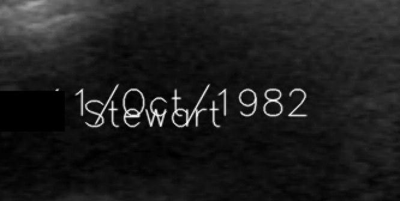

# Project TODO

## De-identification options

- [ ] **Project private-creator allowlist for Retain Safe Private**
  - Offer the user the Private Creators relevant to their project (from the TCIA KB creator list) as an optional restriction on top of the full KB: private elements whose creator is not allowlisted fall to unknown → remove.
  - Default: full TCIA KB (no restriction). The generated KB lookup dict is already keyed by creator, so the allowlist is a membership check before lookup — no KB restructuring needed.
  - Store the allowlist as a project field (creator strings, casefolded). Surface unknown-removed counts per creator in the ingest summary so sites can spot creators worth allowlisting.

## Embedded PHI / OCR

- [ ] **Prototype: overlapping burnt-in text detection (pixel path only)**
  - Problem: EasyOCR (CRAFT) merges overlapping two-line annotations into one garbled box or misses both lines when the letter strokes physically intersect.
  - Example (date rendered over a name — `1st/Oct/1982` over `Stewart`):

    

  - Approach to prototype:
    1. Baseline/component line separation before OCR: binarize → connected ink components → cluster components into text lines by baseline/vertical centroid → render each line on its own canvas (offsets preserved) → run the existing OCR → NER frame-context path on each separated line.
    2. Benchmark against a segmentation-based text detector (PaddleOCR / DBNet polygons) on this crop plus the existing CXR/US fixtures (`davidson_cxr`, `us_rgb_single_frame`).
    3. Cheap sweep first for reference: upscale/`mag_ratio`, lower `text_threshold`/`link_threshold`, tighter `ycenter_ths`/`height_ths` — expected to help only where strokes do not touch.
  - Constraints: pixel frame-context path only; report NER unchanged; no NER post-filters, span merging, or label propagation — separation happens at the image level before the model is called.
  - Success criteria: both the name and the date are returned as separate boxes/entities on the example above, with no regression on the existing OCR fixture suites.
