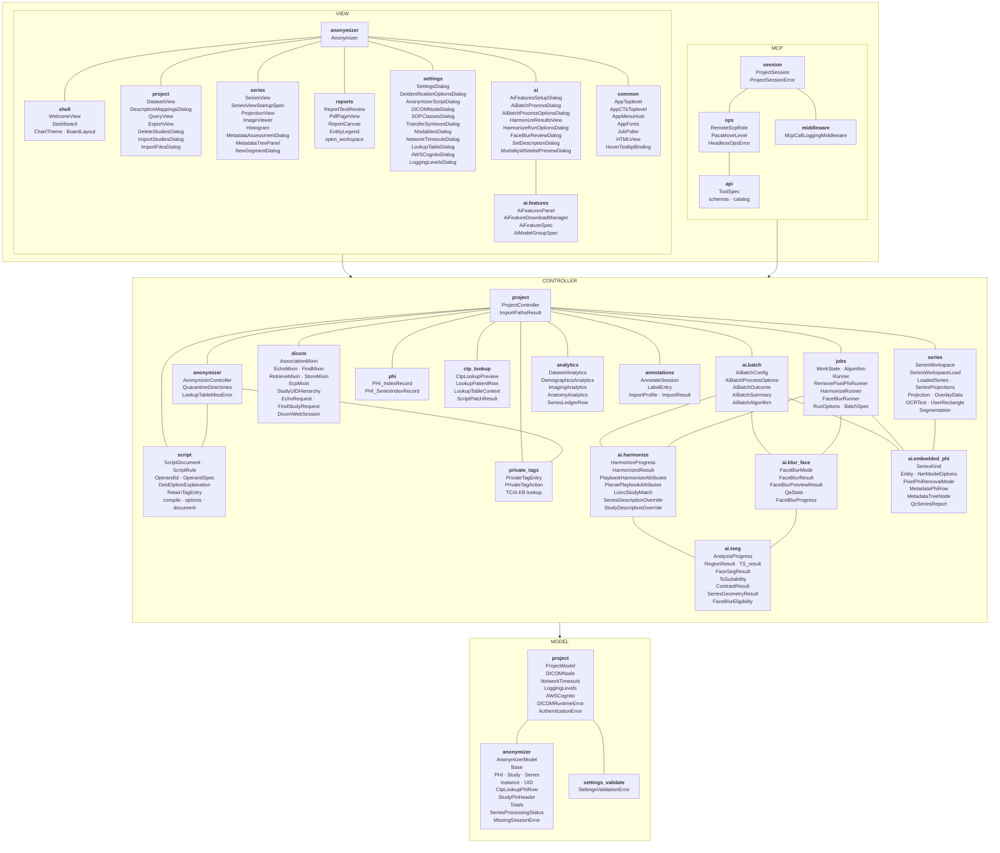

# Class diagram (V19)

MVC layout of the shipped `rsna-anonymizer` package. Each box is one module (or tight package); **module names are bold** (layer prefix omitted — the subgraph is the layer). Attributes, methods, and DTO field detail are omitted.

For **real cross-layer import edges** (View/MCP → Controller → Model), see [`class_diagram_full.md`](class_diagram_full.md).

## Layer rules

| Layer | Owns | Must not import |
| --- | --- | --- |
| **View** | CustomTkinter UI (`Anonymizer`, `view.*`) | Controller internals |
| **MCP** | Headless FastMCP surface (`anonymizer.mcp`) — peer of View | Controller internals; View |
| **Controller** | DICOM/network, anonymization, AI pipelines, series I/O, script compile | View, MCP |
| **Model** | `ProjectModel`, PHI/Study/Series ORM (`AnonymizerModel`) | View, MCP, Controller |

`utils` (logging, memory, storage, translate, modalities, `DeidMethodCode`) sits beside MVC and must not import Controller, View, or MCP.

MCP: `mcp/tools` → `mcp/ops` + `mcp/session` over `ProjectController` and AI public APIs. Prefer controller APIs over Model except where create/open already builds `ProjectModel`.

Function-only leaves (for example `controller.ai.feature_availability`, `controller.ai.tseg.config`, `view.series.anatomy_overlay`, `view.common.treeview_chrome`) are omitted from the boxes.

Series vs Encapsulated PDF / SR: `view.reports.open_workspace` routes to `ReportTextReview` or `SeriesView`. Description mapping CSVs under project `mappings/` are owned by `controller.ai.harmonize.description_mapping_store`.

Experimental CLIs: [`src/prototyping/`](src/prototyping/README.md) (not in the wheel; topic folders `dev/`, `harmonize/`, `ffr/`, `ui/`, …).
