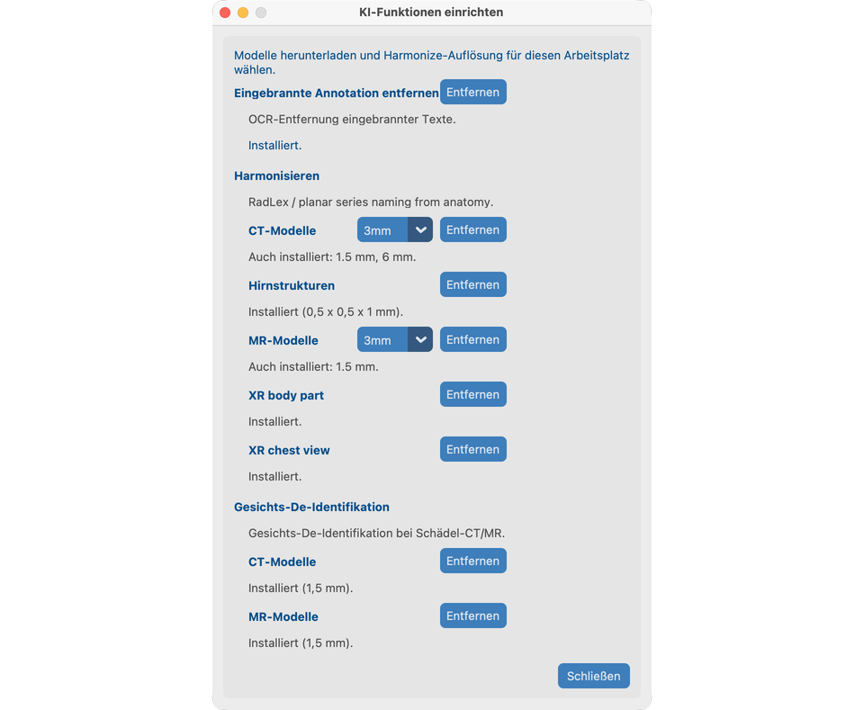

# KI-Funktionen einrichten

KI-Funktionen sind **optional**. Sie laufen nach einem einmaligen Download auf Ihrem Computer. Bilder werden nicht zur Verarbeitung hochgeladen.

Bearbeiten Sie dieses Kapitel **vor** den Werkzeug-Walkthroughs zu `davidson_cxr` und `CT_Head_With_Contrast`.

## Ziel

Laden Sie die benötigten Modelle herunter und wählen Sie die Harmonize-Auflösung für diesen Arbeitsplatz.

## Einrichtung öffnen

Nur vom **Willkommen**-Bildschirm: auf **KI-Funktionen** klicken.

Schließen Sie das Projekt (oder starten Sie die App), um zum Willkommen-Bildschirm zurückzukehren, wenn Sie später Modelle laden oder die Harmonize-Auflösung ändern möchten.

!!! note "Nachdem alle Modelle geladen sind"
    Jede Zeile zeigt **Installiert** (mit kurzer Angabe, z. B. Auflösung) und eine Schaltfläche **Entfernen** statt **Herunterladen**. Die Harmonize-CT/MR-Zeilen behalten ein Auflösungsmenü; weitere bereits vorhandene Auflösungen erscheinen als „Auch installiert: …“. Der Screenshot oben zeigt diesen vollständig installierten Zustand.

## Modelle in diesem Dialog

Jede Zeile ist ein **Download für diesen Arbeitsplatz**. Es gibt **keine projektbezogenen Ein-/Ausschalter** — hier installieren; die passenden Werkzeuge schalten sich später unter [Ansicht](../07-view/index.md) und [Verarbeiten](../08-process/index.md) frei (einschließlich [auf vielen Studien ausführen](../08-process/05-run-on-many-studies/index.md)).

| Funktion | Was sie später freischaltet | Herunterladen? |
| --- | --- | --- |
| **Embedded PHI** (OCR + englisches NER, ein Paket) | Eingebrannten Text bereinigen, Berichtstext prüfen, Metadaten **PHI erkennen** | Ja, wenn Sie Pixel, Berichte oder Tag-Text bereinigen |
| **Harmonisieren** CT/MR + Auflösung (1.5 / 3 / 6 mm) | TotalSegmentator-Organmasken für CT/MR — standardisierte Seriennamen sowie Organvolumina zur Prüfung in [Dashboard Analytics](../07-view/index.md#analytics) | Ja, wenn Sie CT/MR harmonisieren oder Organvolumen-Analytics nutzen — Auflösung wählen |
| **Harmonisieren** XR body part | Zusätzliche Pixel-Körperteil-Hilfe für CR/DX bei fehlenden/falschen Tags | Ja, wenn Sie allgemeines Röntgen harmonisieren |
| **Harmonisieren** XR chest view | Zusätzliches Pixel-AP/PA/Lat (+ Rotationsprüfung) für Thorax-CR/DX | Ja, wenn Sie allgemeines Röntgen harmonisieren (Thorax) |
| **Gesichts-De-Identifikation** | Gesichtsunschärfe auf geeigneten Kopf-CT/MR | Ja, wenn Sie Kopf-CT/MR kuratieren |
| **Hirnstrukturen** | Zusätzliche Hirnstruktur-Masken für Kopf-CT/MR (mit Harmonisieren) — Anatomie und Organvolumen-Verteilungen interessierender Strukturen in [Dashboard Analytics](../07-view/index.md#analytics) prüfen | Ja, wenn Sie Kopf-CT/MR kuratieren und Organvolumen-Analytics nutzen — Lizenz nötig |

XR-Harmonisieren funktioniert ohne die Pakete XR body part oder XR chest view (nur DICOM-Tags / Schlüsselwörter). Mit Installation können CR/DX-Serien nutzen:

- EfficientNet-B4-Körperteil-Klassifikator ([Xp-Bodypart-Mislabel-Checker](https://huggingface.co/spaces/MedicalAILabo/Xp-Bodypart-Mislabel-Checker); [Mitsuyama et al., *European Radiology* 2025](https://doi.org/10.1007/s00330-025-12053-7)), fusioniert mit DICOM-Anatomie.
- Nur-Thorax-Projektions-/Rotations-Klassifikator ([CXp-Projection-Rotation-Mislabel-Checker](https://huggingface.co/spaces/MedicalAILabo/CXp-Projection-Rotation-Mislabel-Checker); dieselbe Arbeit von [Mitsuyama et al.](https://doi.org/10.1007/s00330-025-12053-7)) zur Verfeinerung von AP/PA/Lat; die Rotation erscheint in der Harmonize-Analysetabelle und wird nicht in SeriesDescription geschrieben.

Mammographie und Ultraschall nutzen diese Modelle nicht.

## Erste Schritte

1. **KI-Funktionen** öffnen.
2. **Eingebrannten Text entfernen**, **Harmonisieren** (CT) und **Gesichts-De-Identifikation** herunterladen.
3. Bei Aufforderung die akademische Lizenz eingeben oder prüfen (Gesicht / Hirnstrukturen).
4. Harmonize-CT-Auflösung wählen; fehlendes Paket herunterladen.
5. Optional **Hirnstrukturen** und/oder **XR body part** / **XR chest view** herunterladen, wenn Sie diese Extras brauchen.
6. Dialog schließen. Die Einstellungen bleiben auf diesem Arbeitsplatz.

!!! tip "Internet nur für den Download"
    Nachdem Modelle und Lizenz bereitstehen, läuft die Verarbeitung lokal. Unter **macOS** vor Harmonisieren / verwandten KI-Funktionen die OpenMP-C++-Bibliothek installieren: `brew install libomp` (siehe [Installation](../02-install/index.md#4-macos-only-openmp-for-ai-features)).

## Modelle entfernen

Mit **Entfernen** auf einer Werkzeugkarte die heruntergeladenen Dateien löschen. Bereits in anonymisierte Bilder geschriebene Änderungen werden dadurch nicht rückgängig gemacht.

## So sieht es aus, wenn es passt

- Status zeigt bereit für OCR, Harmonisieren CT und Gesicht.
- Nach dem Import können Sie die passenden [Verarbeiten](../08-process/index.md)-Werkzeuge auf den Demo-Serien ausführen (Kapitel 8.1–8.3).

## Wenn es fehlschlägt

- Download unvollständig → Netzwerk prüfen und erneut versuchen.
- TotalSegmentator / OpenMP unter macOS → `brew install libomp`.
- Lizenz ungültig → `aca_`-Format oder die Anbieter-URL im Dialog prüfen.

## Nächste Schritte

1. [Begriffe](../04-words-we-use/index.md) und [Projekt anlegen](../05-create-project/index.md), oder
2. Zu den [Verarbeiten](../08-process/index.md)-Werkzeugen springen, sobald Studien importiert sind — beginnen Sie mit [8.1 Embedded PHI](../08-process/02-remove-burned-in-text/index.md)
