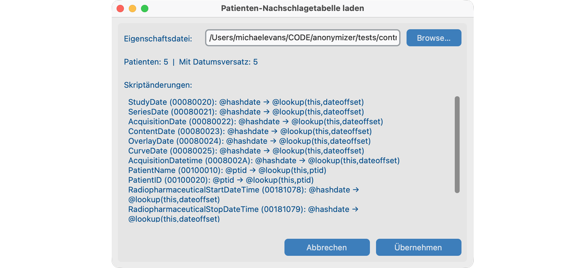

# Anonymizer-Skript (erweitert)

[De-Identifikationsoptionen](index.md#2-de-identification-options) kompilieren das Projektskript für die meisten Standorte. Nutzen Sie diese Seite, um einzelne Tag-Regeln zu ändern, eine Datumsstrategie zu wählen, eine Patienten-Nachschlagetabelle zu laden oder ein CTP-`.script` zu importieren.

## Editor öffnen

Nach dem Anlegen des Projekts: **Ablage → Projekteinstellungen**. In der Zeile **Script File** **Edit Anonymizer Script**, oder **Import CTP Script…**, um ein CTP-`.script` zu installieren, ohne zuerst den Editor zu öffnen.

Der Editor lädt `{site_id}-anonymizer.script` neben `ProjectModel.json` im Projektspeicherordner (der Ordner oben im **Dashboard**). Die Dialogzeile **Skript** ist der Pfad dieser Skriptdatei. Das mitgelieferte `default-anonymizer.script` wird nie überschrieben.

Projekteinstellungen und Editor-Kopfzeile teilen denselben Status: Skriptname plus Options-Zusammenfassung (**Basic**, **Retain** oder abgekürzt). **Custom** bedeutet, dass das live Skript nicht mehr einer frischen Kompilierung der gespeicherten Optionen entspricht (importiert oder handeditiert).


## Ansichten

| Ansicht | Inhalt |
| --- | --- |
| **Aktiv** (Standard) | Regeln, die den Wert behalten oder umwandeln (nicht `@remove()`). |
| **Entfernt** | Regeln mit Operation `@remove()`. |
| **Alle** | Jede Regel im Skript. |

**Suche** und der Werkzeugleisten-Filter **Operand** gelten innerhalb der aktuellen Ansicht.

## Regel ändern {#4-custom-script-edits}

1. Zeile auswählen.
2. Operanden mit dem Werkzeugleisten-Filter **Operand** oder der Detailsteuerung **Operand** prüfen — **So funktioniert dieser Operand** aktualisiert sich sofort; die Regel ändert sich erst mit **Anwenden**.
3. Braucht der Operand einen Parameter, fordert **Anwenden** ihn an (siehe [Operanden](#operands)). **Parameter ändern** bearbeitet den Parameter an einer Regel, die den Operanden bereits nutzt.
4. **@remove()** dann **Anwenden** entfernt das Tag aus **Aktiv** (die Regel bleibt im Skript).

## Operandenkatalog {#operands}

Unterstützte Operationen entsprechen dem Katalog des Skript-Editors und dem Ingest-Walk. Parameter werden bei Bedarf bei **Anwenden** abgefragt. Datums-Delta-Operationen auf Datumsfeldern müssen dieselbe Operation wie **StudyDate** nutzen (Ein-Klick-Angleichung im Editor).

| Operand (Skripttext) | Parameter | Verhalten |
| --- | --- | --- |
| `@keep` | — | Wert unverändert lassen. Behaltener Freitext kann weiterhin durch Embedded PHI / Report-NER gescannt werden. |
| `@safe()` | — | Produkterweiterung (kein CTP): Wert unverändert lassen und von Embedded-PHI- / PseudoPHI-Bulk-NER ausschließen. Für beizubehaltende technische Strings ohne NER-Scrub. |
| `@remove()` | — | Tag aus dem anonymisierten Dataset löschen. |
| `@empty()` | — | Tag behalten, Wert leer setzen. |
| `@uid` | — | Durch stabile anonymisierte UID ersetzen. Gleiche Original-UID → gleiche Anon-UID im Projekt (referenzielle Integrität). |
| `@ptid` | — | Durch die anonymisierte Patienten-ID des Projekts für diesen Patienten ersetzen. |
| `@acc` | — | Durch die anonymisierte Accession-Nummer dieser Studie ersetzen, sofern zugewiesen. Leere Quelle bleibt leer. |
| `@hashdate` | — | Datum/DatumZeit um einen stabilen patientenbezogenen Tagesversatz aus der PHI-Patienten-ID verschieben. Intervalle zwischen Studien dieses Patienten bleiben erhalten. Setzt `(0028,0303) LongitudinalTemporalInformationModified = MODIFIED`, wenn ein Datums-Delta läuft (Code 113107 bei gewähltem Modified Dates). |
| `@lookup(this,ptid)` | — | Ersetzen durch die anonymisierte Patienten-ID aus der Patienten-Nachschlagetabelle (`ptid/`-Zeilen in CTP-`.properties`). Ist die Tabelle nicht geladen, öffnet **Anwenden** **Patienten-Nachschlagetabelle laden**. |
| `@lookup(this,dateoffset)` | — | Patientenbezogenen Tagesversatz aus der Nachschlagetabelle anwenden (`dateoffset/`-Zeilen). Fehlen diese Zeilen, öffnet **Anwenden** **Patienten-Nachschlagetabelle laden**. |
| `@lookup(this,cname)` | — | Ersetzen durch den Collection-Namen aus `cname/`-Zeilen (TCIA ProjectName-/TrialName-Stempel). Fehlender Wert → **Lookup_Miss**. Legt das Element an, falls fehlend. |
| `@lookup(this,siteid)` | — | Ersetzen durch die Site-ID aus `siteid/`-Zeilen. Fehlender Wert → **Lookup_Miss**. Legt das Element an, falls fehlend. |
| `@lookup(this,ddate)` | — | Ersetzen durch Diagnose-/Basisdatum aus `ddate/`- oder `basedate/`-Zeilen (als YYYYMMDD gespeichert). Fehlender Wert → **Lookup_Miss**. Legt das Element an, falls fehlend. |
| `@incrementdate(this,n)` | **`n`**: vorzeichenbehafteter ganzzahliger Tagesversatz (studienweites DATEINC). Positiv verschiebt später; negativ früher. Die Bestätigung setzt dasselbe `@incrementdate(this,n)` auf jedes Datums-Delta-Feld im Skript (im Dialog aufgelistet). | Fester Tagesversatz für alle Patienten. Intervalle zwischen Studien eines Patienten bleiben erhalten. |
| `@rebasedate(this,origin)` | **`origin`**: Epochenbeginn als `YYYYMMDD` (acht Ziffern; Standard `19600101`). | TCIA/NCTN-Rebase: anonymisiertes Datum = `origin + (reales Datum − basedate)`. Erfordert `basedate/<PatientID>=YYYYMMDD` (oder `ddate/`, wenn basedate fehlt) in der Nachschlagetabelle. Schreibt `(0012,0052)` / `(0012,0053)=REGISTRATION` aus PHI StudyDate − basedate (Event-Typ kann von `@always()` auf `(0012,0053)` kommen). Fehlen basedates, öffnet **Anwenden** zuerst **Patienten-Nachschlagetabelle laden**. |
| `@round(this,n)` | **`n`**: Ganzzahl ≥ 1, Altersbandbreite in ganzen Jahren (VR AS). Bänder zentriert bei null (CTP `@round`): Wert → nächstes Vielfaches von `n`. | Patient Age vergröbern. Breite `5`: `027Y` → `025Y`, `043Y` → `045Y`. |
| `@modifydate(StudyDate,*,1,1)` | — | Vierstellige Jahreszahl aus StudyDate in dieses Tag schreiben (TCIA StudyYear). |
| `@truncate(this,n)` | **`n`**: Ganzzahl ≥ 1, zu behaltende Zeichen. | Die ersten `n` Zeichen des aktuellen Werts behalten. |
| `@hashname(this,n)` | **`n`**: Ganzzahl ≥ 1, Hex-Länge. Optionaler Literal-Präfix vor `@hashname` (z. B. `REV-@hashname(this,4)`). | Ersetzen durch die ersten `n` Hex-Zeichen eines MD5 des aktuellen Werts. |
| `@dateinterval(StudyDate,ddate,PatientID)` | — | Ganze Tage von Lookup-basedate/ddate bis StudyDate schreiben (TCIA longitudinaler Offset-Stempel). Legt das Element an, falls fehlend. Fehlendes basedate → **Lookup_Miss**. |
| `@if(this,isblank){then}{else}` | Beide Zweige müssen gültige Produkt-Operanden sein. | Ist der aktuelle Wert leer, then anwenden; sonst else. Nur die Bedingung `isblank` wird unterstützt. |
| `@always()text` | **`text`**: nicht leerer Literalersatz (darf nicht mit `@` beginnen). Gespeichert als `@always()YES`. Bloße Literale ohne `@` (`YES`) in älteren Skripten sind derselbe Operand. | Element auf festen Wert setzen; fehlendes Element anlegen. |
| `@process()` | — | Sequenz-Wrapper (`SQ`) behalten und Skriptregeln rekursiv auf innere Items anwenden. |

Nach dem Skript-Durchlauf werden fehlende Nicht-Sequenz-Elemente in einem Durchgang für `@always()…`, Stempel `@lookup(this,cname|siteid|ddate)` und `@dateinterval(StudyDate,ddate,PatientID)` angelegt.

Import und Neuladen lehnen unbekannte Operanden ab. Erreicht eine unerkannte Operation dennoch den Ingest (z. B. handeditierte Keep-Tabelle), protokolliert der Anonymizer einen **Fehler und entfernt das Element**.

Werkzeugleisten-Filter **Operand** **Alle** zeigt jede Regel der Ansicht; ein konkreter Operand filtert die Liste und aktualisiert die Hilfe, ohne bis **Anwenden** zuzuweisen.

## Fehlendes Tag hinzufügen

**Aus Wörterbuch hinzufügen** (untere Leiste) listet DICOM-Wörterbuch-Tags, die im Skript fehlen. **Hinzufügen** legt eine Regel mit Standard `@keep` an. Die Schaltfläche ist ausgeblendet, wenn das Skript das Wörterbuch bereits abdeckt.

## Speichern

| Steuerung | Wirkung |
| --- | --- |
| **Übernehmen** | Operanden prüfen; `{site_id}-anonymizer.script` im Projektspeicherordner schreiben; live Anonymisierungsregeln neu laden; Projekt auf diese Datei zeigen. |
| **Zurücksetzen** | Skriptdatei vom Datenträger neu laden; ungespeicherte Änderungen verwerfen. |
| **Abbrechen** | Schließen ohne Speichern. |

!!! note "Optionen vs. benutzerdefinierte Bearbeitung"
    Das Übernehmen neuer [De-Identifikationsoptionen](index.md#2-de-identification-options) baut das Skript aus dem mitgelieferten Standard plus den gewählten Optionen neu und **verwirft** ein benutzerdefiniertes oder importiertes Skript. Bereits gespeicherte Instanzen werden nicht erneut anonymisiert. Ist das Skript **Custom**, warnen die Projekteinstellungen, dass Import / Custom ersetzt wird.

## Patienten-Nachschlagetabelle und Datumsangaben {#5-patient-lookup-table-and-dates}

### Longitudinale Datumsangaben {#longitudinal-dates-tcia-style}

| Strategie | Operand | Voraussetzung |
| --- | --- | --- |
| Hash pro Patient | `@hashdate` | Standard kompiliertes Skript; keine Nachschlagetabelle. |
| Lookup-Offset pro Patient | `@lookup(this,dateoffset)` | `dateoffset/`-Zeilen in der Lookup-`.properties`. |
| Studienweiter Offset | `@incrementdate(this,n)` | Parameter `n` (DATEINC); auf alle Datums-Delta-Felder. |
| Epochen-Rebase | `@rebasedate(this,origin)` | `basedate/`- oder `ddate/`-Zeilen; Parameter `origin` (`YYYYMMDD`). |

Alle vier erhalten Intervalle zwischen Studien eines Patienten und setzen Longitudinal Temporal Information Modified wie unter `@hashdate`. Deterministische UID-/Datums-/Accession-Hinweise: [De-Identifikationsprotokoll](../deidentification-protocol.md#deterministic-replacements-uids-dates-accessions).

### Patienten-Nachschlagetabelle {#patient-lookup-table}

**Patienten-Nachschlagetabelle laden** öffnen durch:

- **Anwenden** auf `@lookup(this,ptid)`, `@lookup(this,dateoffset)` oder `@rebasedate(this,origin)`, wenn die nötige Tabelle (bzw. `dateoffset`-/`basedate`-Zeilen) nicht geladen ist; oder
- **Lookup-Tabelle laden** / **Lookup-Tabelle ersetzen** neben der Detailsteuerung **Operand** an einer lookup-abhängigen Regel.



**Patienten-Nachschlagetabelle laden**:

1. **Durchsuchen…** zu einer CTP/TCIA-`.properties`-Datei.
2. Patienten- und Datums-Offset-Zähler sowie die gelisteten **Skriptänderungen** prüfen (`@ptid` → `@lookup(this,ptid)`, `@hashdate` → `@lookup(this,dateoffset)` und passende Datumsfelder).
3. **Übernehmen** speichert eine projekt-private Kopie der Tabelle, schreibt die Regeln um und aktiviert Runtime-Lookup. **Abbrechen** lässt das Skript unverändert.

`.properties`-Schlüssel:

```text
ptid/<PHI-Patienten-ID>=<anonymisierte-Patienten-ID>
dateoffset/<PHI-Patienten-ID>=<vorzeichenbehaftete-ganzzahlige-Tage>
basedate/<PHI-Patienten-ID>=YYYYMMDD
ddate/<PHI-Patienten-ID>=M/D/YYYY   (oder YYYYMMDD; als basedate gespeichert, wenn basedate/ fehlt)
cname/<PHI-Patienten-ID>=<Collection-Name>
sname/<PHI-Patienten-ID>=<Site-Name>
siteid/<PHI-Patienten-ID>=<Site-ID>
```

`ptid/` allein ist gültig. `dateoffset/` ermöglicht `@lookup(this,dateoffset)`. `basedate/` oder `ddate/` ermöglichen `@rebasedate(this,origin)` und `@lookup(this,ddate)` / StudyDate–ddate-`@dateinterval`. `cname/` und `siteid/` ermöglichen die passenden Stempel-Lookups. `sname/` wird in der PHI-Patientenzeile für Export/Buchhaltung gespeichert; es gibt keinen Runtime-Operanden `@lookup(this,sname)`. Unbekannte Property-Schlüsselpräfixe werden mit Warnung übersprungen.

!!! note "Lookup nach gespeicherten Dateien"
    Das Laden einer Nachschlagetabelle anonymisiert bereits im Projekt gespeicherte Instanzen **nicht** erneut. Patienten, die bereits im Projekt sind, funktionieren weiter ohne Tabellenzeile. **Neue** Dateien, deren PHI-Patienten-ID fehlt, landen in Quarantäne als **Lookup_Miss** und werden nicht gespeichert.

## CTP-Skript importieren

Nutzen Sie **Import CTP Script…** unter **Ablage → Projekteinstellungen** (Zeile Script File) oder **Import…** im Editor — dieselbe Pipeline. Der Fortschrittsdialog benennt jede Stufe, darunter **Checking script rules…** (gleiche Prüfung wie beim Neuladen). Wenn das verarbeitete Skript `@lookup` / `@rebasedate` nutzt und noch keine Nachschlagetabelle geladen ist, öffnet Import **Load Patient Lookup Table**; Abbrechen bricht den Import ab. Bei Fehler bleibt das bisherige Skript. Bei Erfolg: Validierung bestanden; Projekteinstellungen speichern `{site_id}-anonymizer.script` sofort; der Editor braucht noch **Übernehmen**. Danach speichert **De-identification Options** nur Metadaten (kein Neuaufbau). Spätere Optionsänderung baut aus dem Standard neu und verwirft den Import. CTP/TCIA-Formen: siehe englische Seite. `<p>`-Parameter / **LTET** wie zuvor.

## Wenn es fehlschlägt

- **Übernehmen** oder Projektöffnen abgelehnt → nicht unterstützte `@…`-Operanden in der Fehlermeldung korrigieren. Leeres `@always()` ist ungültig; nicht leeren `text` angeben. Bloße Literale ohne `@` gelten als feste Werte (`ALWAYS`).
- Ingest mit fehlendem erforderlichem Lookup-Stempel oder basedate → Datei in Quarantäne **Lookup_Miss**.
- Unerkannter Operand beim Ingest (sollte nach Validierung nicht vorkommen) → protokolliert und das Element wird entfernt.

## Siehe auch

- [Projekt anlegen](index.md) — wie Optionen `{site_id}-anonymizer.script` kompilieren
- [De-Identifikationsprotokoll](../deidentification-protocol.md)
- [DICOM-Konformitätserklärung](../dicom-conformance-statement.md)
