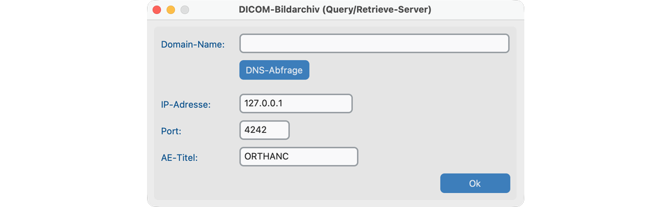
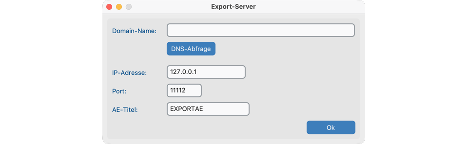
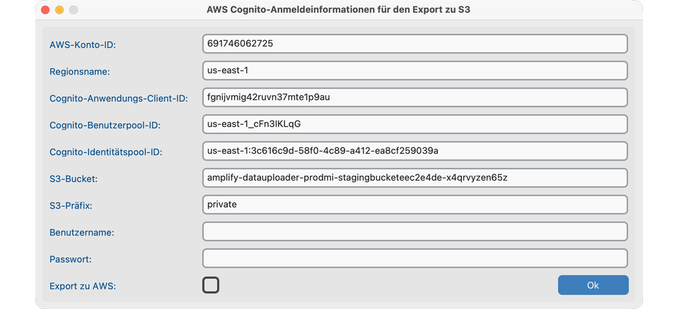
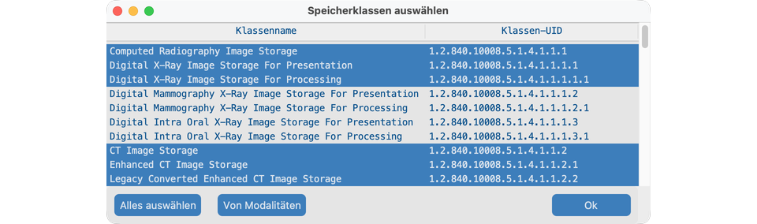
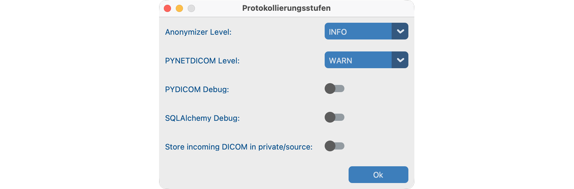
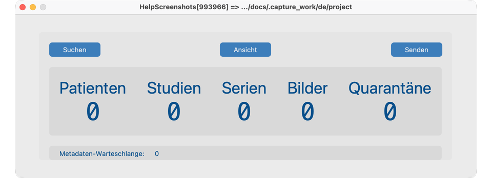

# Projekt anlegen

Ein **Projekt** hält Einstellungen und anonymisierten Speicher zusammen. Legen Sie es einmal im Desktop-Fenster an, auch wenn ein Server später [ohne Oberfläche](../10-headless/index.md) laufen soll.

Arbeiten Sie dieses Kapitel **der Reihe nach** durch: Identität und Speicher → De-Identifikationsoptionen (daraus wird das Anonymizer-Skript erstellt) → Netzwerk und Modalitäten mit der IT → optionale Skriptbearbeitung und Nachschlagetabellen → Dashboard. Studien importieren Sie als Nächstes unter [Suchen](../06-search/index.md). Kohorten-**Analytics** gibt es auf dem Dashboard erst nach dem Import — siehe [Ansicht](../07-view/index.md#analytics).

## Ziel

Ein sauberes Projekt mit Speicher, Standort-Identität und einem De-Identifikations-Skript öffnen, bereit für den Import.

## 1. Neues Projekt anlegen

1. Über **Datei → Neues Projekt** die **Neuen Projekteinstellungen** öffnen.
2. Einen **Projektnamen** wählen (kurz, unter 16 Zeichen) und das **Speicherverzeichnis** bestätigen.
3. **Standort-ID** und **UID-Wurzel** prüfen (meist Standardwerte belassen, außer Sie setzen einen Java-Anonymizer-Standort fort).
4. Vor dem Speichern mit [De-Identifikationsoptionen](#2-de-identification-options) fortfahren.
5. [Modalitäten und Netzwerk](#3-network-and-modalities) mit der IT abstimmen, wenn Sie ein PACS abfragen.
6. Projekt speichern / erstellen. Das kompilierte Anonymizer-Skript liegt neben `ProjectModel.json` als `{site_id}-anonymizer.script`. Das **Dashboard** öffnet sich.


## 2. De-Identifikationsoptionen {#2-de-identification-options}

De-Identifikationsoptionen sind die DICOM-Vertraulichkeitsentscheidungen aus [PS 3.15 Anhang E](https://dicom.nema.org/medical/dicom/current/output/chtml/part15/chapter_E.html) (Basic Profile, Modified Dates, Retain Safe Private und verwandte Optionen). Sie erscheinen unter ihren Standardnamen unter **De-identification Options**.


### Voreinstellungen

| Voreinstellung | Was ausgewählt wird |
| --- | --- |
| **Basic** | Nur Basic Profile |
| **Retain** | Basic Profile + Modified Dates + Patient Characteristics + Retain Safe Private |

Voreinstellungen füllen nur die Kontrollkästchen. Das Projekt speichert die **ausgewählten Optionscodes**, nicht den Namen der Voreinstellung.

### Wie Optionen das Anonymizer-Skript erzeugen

Beim Anlegen (und immer wenn Sie bei einem bestehenden Projekt neue Optionen **Übernehmen**), **kompiliert** die App das Projekt-Anonymizer-Skript:

1. Ausgangspunkt ist das mitgelieferte `default-anonymizer.script`.
2. **Options-Overlays** für jede gewählte Vertraulichkeitsoption (welche Tags behalten, entfernt oder umgewandelt werden).
3. Ergebnis als projekt-private `{site_id}-anonymizer.script` neben `ProjectModel.json`.

Der Import verwendet **nur dieses Skript** (nicht NER/OCR). Vollständige Regelsprache und Stempel-Tags stehen im [De-Identifikationsprotokoll](../deidentification-protocol.md). Prüfer mit der Checkliste PS 3.15 § E.1.3 nutzen die [DICOM-Konformitätserklärung](../dicom-conformance-statement.md).

!!! warning "Optionen später ändern"
    Bei einem **bestehenden** Projekt fragt die App beim Anwenden anderer Optionen zur Bestätigung. **Übernehmen** **kompiliert** neu aus dem mitgelieferten Standard plus Overlays — **benutzerdefinierte Skriptbearbeitungen gehen verloren**. Bereits importierte Bilder werden nicht erneut verarbeitet.

### Bereinigungsoptionen und Modalitäten

Bereinigungsoptionen (Clean Pixel Data, Clean Structured Content, Clean Descriptors, Clean Recognizable Visual Features) lassen sich nur wählen, wenn die zugehörige KI-Funktion installiert ist — Sie werden zum Modell-Download aufgefordert. Die Auswahl von Clean Structured Content oder Clean Descriptors aktiviert SR/PDF-Modalitäten; neu aktivierte SR- oder PDF-Modalitäten schalten Clean Structured Content ein, wenn es aus war.

Die Bereinigung beim Import ist begrenzt: Pixel- und Berichtsbereinigung brauchen nach dem Import weiterhin die optionalen Process- / Report-Werkzeuge. Siehe [De-Identifikationsprotokoll](../deidentification-protocol.md#pixel-and-face-options-in-the-dicom-profile).

## 3. Netzwerk und Modalitäten {#3-network-and-modalities}

Öffnen Sie **Datei → Projekteinstellungen** (oder schließen Sie diese Schritte in den Neuen Projekteinstellungen vor dem Anlegen ab). Konfigurieren Sie sie vor Suchen / Senden.

### Wenn Sie mit der IT sprechen {#when-you-talk-to-it}

Teilen Sie diese Ideen (Details stehen in den Dialogfenstern unten):

- **Lokaler Server** — Adresse, Port und AE Title, mit denen dieser Computer Bilder **empfängt**.
- **DICOM-Bildarchiv (Query/Retrieve-Server)** — das Krankenhausarchiv, in dem Sie suchen und abrufen.
- **Export-Server** oder **AWS** — wohin anonymisierte Studien gesendet werden.
- **Modalitäten / Speicherklassen / Transfersyntaxen** — welche Bildtypen erlaubt sind.
- **Netzwerk-Zeitüberschreitungen** — wie lange auf langsame Archive gewartet wird.

Wenn das Projekt auf einem Laborserver laufen soll, weiter mit [Ohne Oberfläche](../10-headless/index.md).

### Lokaler Server

Adresse, Port und AE Title, mit denen dieser Computer Bilder **empfängt**.


### DICOM-Bildarchiv (Query/Retrieve-Server)

Krankenhausarchiv für Dashboard-**Suchen**.



Für entfernte Systeme mit **DICOMweb** öffnen Sie den Query-Server-Dialog und aktivieren **DICOMweb**. Tragen Sie **HTTP-Port**, **Pfad** (z. B. `/dicom-web`), optional **Use HTTPS** sowie optional Benutzername/Passwort ein. Suchen nutzt dann QIDO-RS, Import WADO-RS. DIMSE-Port und AE Title bleiben für **Echo** und Dual-Stack-Server. Echo verwendet weiterhin DIMSE.

### Export-Server

DICOM-Ziel beim **Senden** (die Einstellung kann weiterhin Export Server heißen).



Ist am Export-Server **DICOMweb** aktiv, nutzt Senden STOW-RS statt C-STORE.

### AWS Cognito (optional)

Anmeldedaten für S3-Senden, wenn aktiviert.



### Netzwerk-Zeitüberschreitungen {#network-timeouts}

Wie lange auf langsame Archive gewartet wird.


### Modalitäten / Speicherklassen / Transfersyntaxen {#storage-classes}

Welche Bildtypen und Kodierungen erlaubt sind.





### Protokollierungsstufen

Anonymizer- / Netzwerkprotokollierung erhöhen, wenn Sie mit der IT Fehler beheben.



## 4. Benutzerdefinierte Skriptbearbeitung {#4-custom-script-edits}

Die meisten Standorte bearbeiten das Skript nie von Hand — [De-Identifikationsoptionen](#2-de-identification-options) kompilieren bereits die richtigen Regeln. Nutzen Sie den Editor, wenn Datenschutz oder Studienrichtlinie eine **benutzerdefinierte** Tag-Regel, eine andere Datumsstrategie oder eine [Patienten-Nachschlagetabelle](#5-patient-lookup-table-and-dates) braucht.

Öffnen Sie **Datei → Projekteinstellungen** (oder Neue Projekteinstellungen), dann **Anonymizer-Skript bearbeiten**. Der Editor lädt das mitgelieferte Standard-Skript, bis Sie Übernehmen; danach öffnet er Ihre projekt-private Kopie und zeigt den Pfad oben im Dialog.

Die Kopfzeile zeigt die Options-Zusammenfassung (**Basic**, **Retain** oder die abgekürzt gewählten Optionen) und den **Skript**-Pfad. Stimmt das live Skript nicht mehr mit einer frischen Kompilierung der gespeicherten Optionen überein, steht der Status auf **Custom**.

**Import…** lädt ein benutzerdefiniertes CTP-Skript: unbekannte Operanden werden abgelehnt, Datumsregeln müssen zur StudyDate-Operation passen (Ein-Klick-Korrektur verfügbar), und bei Übernehmen bestätigen Sie, welche De-Identifikationsoptionen dafür gespeichert werden (vorausgefüllt aus den Regeln).


### Ansichten

| Ansicht | Inhalt |
| --- | --- |
| **Aktiv** (Standard) | Tags, die **behalten** oder **umgewandelt** werden (nicht `@remove()`). Die alltägliche Liste — etwa 1,5k statt ~4,6k Zeilen. |
| **Entfernt** | Tags mit `@remove()` (werden beim Anonymisieren gelöscht). |
| **Alle** | Jede Tag-Regel im Skript. |

Suche und der **Operand**-Filter gelten innerhalb der aktuellen Ansicht.

### Regel ändern

1. Zeile in der Liste auswählen. Operanden erscheinen in Skriptsyntax (z. B. `@keep`, `@remove()`, `@uid`, `@always()YES`).
2. Um einen Operanden zu verstehen, ohne das Skript zu ändern, nutzen Sie den **Operand**-Filter in der Symbolleiste oder das **Operand**-Dropdown im Detail — **So funktioniert dieser Operand** aktualisiert sich sofort. Eine Zuweisung erfolgt erst beim Klick auf **Anwenden**.
3. Braucht der Operand einen Parameter, fordert **Anwenden** den Wert mit Einheit und Bedeutung an. **Parameter ändern** bearbeitet ihn später an einer Regel, die den Operanden schon nutzt:
   - **@round(this,n)** — Altersbandbreite in ganzen Jahren
   - **@always()** — fester Ersatztext (CTP-Stil, z. B. `YES`). Wird als `@always()YES` gespeichert. Bloße Literale wie `YES` in älteren Skripten sind derselbe Operand und bleiben gültig.
   - Datums- und Lookup-Operanden — siehe [Patienten-Nachschlagetabelle und Datumsangaben](#5-patient-lookup-table-and-dates).
4. **@remove()** wählen (dann Anwenden) stuft das Tag aus der Aktiven Ansicht heraus (bleibt im Skript als `@remove()`).

### Fehlendes Tag hinzufügen

Fehlt im Skript ein DICOM-Wörterbuch-Tag, erscheint **Aus Wörterbuch hinzufügen** in der unteren Leiste. Suchen Sie die fehlenden Tags und **Hinzufügen** (Standard `@keep`). Deckt das Skript bereits das Wörterbuch ab, ist die Schaltfläche ausgeblendet.

### Speichern

- **Übernehmen** prüft Operanden, schreibt eine private Kopie unter `{Speicher}/private/{site_id}-anonymizer.script`, lädt die live Anonymisierungsregeln neu und verweist das Projekt auf diese Datei. Das mitgelieferte Standard-Asset wird nie überschrieben.
- **Zurücksetzen** lädt die Datei vom Datenträger neu und verwirft ungespeicherte Änderungen.
- **Abbrechen** schließt ohne Speichern.

!!! note "Optionen vs. benutzerdefinierte Bearbeitung"
    Das Übernehmen neuer [De-Identifikationsoptionen](#2-de-identification-options) kompiliert das Skript neu und **verwirft** benutzerdefinierte Bearbeitungen. Optionen zuerst festlegen; das Skript danach nur bearbeiten, wenn Sie noch Ausnahmen brauchen.

## 5. Patienten-Nachschlagetabelle und Datumsangaben {#5-patient-lookup-table-and-dates}

Nutzen Sie diesen Abschnitt, wenn Ihr Standort eine CTP/TCIA-artige **Patient Lookup Table** und/oder eine bestimmte **longitudinale Datums**-Strategie braucht. Diese Steuerelemente liegen im [Skript-Editor](#4-custom-script-edits).

### Longitudinale Datumsangaben (TCIA-Stil) {#longitudinal-dates-tcia-style}

Alle Datums-Delta-Strategien erhalten Abstände zwischen Studien eines Patienten. Läuft eine davon, setzt der Anonymizer `(0028,0303) LongitudinalTemporalInformationModified = MODIFIED` (DICOM-Option 113107), wenn Modified Dates gewählt ist.

| Strategie | Operand | Wann nutzen |
| --- | --- | --- |
| Patienten-Hash | `@hashdate` (Standard kompiliertes Skript) | Keine Mapping-Tabelle; deterministischer Offset pro Patient |
| Lookup-Offset | `@lookup(this,dateoffset)` | Gesteuerter Offset pro Patient aus Standort-`.properties` |
| Studienweiter Offset | `@incrementdate(this,n)` | Gleiches DATEINC für alle Patienten (`n` im Skript-Editor setzen) |
| Epochen-Neubasis | `@rebasedate(this,origin)` | TCIA/NCTN-Stil: `origin + (date − basedate)`; braucht `basedate/`-Zeilen |

`@hashdate`, anonymisierte UIDs und gehashte Accession-Nummern sind **absichtlich ohne Geheimnis**: Sie halten stabile Verknüpfungen innerhalb eines Projekts. Sie sind nicht gegen Verifikation abgesichert, wenn jemand bereits einen Kandidaten für das Original kennt. Details: [De-Identifikationsprotokoll — Deterministische Ersetzungen](../deidentification-protocol.md#deterministic-replacements-uids-dates-accessions).

**@incrementdate(this,n)** — fester Tagesversatz (CTP DATEINC). Abgefragt beim Anwenden des Operanden (Standard 365). Weil DATEINC studienweit ist, wendet die Bestätigung dasselbe `@incrementdate(this,n)` auf jedes Datums-Delta-Feld im Skript an (z. B. alle `@hashdate`-Regeln), und die Abfrage listet diese Felder.

**@rebasedate(this,origin)** — Epochen-ORIGIN als JJJJMMTT (Standard `19600101`). Abgefragt beim Anwenden; sind basedates nicht geladen, öffnet Anwenden zuerst den Lookup-Tabellen-Dialog.

**@lookup(this,ptid)** / **@lookup(this,dateoffset)** — ist die nötige Nachschlagetabelle (oder dateoffset-Zeilen) nicht geladen, öffnet Anwenden zuerst den Lookup-Tabellen-Dialog.

### Patienten-Nachschlagetabelle {#patient-lookup-table}

`@lookup(this,ptid)`, `@lookup(this,dateoffset)` und `@rebasedate(this,origin)` erscheinen in der Operandenliste. Wählen Sie einen und klicken **Anwenden** — **Patient Lookup Table laden** öffnet sich, wenn die nötige Tabelle (oder dateoffset- / basedate-Einträge) noch nicht geladen ist. An einer Regel mit lookup-abhängigem Operanden nutzen Sie **Lookup-Tabelle laden** / **Lookup-Tabelle ersetzen** neben der Operanden-Steuerung.

Eine CTP/TCIA-`.properties`-Datei mappt jede PHI-Patienten-ID auf eine anonymisierte ID und optional einen Datumsversatz pro Patient und/oder ein Registrierungs-basedate:

```text
ptid/MRN-1001=527408-000101
dateoffset/MRN-1001=42
basedate/MRN-1001=20180327
```

Übernehmen speichert eine private Projektkopie, schreibt passende Patient-ID- / Datumsregeln auf `@lookup…` um und aktiviert Runtime-Lookup. Mit vorhandenen Datumsversätzen kann `@lookup(this,dateoffset)` angewendet werden; mit `basedate/`-Zeilen `@rebasedate(this,origin)` (Sie werden nach dem ORIGIN-Datum gefragt).

Lookup-`.properties` können nur Registrierungs-/Ereignisdaten enthalten:

```text
ptid/MRN-1=SITE-0001
basedate/MRN-1=20180327
```

Mit geladenen basedates erscheint `@rebasedate(this,origin)` in der Operandenliste. Beim Anonymisieren schreibt die App außerdem `(0012,0052)` / `(0012,0053)=REGISTRATION` aus PHI StudyDate − basedate.

!!! note "Bestehende Projekte"
    Das Laden einer Nachschlagetabelle anonymisiert vorhandene Dateien im Datensatz **nicht** erneut — sie bleiben unverändert. Bereits importierte Patienten funktionieren weiter ohne Tabelleneintrag. **Neue** Dateien, deren PHI-Patienten-ID nicht in der Tabelle steht, landen in Quarantäne als **Lookup_Miss** und werden nicht gespeichert.


## Tägliche Projektaktionen

| Aktion | So |
| --- | --- |
| Schließen | **Datei → Projekt schließen** oder Fenster schließen |
| Erneut öffnen | **Datei → Zuletzt geöffnet** |
| Einstellungen klonen | **Datei → Projekt klonen** in einen neuen Speicherordner (keine Bilder werden kopiert). Halten Sie die UID-Wurzel projektübergreifend eindeutig. |

## Dashboard nach dem Anlegen



Das Dashboard zeigt die zentralen Workflow-Schaltflächen: **Suchen**, **Ansicht** und **Senden**. Nach dem [Import von Studien](../06-search/index.md) nutzen Sie [Ansicht → Analytics](../07-view/index.md#analytics) für Kohorten-Diagramme.

## So sieht es aus, wenn es passt

- Das Dashboard zeigt Projektname und Standort-ID.
- Das Speicherverzeichnis existiert und ist beschreibbar.
- De-Identifikationsoptionen passen zu Ihrem Datenschutzplan; der Projekt-Skriptpfad existiert neben `ProjectModel.json`.
- Sie können den aktuell kuratierten **Datensatz** öffnen (leer bis zum Import), indem Sie auf **Ansicht** klicken.

## Wenn es fehlschlägt

- Speicherpfad nicht beschreibbar → anderen Ordner wählen.
- Name zu lang → Projektnamen kürzen.
- Warnung beim Klonen zur UID-Wurzel → pro Projekt eine eindeutige Wurzel verwenden, um ID-Kollisionen zu vermeiden.
- Skript-Editor **Übernehmen** abgelehnt → nicht unterstützte `@…`-Operanden in der Fehlermeldung korrigieren. Leeres `@always()` ist ungültig (Text angeben, z. B. `@always()YES`). Bloße Literale ohne `@` wie `YES` werden als feste Werte akzeptiert.

## Nächste Schritte

1. [Suchen](../06-search/index.md) — Studien in das Projekt importieren.
2. [Ansicht](../07-view/index.md) — Datensatz, Projektionen, Serienansicht und [Analytics](../07-view/index.md#analytics) nach dem Import.
