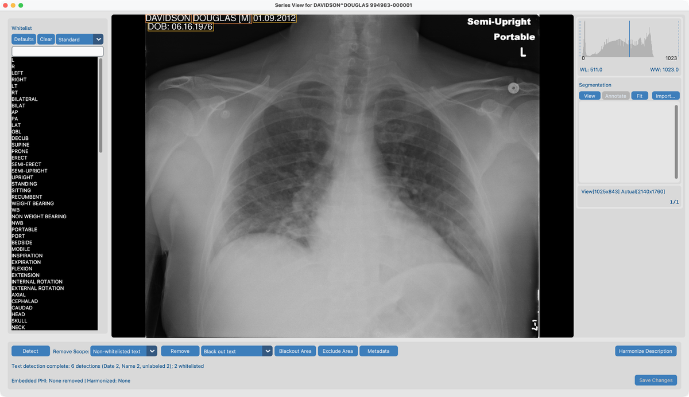
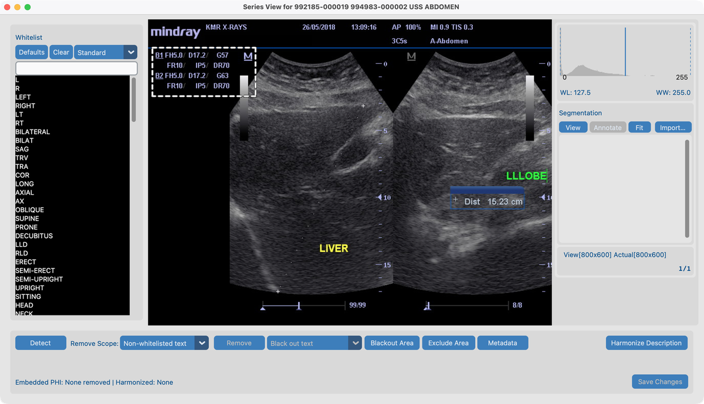

# 8.1 Embedded PHI

**Embedded PHI** findet und entfernt geschützte Gesundheitsinformationen, die **nach** der Tag-Anonymisierung beim Import verbleiben: Text auf Bildpixeln sowie PHI in Berichten / Freitext. OCR (Pixel) und englische Named-Entity-Erkennung (NER). Ingest führt kein NER/OCR aus.

| Abschnitt | Inhalt | Wo Sie arbeiten |
| --- | --- | --- |
| [Pixel](#pixel) | Eingebrannter Text auf Bildpixeln | Serienansicht |
| [Text › Metadata](#metadata) | Tag-Werte mit PHI nach dem Import | Serienansicht / Bericht → **Metadata** |
| [Text › Reports](#reports) | Structured Reports, Encapsulated PDF, Freitext-Körper | **Report Text Review** (und Text-Stapel) |

Schließen Sie [KI-Funktionen einrichten](../../03-ai-features-setup/index.md) (Embedded-PHI-Paket) vor diesen Abschnitten ab.

### Benannte Entitäten (OpenMed)

Das englische NER im Embedded-PHI-Paket ist **OpenMed ClinicalE5-Small**. Detect färbt Treffer nach Typ (Typname in dieser Farbe):

| Typ | Beispiele |
| --- | --- |
| **First name** | Eingebrannter Vorname auf Pixeln (z. B. `DOUGLAS`); Vorname in Study Description oder Bericht |
| **Last name** | Eingebrannter Nachname (z. B. `DAVIDSON`); Nachname in Study Description oder Bericht |
| **Location** | Krankenhaus- / Standort- / Stadttext auf Overlays oder in Freitext-Tags und Berichten |
| **ID** | MRN oder ähnliche Kennungen in Bericht / Freitext-Tag-Werten |
| **Phone** | Telefonnummern in Berichten oder Freitext-Tags |
| **Date** | Eingebrannte Daten / DOB-Strings; Daten in Study Description oder Berichten |
| **Email** | E-Mail-Adressen in Berichten oder Freitext-Tags |

Auf **Pixeln** verschmelzen First name und Last name zu einer **Name**-Boxfarbe (gleiche Familie wie First name). In **Metadata** und **Report Text Review** bleiben sie getrennt. Hover über eine farbige Spanne oder Box zeigt den Typ.

---

## Pixel {#pixel}

Eingebrannte Namen und Beschriftungen auf dem Bild. Das Bereinigen der DICOM-Tags allein entfernt sie nicht.

### Demo-Serien

| Serie | Pfad | Verwendung |
| --- | --- | --- |
| **`davidson_cxr`** | `tests/controller/assets/test_dcm_files/davidson_cxr` | Whitelist → **Detect** → **Black out text** |
| **`us_rgb_single_frame`** | `tests/controller/assets/test_dcm_files/us_rgb_single_frame` (`US_RGB_SingleFrame.dcm`) | **Detect** → **Blend into background**; **Exclude Area** on the machine-parameter block under **mindray** |

Jeden Ordner in Ihr Projekt importieren, dann die Serie in der **Serienansicht** aus dem [Datensatz](../../07-view/index.md) öffnen.

### Ziel

1. On `davidson_cxr`, detect burned-in text and **black out** PHI while keeping useful markers via the default whitelist.
2. On `us_rgb_single_frame`, detect burned-in text and remove it by **blending into the background** (inpaint).
3. On the same color US series, mark the non-PHI machine-parameter strip with **Exclude Area** so Detect and Remove skip it.

### Werkzeugleiste Serienansicht

Von links nach rechts in der Textbearbeitungsleiste:

| Steuerung | Rolle |
| --- | --- |
| **Edit Context** | **Frame** or **Series**. Hidden on single-frame series (no choice to make). |
| **Detect** | Run OCR (+ NER labelling). Boxes show what **Remove** would delete for the current **Remove Scope**. Pixels are not changed. |
| **Remove Scope** | **Non-whitelisted text** (default), **PHI only**, or **All text**. Filters which detections are boxed and what **Remove** deletes. Changing scope after Detect re-filters existing boxes; **Remove** stays enabled while boxed text remains under the new scope. |
| **Remove** | Delete boxed text using the removal mode menu. Disabled until Detect has identified text for removal. |
| Removal mode menu | **Black out text** or **Blend into background**. |
| **Blackout Area** | Paint drawn user rectangles black (manual). |
| **Exclude Area** | Convert drawn rectangles into keep-out zones for Detect/Remove (no pixel change). |
| **Metadata** | DICOM tag tree for the current slice ([Detect PHI / Remove PHI](../../07-view/index.md#metadata-dicom-tags) on tag values). |

**Save Changes** (bottom right) writes pixel edits and/or modality exclude-area files. Hover it to see what will be saved.

Left panel: **Whitelist** with **Defaults**, **Clear**, match mode (**Exact** / **Strict** / **Standard** / **Lenient**), search, and the keeper list.

### Ablauf auf `davidson_cxr` (schwärzen)

#### 1. Default whitelist and Remove Scope

1. Keep the **default whitelist** (do not **Clear** it).
2. Leave **Remove Scope** on **Non-whitelisted text**.
3. On this single-frame series, **Edit Context** is hidden.

#### 2. Detect

1. Click **Detect**.
2. Auf Detect warten. Rechtecke markieren Text, der für den aktuellen **Remove Scope** entfernt würde. NER färbt Rahmen nach Kategorie (**Name**, **Location**, **Date**, **ID**, **Phone**, **Email**); unmarkierte OCR bleibt bei **Non-whitelisted text** oder **All text** gerahmt.

Detect classifies with the **whole frame as context** (OCR boxes in reading order joined for one NER call). Each rectangle is still one OCR box and is removed **whole** — including unmarked prefixes or suffixes inside the same box (the `DOB:` prefix before a date; the `[M]` marker after a name). Hover a PHI rectangle to see its NER category (bold caps on the category colour), not the detected string.

| Remove Scope | Effect |
| --- | --- |
| **Non-whitelisted text** (default) | Remove OCR that is not a whitelist match and not in an exclude area |
| **PHI only** | Remove only NER-labelled PHI. Unlabeled text and whitelist matches stay; whitelist still vetoes keepers |
| **All text** | Remove every detected box; whitelist is ignored |

Auf `davidson_cxr` mit Standard-Whitelist und **Remove Scope: Non-whitelisted text** zeichnet Detect **vier** Rahmen: **DAVIDSON** und **DOUGLAS [M]** (Name), **01.09.2012** und **DOB: 06.16.1976** (Date). **Semi-Upright**, **Portable** und **L** bleiben ohne Rahmen (Standard-Whitelist-Keeper).

**Whitelist match** (next to Defaults / Clear — default **Standard**):

| Setting | Effect |
| --- | --- |
| **Exact** | Keeper only on letter-for-letter match |
| **Strict** | Almost exact — tiny OCR mistakes only |
| **Standard** (default) | Small OCR errors allowed (`AXIL` still matches `AXIAL`) |
| **Lenient** | Most forgiving — noisy text and short markers |

Use a stricter setting if too much text is skipped; looser if useful markers keep getting boxed.

#### 3. Review and whitelist keepers

1. If a green rectangle covers text you want to **keep**, click that rectangle.
2. The text is added to the whitelist on the left and will not be removed.

Auf `davidson_cxr` stehen **Semi-Upright**, **Portable** und **L** bereits auf der Standard-DX-Whitelist.

#### 4. Remove with black out

1. Set the removal mode menu to **Black out text**.
2. Click **Remove**.
3. PHI regions become solid black; whitelisted keepers stay.
4. Click **Save Changes** when satisfied.

Black out is the usual de-identification choice: removed text is clearly gone and cannot be recovered from the pixels.

### Ablauf auf `us_rgb_single_frame` (einblenden)

Use this color ultrasound frame when removed text should look like nearby tissue instead of black bars.

#### 5. Remove with blend

1. Import and open **`us_rgb_single_frame`** (`US_RGB_SingleFrame.dcm`) in Series View.
2. Set the removal mode menu to **Blend into background**.
3. Click **Detect** and wait for the green rectangles.

4. Click **Remove**.
5. Detected text is painted out by blending with surrounding pixels (inpaint), then **Save Changes**.

**Black out text** replaces text with black. **Blend into background** fills the area to match surrounding pixels. Prefer black out for obvious, irreversible redaction; prefer blend when a less conspicuous result is acceptable (ultrasound overlays).

### Ablauf auf Farb-US (Exclude Area)

Use the same **`us_rgb_single_frame`** series when OCR boxes machine settings that are **not PHI**. **Exclude Area** skips a spatial region for Detect and Remove without changing pixels (unlike **Blackout Area**).

#### 6. Exclude the parameter block under mindray

On this frame, a dense block of machine parameters (gain, depth, FR, DR, and similar tokens) sits on the **upper left**, directly **below** the **mindray** logo.

1. Open **`us_rgb_single_frame`** in Series View.
2. Draw a rectangle covering that parameter block (leave **mindray** and true PHI / site labels outside if you still want them detected). Pending draws appear as **solid blue** rectangles.
3. Click **Exclude Area**. The rectangle moves to the exclude list and redraws as a **white dotted outline** (no fill). **Save Changes** stores the current exclude set for this modality without changing pixels when that is the only pending change.

4. Click **Detect**. Green boxes should appear on PHI / vendor text **outside** the block; parameter tokens inside the dotted region should **not** be boxed for removal.

5. Optionally choose **Blend into background** or **Black out text**, then **Remove** and **Save Changes**.
6. Click a white dotted rectangle to remove it from the exclude list if you need to adjust.

**Whitelist** keeps specific OCR *strings*. **Exclude Area** skips a *region* (no pixel change). **Blackout Area** paints drawn rectangles black. Prefer setting exclude rectangles **before** Detect (or Detect again after adjusting). With **Series** edit context (multi-frame), drawing propagates across frames so the same panel can be excluded on a cine loop.

### Nach der Pixelarbeit

- Dataset **Embedded PHI** status updates for each series you saved (removed PHI text only).
- Modality whitelists and the match dropdown live in Series View; stricter matching means fewer OCR hits count as keepers.
- Exclude regions are session-only until **Save Changes**. Active rectangles (including removals of previously saved ones) are written to `whitelists/{modality}.exclude.json` next to the modality whitelist. Clearing all areas removes that file. AI Batch applies those areas when **Enable Exclude Areas** is on.
- To run pixel Embedded PHI on many studies, see [8.4 Run on many studies](../05-run-on-many-studies/index.md).

### Was gut aussieht (Pixel)

- On `davidson_cxr`: PHI blacked out; orientation markers kept if whitelisted.
- On `us_rgb_single_frame`: burned-in labels blended away without solid black bars; with Exclude Area, the mindray parameter block is not removed as PHI.

### Wenn Pixelarbeit fehlschlägt

- Many false boxes → tighten match strictness; whitelist keepers; or **Exclude Area** for whole panels.
- Missed text → manual **Blackout Area**.
- Parameter text still boxed → enlarge the exclude rectangle and Detect again; click dotted outlines to delete and redraw.
- Tools greyed out → finish [AI Features](../../03-ai-features-setup/index.md).

---

## Text {#text}

PHI in **Tag-Werten** und in **Bericht- / Freitext-Körpern** — nicht auf Pixeln gezeichnet. Dasselbe Embedded-PHI-NER-Paket wie bei Pixel.

### Metadata {#metadata}

Tag-Werte, die nach dem Import noch PHI halten können (Kommentare, Beschreibungen, verbliebener Freitext). Arbeit in der Serienansicht oder Report Text Review über **Metadata**.

Vollständige Schritte (Baum, **Detect PHI** / **Remove PHI**, Blank vs Synthetic, Speichern der aktuellen Datei): [Ansicht → Metadaten (DICOM-Tags)](../../07-view/index.md#metadata-dicom-tags).

**Klares Beispiel — `davidson_cxr` vor Harmonize.** Der Import entfernt Patientennamen aus den üblichen Name-/ID-Tags, aber **Study Description** kann Freitext wie `XR CHEST AP PORTABLE for Douglas Davidson` behalten. Metadata **vor** Harmonize Description ausführen, damit diese Rest-PHI sichtbar bleibt.

1. **`davidson_cxr`** in der Serienansicht öffnen (**noch nicht** Harmonize — Status Harmonized: None).
2. **Metadata**, dann **Detect PHI**.
3. Die markierte Zeile **Study Description** prüfen: Namensspannen als **First name** / **Last name**. Optional Zeile ausschließen, **Blank** oder **Synthetic**, dann **Remove PHI** / **Replace PHI**, und **Save**.

Dieselbe Metadata-Dialog öffnet sich aus Report Text Review (**Metadata** in der Bericht-Symbolleiste) für die aktuelle Bericht-Datei.

!!! note "Nur aktuelle Datei"
    Metadata-Entfernung gilt für das **aktuelle** Bild oder die Bericht-Datei. Für Tag-Bereinigung über Serie oder Kohorte: [KI-Stapel](../05-run-on-many-studies/index.md).

### Reports {#reports}

PHI in **Structured Reports**, **Encapsulated PDF** und anderen Freitext-Dokumentkörpern. Öffnet **Report Text Review** statt der Serienansicht.

#### Report Text Review {#reports-and-free-text-report-text-review}

Demo: **`demo_report_pdf`** (synthetischer Radiologiebericht). Import mit **Clean Structured Content**, damit Encapsulated-Document- / SR-Text zur Prüfung erhalten bleibt.

1. Demo-Bericht öffnen. Links die PDF-Seite, rechts der extrahierbare Text.
2. **Detect PHI**. Spannen rechts färben sich nach Typ (**First name**, **Last name**, **Location**, **ID**, **Phone**, **Date**, **Email**) — dieselben OpenMed-Farben wie unter [Benannte Entitäten](#benannte-entitäten-openmed).
3. Eine Hervorhebung anklicken, um eine Spanne zu **behalten**.
4. **Blank** (löschen) oder **Synthetic** (Fake-Wert gleichen Typs), dann **Remove PHI** / **Replace PHI**.
5. **Save** schreibt den Bericht. Bei Encapsulated PDF ersetzt Save die PDF-Bytes durch ein de-identifiziertes Plain-Text-Dokument (Layout bleibt nicht erhalten). In der Dataset-Spalte Embedded PHI steht nur der **original entfernte PHI-Text** — nie der Berichtskörper und nie die synthetischen Ersetzungen.
6. Optional — **Metadata** in der Bericht-Symbolleiste für Tag-Bereinigung dieser Datei ([Metadata](#metadata) oben).

Synthetische Werte folgen deterministisch aus Projekt und anonymisierter Patienten-ID. Pixel-Entfernung nutzt immer Black out / Blend; **Synthetic** gilt nur für Text.

#### Gescannte Textberichte

Sieht eine Secondary-Capture-Serie wie ein Textbericht aus (Dosis- oder Arbeitsblattseite), zuerst die [Pixel](#pixel)-Werkzeuge. **Save Changes** in der Serienansicht kann zusätzlich das bereinigte OCR-Transkript als **Basic Text SR** in derselben Studie schreiben. Das SR ist ein Derivat; es erscheint nicht in der Embedded-PHI-Spalte.

#### Freitext im Stapel

Kommentare, Protokoll-/Prozedurbeschreibungen und ähnliche Freitext-Attribute über viele Studien: Text-Pfad in [KI-Stapel](../05-run-on-many-studies/index.md).

### Wenn Textarbeit fehlschlägt

- Werkzeuge ausgegraut → [KI-Funktionen](../../03-ai-features-setup/index.md) abschließen.
- Leerer Berichtskörper nach Import → **Clean Structured Content** (und SR/PDF-Modalitäten) vor dem Import aktivieren, damit Dokumentbytes zur Prüfung bleiben.

---

## Nächste Schritte

Weiter mit [8.2 Namen harmonisieren](../03-harmonize-names/index.md) mit **`CT_Head_With_Contrast`**.
