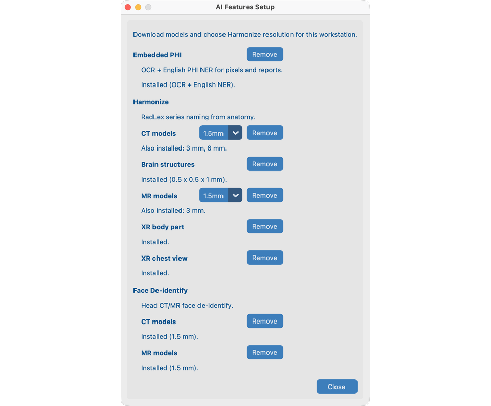

# AI Features setup

AI Features are **optional**. They run on your computer after a one-time download. Images are not uploaded for processing.

Do this chapter **before** the tool walkthroughs on `davidson_cxr` and `CT_Head_With_Contrast`.

## Goal

Download the models you need and choose Harmonize resolution for this workstation.

## Open setup

From the **Welcome** screen only: click **AI Features**.

Close the project (or start the app) to return to Welcome if you need to download models or change Harmonize resolution later.

!!! note "After all models are downloaded"
    Each row shows **Installed** (with a short detail such as resolution) and a **Remove** button instead of **Download**. Harmonize CT/MR rows keep a resolution menu; extra resolutions already on disk appear as “Also installed: …”. The screenshot above shows that fully installed state.

## Models in this dialog

Each row is a **workstation download**. There are **no project on/off checkboxes** — install here; the matching tools unlock later in [View](../07-view/index.md) and [Process](../08-process/index.md) (including [run on many studies](../08-process/05-run-on-many-studies/index.md)).

| Feature | What it unlocks later | Download? |
| --- | --- | --- |
| **Embedded PHI** (OCR + English NER, one pack) | Burned-in text cleanup, report text review, and Metadata **Detect PHI** | Yes, if you scrub pixels, reports, or tag text |
| **Harmonize** CT/MR + resolution (1.5 / 3 / 6 mm) | TotalSegmentator organ masks for CT/MR — standardized series names, plus organ volumes to review in [Dashboard Analytics](../07-view/index.md#analytics) | Yes, if you Harmonize CT/MR or use organ-volume Analytics — pick a resolution |
| **Harmonize** XR body part | Extra pixel body-part help for CR/DX when tags are missing or wrong | Yes, if you Harmonize general X-ray |
| **Harmonize** XR chest view | Extra pixel AP/PA/Lat (+ rotation check) for chest CR/DX | Yes, if you Harmonize general X-ray (chest) |
| **Face de-identify** | Face blur on eligible head CT/MR | Yes, if you are curating head CT/MR |
| **Brain structures** | Extra brain-structure masks on head CT/MR (with Harmonize) — review anatomy and organ-volume distributions for structures of interest in [Dashboard Analytics](../07-view/index.md#analytics) | Yes, if you curate head CT/MR and use organ-volume Analytics — needs license |

XR Harmonize works without the XR body-part or chest-view packs (DICOM tags / keywords only). When installed, CR/DX series can use:

- EfficientNet-B4 body-part classifier ([Xp-Bodypart-Mislabel-Checker](https://huggingface.co/spaces/MedicalAILabo/Xp-Bodypart-Mislabel-Checker); [Mitsuyama et al., *European Radiology* 2025](https://doi.org/10.1007/s00330-025-12053-7)), fused with DICOM anatomy.
- Chest-only projection/rotation classifier ([CXp-Projection-Rotation-Mislabel-Checker](https://huggingface.co/spaces/MedicalAILabo/CXp-Projection-Rotation-Mislabel-Checker); same [Mitsuyama et al.](https://doi.org/10.1007/s00330-025-12053-7) paper) to refine AP/PA/Lat; rotation is shown in the Harmonize analysis table and is not written into SeriesDescription.

Mammography and ultrasound do not use these models.

## First-time steps

1. Open **AI Features**.
2. Download **Embedded PHI**, **Harmonize** (CT), and **Face de-identify**.
3. Enter or validate the academic license when prompted (face / brain structures).
4. Choose Harmonize CT resolution; download if the pack is missing.
5. Optionally download **Brain structures** and/or **XR body part** / **XR chest view** if you need those extras.
6. Close the dialog. Preferences stay on this workstation.

!!! tip "Internet only for download"
    After models and license are in place, processing is local. On **macOS**, install the OpenMP C++ library before using Harmonize / related AI Features: `brew install libomp` (see [Install](../02-install/index.md#4-macos-only-openmp-for-ai-features)).

## Remove models

Use **Remove** on a tool card to delete downloaded files. This does not undo changes already written to anonymized images.

## What good looks like

- Status shows ready for OCR, Harmonize CT, and Face.
- After import, you can run the matching [Process](../08-process/index.md) tools on the demo series (chapters 8.1–8.3).

## If it fails

- Download incomplete → check network and retry.
- TotalSegmentator / OpenMP on macOS → `brew install libomp`.
- License invalid → check `aca_` format or the vendor URL in the dialog.

## Next steps

1. [Words we use](../04-words-we-use/index.md) and [Create a project](../05-create-project/index.md), or
2. Jump to [Process](../08-process/index.md) tools once you have imported studies — start with [8.1 Embedded PHI](../08-process/02-remove-burned-in-text/index.md)
