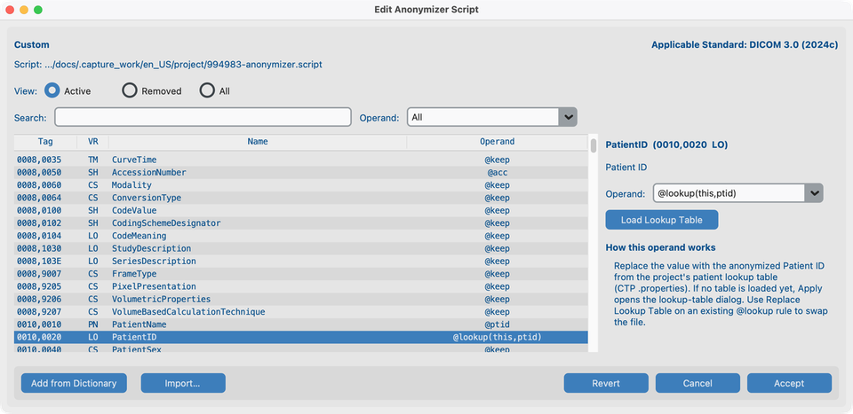
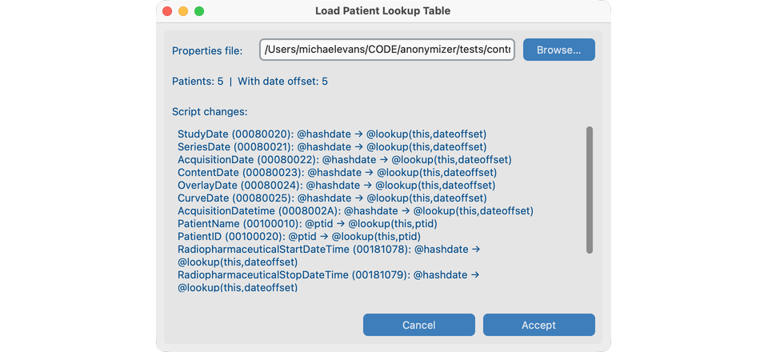

# Anonymizer script (advanced)

[De-identification options](index.md#2-de-identification-options) compile the project script for most sites. Use this page to change individual tag rules, choose a date strategy, load a patient lookup table, or import a CTP `.script`.

## Open the editor

After the project exists: **File → Project Settings**. On the **Script File** row use **Edit Anonymizer Script**, or **Import CTP Script…** to install a CTP `.script` without opening the editor first.

The editor loads `{site_id}-anonymizer.script` next to `ProjectModel.json` in the project storage folder (the folder shown at the top of the **Dashboard**). The dialog **Script** line is that script file path. The packaged `default-anonymizer.script` is never overwritten.

Project Settings and the editor header show the same status: project script name plus an options summary (**Basic**, **Retain**, or abbreviated selected options). **Custom** means the live script no longer matches a fresh compile of the stored options (imported or hand-edited).



## Views

| View | Contents |
| --- | --- |
| **Active** (default) | Rules that keep or transform the value (not `@remove()`). |
| **Removed** | Rules whose operation is `@remove()`. |
| **All** | Every rule in the script. |

**Search** and the toolbar **Operand** filter apply within the current view.

## Change a rule {#4-custom-script-edits}

1. Select a row.
2. Inspect operands with the toolbar **Operand** filter or the detail **Operand** control — **How this operand works** updates immediately; the rule does not change until **Apply**.
3. If the operand requires a parameter, **Apply** prompts for it (see [Operands](#operands)). **Change parameter** edits the parameter on a rule that already uses that operand.
4. **@remove()** then **Apply** moves the tag out of **Active** (the rule remains in the script).

## Operand catalog {#operands}

Supported operations match the script editor catalog and ingest walk. Parameters are prompted on **Apply** when required. Date-delta operations on date fields must use the same operation as **StudyDate** (the editor offers one-click alignment).

| Operand (script text) | Parameter | Behavior |
| --- | --- | --- |
| `@keep` | — | Leave the value unchanged. Kept free-text may still be scanned by Embedded PHI / report NER. |
| `@safe()` | — | Product extension (not CTP): leave the value unchanged and exclude it from Embedded PHI / PseudoPHI bulk NER. Use for retained technical strings that must not be NER-scrubbed. |
| `@remove()` | — | Delete the tag from the anonymized dataset. |
| `@empty()` | — | Keep the tag present with an empty value. |
| `@uid` | — | Replace with a stable anonymized UID. Same original UID → same anonymized UID within the project (referential integrity). |
| `@ptid` | — | Replace with the project's anonymized Patient ID for this patient. |
| `@acc` | — | Replace with the anonymized Accession Number for this study when assigned. Empty source stays empty. |
| `@hashdate` | — | Shift date/datetime by a stable per-patient day offset derived from the PHI Patient ID. Intervals between that patient's studies are preserved. Sets `(0028,0303) LongitudinalTemporalInformationModified = MODIFIED` when any date-delta runs (records code 113107 when Modified Dates is selected). |
| `@lookup(this,ptid)` | — | Replace with the anonymized Patient ID from the project patient lookup table (`ptid/` rows in CTP `.properties`). If the table is not loaded, **Apply** opens **Load Patient Lookup Table**. |
| `@lookup(this,dateoffset)` | — | Apply the per-patient day offset from the lookup table (`dateoffset/` rows). If those rows are not loaded, **Apply** opens **Load Patient Lookup Table**. |
| `@lookup(this,cname)` | — | Replace with the collection name from `cname/` rows (TCIA ProjectName / TrialName stamps). Missing value → **Lookup_Miss**. Creates the element if missing. |
| `@lookup(this,siteid)` | — | Replace with the site id from `siteid/` rows. Missing value → **Lookup_Miss**. Creates the element if missing. |
| `@lookup(this,ddate)` | — | Replace with the diagnosis / base date from `ddate/` or `basedate/` (stored as YYYYMMDD). Missing value → **Lookup_Miss**. Creates the element if missing. |
| `@incrementdate(this,n)` | **`n`**: signed integer day offset (trial-wide DATEINC). Positive moves dates later; negative earlier. Confirming applies the same `@incrementdate(this,n)` to every date-delta field in the script (listed in the prompt). | Fixed day shift for every patient. Intervals between a patient's studies are preserved. |
| `@rebasedate(this,origin)` | **`origin`**: epoch start as `YYYYMMDD` (eight digits; default `19600101`). | TCIA/NCTN rebase: anonymized date = `origin + (real date − basedate)`. Requires `basedate/<PatientID>=YYYYMMDD` (or `ddate/` when basedate is absent) in the lookup table. Writes `(0012,0052)` / `(0012,0053)=REGISTRATION` from PHI StudyDate − basedate (event type may come from an `@always()` on `(0012,0053)`). If basedates are not loaded, **Apply** opens **Load Patient Lookup Table** first. |
| `@round(this,n)` | **`n`**: integer ≥ 1, age band width in whole years (AS VR). Bins are centered on zero (CTP `@round`): value → nearest multiple of `n`. | Coarsen Patient Age. Width `5`: `027Y` → `025Y`, `043Y` → `045Y`. |
| `@modifydate(StudyDate,*,1,1)` | — | Write the four-digit year from StudyDate into this tag (TCIA StudyYear). |
| `@truncate(this,n)` | **`n`**: integer ≥ 1, characters to keep. | Keep the first `n` characters of the current value. |
| `@hashname(this,n)` | **`n`**: integer ≥ 1, hex length. Optional literal prefix before `@hashname` (for example `REV-@hashname(this,4)`). | Replace with the first `n` hex characters of an MD5 of the current value. |
| `@dateinterval(StudyDate,ddate,PatientID)` | — | Write whole days from lookup basedate/ddate to StudyDate (TCIA longitudinal offset stamp). Creates the element if missing. Missing basedate → **Lookup_Miss**. |
| `@if(this,isblank){then}{else}` | Both arms must be valid product operands. | If the current value is blank, apply the then operand; otherwise apply the else operand. Only the `isblank` condition is supported. |
| `@always()text` | **`text`**: non-empty literal replacement (must not start with `@`). Stored as `@always()YES`. Bare non-`@` literals such as `YES` in older scripts are the same operand. | Set the element to a fixed value; create the element if missing. |
| `@process()` | — | Keep the sequence (`SQ`) wrapper and recursively apply script rules to items inside it. |

After the script walk, missing non-sequence elements are created in one pass for `@always()…`, stamp `@lookup(this,cname|siteid|ddate)`, and `@dateinterval(StudyDate,ddate,PatientID)`.

Import and reload reject unknown operands. If an unrecognized operation still reaches ingest (for example a hand-edited keep table), the anonymizer **logs an error and removes the element**.

Toolbar **Operand** filter **All** shows every rule in the view; choosing a specific operand filters the list and updates help without assigning until **Apply**.

## Add a missing tag

**Add from Dictionary** (bottom bar) lists DICOM dictionary tags absent from the script. **Add** inserts one rule with default `@keep`. The button is hidden when the script already covers the dictionary.

## Save

| Control | Effect |
| --- | --- |
| **Accept** | Validate operands; write `{site_id}-anonymizer.script` in the project storage folder; reload live anonymizer rules; keep the project pointed at that file. |
| **Revert** | Reload the script file from disk; discard unsaved edits. |
| **Cancel** | Close without saving. |

!!! note "Options vs custom edits"
    Accepting new [de-identification options](index.md#2-de-identification-options) rebuilds the project script from the packaged default plus the selected options and **discards** a custom or imported script. Already-stored instances are not re-anonymized. When the live script is **Custom**, Project Settings warns that the imported / custom script will be replaced.

## Patient lookup table and dates {#5-patient-lookup-table-and-dates}

### Longitudinal dates {#longitudinal-dates-tcia-style}

| Strategy | Operand | Requirement |
| --- | --- | --- |
| Per-patient hash | `@hashdate` | Default compiled script; no lookup table. |
| Per-patient lookup offset | `@lookup(this,dateoffset)` | `dateoffset/` rows in the lookup `.properties`. |
| Trial-wide offset | `@incrementdate(this,n)` | Parameter `n` (DATEINC); applied to all date-delta fields. |
| Epoch rebase | `@rebasedate(this,origin)` | `basedate/` or `ddate/` rows; parameter `origin` (`YYYYMMDD`). |

All four preserve intervals between a patient's studies and set Longitudinal Temporal Information Modified as described under `@hashdate` above. Deterministic UID/date/accession caveats: [De-identification protocol](../deidentification-protocol.md#deterministic-replacements-uids-dates-accessions).

### Patient Lookup Table {#patient-lookup-table}

Open **Load Patient Lookup Table** by:

- **Apply** on `@lookup(this,ptid)`, `@lookup(this,dateoffset)`, or `@rebasedate(this,origin)` when the required table (or `dateoffset` / `basedate` rows) is not loaded; or
- **Load Lookup Table** / **Replace Lookup Table** beside the detail **Operand** control on a lookup-dependent rule.



**Load Patient Lookup Table**:

1. **Browse…** to a CTP/TCIA `.properties` file.
2. Confirm patient and date-offset counts and the listed **script changes** (`@ptid` → `@lookup(this,ptid)`, `@hashdate` → `@lookup(this,dateoffset)`, and matching date fields).
3. **Accept** stores a project-private copy of the table, rewrites those rules, and enables runtime lookup. **Cancel** leaves the script unchanged.

`.properties` keys:

```text
ptid/<PHI-PatientID>=<anonymized-PatientID>
dateoffset/<PHI-PatientID>=<signed-integer-days>
basedate/<PHI-PatientID>=YYYYMMDD
ddate/<PHI-PatientID>=M/D/YYYY   (or YYYYMMDD; stored as basedate when basedate/ is absent)
cname/<PHI-PatientID>=<collection-name>
sname/<PHI-PatientID>=<site-name>
siteid/<PHI-PatientID>=<site-id>
```

`ptid/` alone is valid. `dateoffset/` enables `@lookup(this,dateoffset)`. `basedate/` or `ddate/` enables `@rebasedate(this,origin)` and `@lookup(this,ddate)` / StudyDate–ddate `@dateinterval`. `cname/` and `siteid/` enable the matching stamp lookups. `sname/` is stored on the PHI patient row for export/bookkeeping; there is no `@lookup(this,sname)` runtime operand. Unknown property key prefixes are skipped with a warning.

!!! note "Lookup after files are stored"
    Loading a lookup table does **not** re-anonymize instances already in the project. Patients already in the project continue without a table row. **New** files whose PHI Patient ID is absent from the table are quarantined as **Lookup_Miss** and are not stored.

## Import a CTP script

Use **Import CTP Script…** on **File → Project Settings** (Script File row), or **Import…** in the script editor. Both paths share the same checks. On macOS the file dialog opens with **All Files** so TCIA `.script` / `.script.txt` names are selectable (Tk’s custom extension filter can grey matching files out).

A progress dialog names each stage (reading and adapting, applying date offset / parameters when prompted, **Checking script rules…**, then installing or updating the editor list). If the processed script uses `@lookup` / `@rebasedate` and no patient lookup table is loaded yet, Import opens **Load Patient Lookup Table**; Cancel aborts the import. Import refuses unsupported operands before the project script changes. On success: the script **passed validation**; Project Settings saves it as `{site_id}-anonymizer.script` immediately; the editor still needs **Accept** to write. Success text lists CTP adaptations when any ran, or says none were needed.

Then the **De-identification Options** dialog opens as **project metadata** only (ingest option codes), prefilled from the imported rules. **OK** saves the checkboxes; it does **not** rebuild or replace the imported script. **Cancel** keeps previous option codes; the imported script stays. Changing options later under Project Settings rebuilds from the packaged default and discards the import.

Common CTP spellings are rewritten to product forms before validation:

| CTP form | Product form |
| --- | --- |
| `@keep()` | `@keep` |
| `@hashdate(this,PatientID)` | `@hashdate` (PatientID seed only; other seeds stay unsupported) |
| `@hashuid(…)` | `@uid` (project UID map, not CTP hash+root) |
| `@hashptid(…)` | `@ptid` |
| `@lookup(PatientID,ptid)` | `@lookup(this,ptid)` |
| `@incrementdate(this,@DATEINC)` | `@incrementdate(this,n)` from `<p t="DATEINC">` or a prompt |
| `@always()@param(@NAME)` | `@always(){value}` from `<p t="NAME">` or a prompt |
| `@always()@append(){text}` | `@always()text` |
| `@always()@lookup(PatientID,cname|siteid|ddate)` | `@lookup(this,…)` |
| `@always()@modifydate(StudyDate,*,1,1)` | `@modifydate(StudyDate,*,1,1)` (StudyYear) |
| `@always()@dateinterval(StudyDate,ddate,PatientID)` | `@dateinterval(StudyDate,ddate,PatientID)` |
| `@dateinterval(this,ddate,PatientID,@NORMDATE)` | `@rebasedate(this,{NORMDATE})` from `<p t="NORMDATE">` |
| `@if(this,isblank){then}{else}` | supported when both arms are valid product operands |
| `REV-@hashname(this,n)` | catalog `@hashname` (optional literal prefix) |
| `@round(Element,n)` | `@round(this,n)` (age banding; CTP-style bins centered on zero) |

Duplicate `<e>` tags keep the **last** rule (with a warning). Bare literals must not embed unknown `@…` forms. `@remove` / `@remove()` are exact forms only — nested `@remove()` inside `@if` is not treated as Remove. Patient lookup tables may include TCIA `cname` / `sname` / `siteid` / `ddate` (ddate stored as basedate YYYYMMDD).

Script `<p>` parameters such as `DATEINC`, `UIDROOT`, `SITEID`, `SITENAME`, `LTET`, and `NORMDATE` are retained for that resolution (Import may prompt when a referenced parameter is missing). Missing **LTET** opens a menu of Longitudinal Temporal Event Type values (default **DIAGNOSIS**: also BASELINE, ENROLLMENT, REGISTRATION). Remaining unknown operands are rejected (errors grouped by operand; title **Import CTP Script**, lead **Script did not pass validation**). Date rules must match the StudyDate operation (one-click fix available). From the editor, record option codes on **Accept** after import (same metadata-only dialog).

The project script is validated with the same rule checks whenever it is loaded into the keep table (project open / **Accept** / compile reload / Settings import install). Sequences are always walked recursively; `@process()` is informational. CTP “keep a sequence without processing its items” is not supported.

## If it fails

- **Accept** or project open rejected → fix unsupported `@…` operands listed in the error. Empty `@always()` is invalid; supply non-empty `text`. Bare non-`@` literals are accepted as fixed values (`ALWAYS`).
- Ingest with a required lookup stamp or basedate missing → file quarantined as **Lookup_Miss**.
- Unrecognized operand at ingest (should not occur after validation) → logged and the element is removed.

## See also

- [Create a project](index.md) — how options compile `{site_id}-anonymizer.script`
- [De-identification protocol](../deidentification-protocol.md)
- [DICOM Conformance Statement](../dicom-conformance-statement.md)
