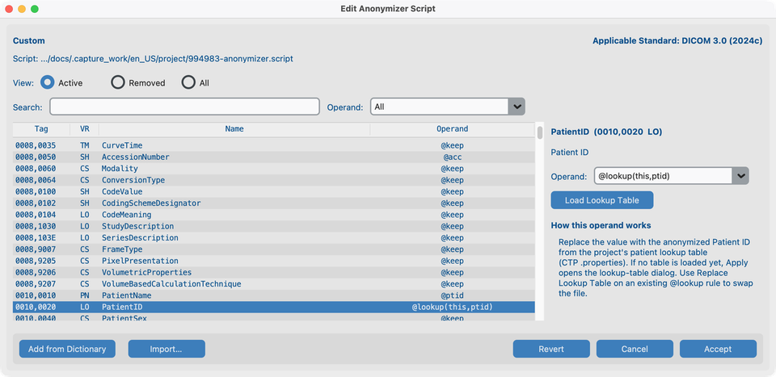
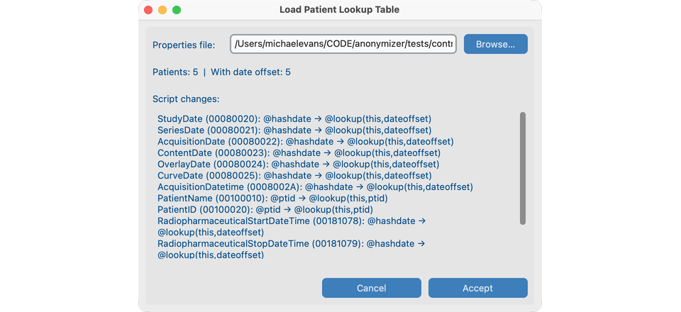

# Create a project

A **project** keeps settings and anonymized storage together. Create it once in the desktop window, even if a server will later run [headless](../10-headless/index.md).

Work through this chapter **in order**: identity and storage → de-identification options (these build the anonymizer script) → network and modalities with IT → optional script edits and lookup tables → Dashboard. Import studies next in [Search](../06-search/index.md). Cohort **Analytics** lives on the Dashboard only after import — see [View](../07-view/index.md#analytics).

## Goal

Open a clean project with storage, site identity, and a de-identification script ready for import.

## 1. Create a new project

1. From **File → New Project**, open **New Project Settings**.
2. Choose a **Project Name** (short, under 16 characters) and confirm the **Storage Directory**.
3. Review **Site ID** and **UID Root** (usually leave defaults unless continuing a Java Anonymizer site).
4. Continue with [de-identification options](#2-de-identification-options) before you save.
5. Confirm [modalities and network](#3-network-and-modalities) with IT if you will query a PACS.
6. Save / create the project. The compiled anonymizer script is stored beside `ProjectModel.json` as `{site_id}-anonymizer.script`. The **Dashboard** opens.


## 2. De-identification options {#2-de-identification-options}

De-identification options are the DICOM confidentiality choices from [PS 3.15 Appendix E](https://dicom.nema.org/medical/dicom/current/output/chtml/part15/chapter_E.html) (Basic Profile, Modified Dates, Retain Safe Private, and related options). They appear under their standard names in **De-identification Options**.


### Presets

| Preset | What it selects |
| --- | --- |
| **Basic** | Basic Profile only |
| **Retain** | Basic Profile + Modified Dates + Patient Characteristics + Retain Safe Private |

Presets only fill the checkboxes. The project stores the **selected option codes**, not the preset name.

### How options build the anonymizer script

At create (and whenever you Accept new options on an existing project), the app **compiles** the project anonymizer script:

1. Start from the packaged `default-anonymizer.script`.
2. Apply **option overlays** for every selected confidentiality option (which tags to keep, remove, or transform).
3. Write the result as the project-private `{site_id}-anonymizer.script` next to `ProjectModel.json`.

Import always uses that **script only** (not NER/OCR). Full rule language and stamp tags are in [De-identification protocol](../deidentification-protocol.md). Reviewers looking for the PS 3.15 § E.1.3 checklist should use the [DICOM Conformance Statement](../dicom-conformance-statement.md).

!!! warning "Changing options later"
    On an **existing** project, applying different options asks you to confirm. Accepting **recompiles** from the packaged default plus overlays — **custom script edits are lost**. Already-imported images are not re-processed.

### Cleaning options and modalities

Cleaning options (Clean Pixel Data, Clean Structured Content, Clean Descriptors, Clean Recognizable Visual Features) can only be selected when their AI feature is installed — you will be offered the model download. Selecting Clean Structured Content or Clean Descriptors enables SR/PDF modalities; newly enabling SR or PDF modalities enables Clean Structured Content when it is off.

Cleaning at import is limited: pixel and report scrubbing still need the optional Process / Report tools after import. See [De-identification protocol](../deidentification-protocol.md#pixel-and-face-options-in-the-dicom-profile).

## 3. Network and modalities {#3-network-and-modalities}

Open **File → Project Settings** (or finish these in New Project Settings before create). Configure them before Search / Send.

### When you talk to IT {#when-you-talk-to-it}

Share these ideas (details live in the dialogs below):

- **Local server** — address, port, and AE Title this computer uses to **receive** images.
- **Query server** — the hospital archive you search and retrieve from.
- **Export server** or **AWS** — where anonymized studies will be sent.
- **Modalities / storage classes / transfer syntaxes** — which image types are allowed.
- **Network timeouts** — how long to wait for slow archives.

If the project will live on a lab server, continue later with [Headless](../10-headless/index.md).

### Local Server

Address, port, and AE Title this computer uses to **receive** images.


### Query Server

Hospital archive used by Dashboard **Search**.


For remotes that speak **DICOMweb**, open the Query Server dialog and enable **DICOMweb**. Enter the **HTTP Port**, **Path** (for example `/dicom-web`), optional **Use HTTPS**, and optional username/password. Search then uses QIDO-RS and import uses WADO-RS. The DIMSE port and AE Title remain for **Echo** and dual-stack servers. Echo still uses DIMSE.

### Export Server

DICOM destination used when you **Send** (settings label may still say Export Server).


When **DICOMweb** is enabled on the Export Server, Send uses STOW-RS instead of C-STORE.

### AWS Cognito (optional)

Credentials for S3 Send when enabled.


### Network Timeouts {#network-timeouts}

How long to wait for slow archives.


### Modalities / Storage Classes / Transfer Syntaxes {#storage-classes}

Which image types and encodings are allowed.


### Logging Levels

Raise anonymizer / network logging when troubleshooting with IT.


## 4. Custom script edits {#4-custom-script-edits}

Most sites never edit the script by hand — [de-identification options](#2-de-identification-options) already compile the right rules. Use the editor when privacy or trial policy needs a **custom** tag rule, a different date strategy, or a [patient lookup table](#5-patient-lookup-table-and-dates).

Open **File → Project Settings** (or New Project Settings), then **Edit Anonymizer Script**. The editor loads the packaged default until you Accept; after that it opens your project-private copy and shows its path at the top of the dialog.

The header shows the option summary (**Basic**, **Retain**, or the abbreviated selected options) and the **Script** path. When the live script no longer matches a fresh compile of the stored options, status shows **Custom**.

**Import…** loads a custom CTP script: unknown operands are rejected, date rules must match the StudyDate operation (one-click fix available), and on Accept you confirm which de-identification options to record for it (prefilled from its rules).



### Views

| View | What you see |
| --- | --- |
| **Active** (default) | Tags that are **kept** or **transformed** (not `@remove()`). This is the list that matters day to day — about 1.5k rows instead of the full ~4.6k. |
| **Removed** | Tags marked `@remove()` (deleted on anonymize). |
| **All** | Every tag rule in the script. |

Search and the **Operand** filter apply inside the current view.

### Change a rule

1. Select a row in the list. Operands are shown in script syntax (for example `@keep`, `@remove()`, `@uid`, `@always()YES`).
2. To learn about an operand without changing the script, use the toolbar **Operand** filter or the detail **Operand** dropdown — **How this operand works** updates immediately. Assignment only happens when you click **Apply**.
3. If the operand needs a parameter, **Apply** prompts for the value with units and meaning. Use **Change parameter** to edit it later on a rule that already uses that operand:
   - **@round(this,n)** — age band width in whole years
   - **@always()** — fixed replacement text (CTP style, e.g. `YES`). Stores as `@always()YES`. Bare literals such as `YES` in older scripts are the same operand and remain valid.
   - Date and lookup operands — see [Patient lookup table and dates](#5-patient-lookup-table-and-dates).
4. Choosing **@remove()** (then Apply) demotes the tag out of the Active view (it stays in the script as `@remove()`).

### Add a missing tag

If the script is missing any DICOM dictionary tags, **Add from Dictionary** appears on the bottom bar. Search those missing tags and **Add** one (default `@keep`). When the script already covers the dictionary, the button is hidden.

### Save

- **Accept** validates operands, writes a private copy under `{storage}/private/{site_id}-anonymizer.script`, reloads the live anonymizer rules, and points the project at that file. The packaged default asset is never overwritten.
- **Revert** reloads the file from disk and discards unsaved edits.
- **Cancel** closes without saving.

!!! note "Options vs custom edits"
    Accepting new [de-identification options](#2-de-identification-options) recompiles the script and **discards** custom edits. Finish option choices first; edit the script afterward only if you still need exceptions.

## 5. Patient lookup table and dates {#5-patient-lookup-table-and-dates}

Use this section when your site needs a CTP/TCIA-style **Patient Lookup Table** and/or a specific **longitudinal date** strategy. These controls live in the [script editor](#4-custom-script-edits).

### Longitudinal dates (TCIA-style) {#longitudinal-dates-tcia-style}

All date-delta strategies preserve intervals between a patient's studies. When any of them runs, the anonymizer sets `(0028,0303) LongitudinalTemporalInformationModified = MODIFIED` (DICOM option 113107) when Modified Dates is selected.

| Strategy | Operand | When to use |
| --- | --- | --- |
| Patient hash | `@hashdate` (default compiled script) | No mapping table; deterministic per-patient offset |
| Lookup offset | `@lookup(this,dateoffset)` | Controlled per-patient offset from site `.properties` |
| Trial-wide offset | `@incrementdate(this,n)` | Same DATEINC for every patient (`n` set in the script editor) |
| Epoch rebase | `@rebasedate(this,origin)` | TCIA/NCTN style: `origin + (date − basedate)`; needs `basedate/` rows |

`@hashdate`, anonymized UIDs, and hashed accession numbers are **secret-free** by design: they keep stable links inside a project. They are not keyed against verification if someone already knows a candidate original. Details: [De-identification protocol — Deterministic replacements](../deidentification-protocol.md#deterministic-replacements-uids-dates-accessions).

**@incrementdate(this,n)** — fixed day delta (CTP DATEINC). Prompted when you apply the operand (default 365). Because DATEINC is trial-wide, confirming applies the same `@incrementdate(this,n)` to every date-delta field in the script (for example all `@hashdate` rules), and the prompt lists those fields.

**@rebasedate(this,origin)** — epoch ORIGIN as YYYYMMDD (default `19600101`). Prompted when you apply the operand; if basedates are not loaded, Apply opens the lookup-table dialog first.

**@lookup(this,ptid)** / **@lookup(this,dateoffset)** — if the required lookup table (or dateoffset rows) is not loaded, Apply opens the lookup-table dialog first.

### Patient Lookup Table {#patient-lookup-table}

`@lookup(this,ptid)`, `@lookup(this,dateoffset)`, and `@rebasedate(this,origin)` appear in the operand list. Choosing one and clicking **Apply** opens **Load Patient Lookup Table** when the required table (or dateoffset / basedate entries) is not loaded yet. On a rule that already uses a lookup-dependent operand, use **Load Lookup Table** / **Replace Lookup Table** beside the Operand control.

A CTP/TCIA `.properties` file maps each PHI Patient ID to an anonymized ID, and optionally a per-patient date offset and/or registration basedate:

```text
ptid/MRN-1001=527408-000101
dateoffset/MRN-1001=42
basedate/MRN-1001=20180327
```

Accept stores a private project copy, rewrites matching Patient ID / date rules to `@lookup…`, and enables runtime lookup. With date offsets present, `@lookup(this,dateoffset)` can be applied; with `basedate/` rows, `@rebasedate(this,origin)` can be applied (you are prompted for the ORIGIN date).

Lookup `.properties` may include registration/event dates only:

```text
ptid/MRN-1=SITE-0001
basedate/MRN-1=20180327
```

With basedates loaded, `@rebasedate(this,origin)` appears in the operand list. Anonymize also writes `(0012,0052)` / `(0012,0053)=REGISTRATION` from PHI StudyDate − basedate.

!!! note "Existing projects"
    Loading a lookup table does **not** re-anonymize files already in the dataset — they stay unchanged. Patients already imported keep working without a lookup-table row. **New** files whose PHI Patient ID is not in the table are quarantined as **Lookup_Miss** and are not stored.



## Everyday project actions

| Action | How |
| --- | --- |
| Close | **File → Close Project** or close the window |
| Re-open | **File → Open Recent** |
| Clone settings | **File → Clone** into a new storage folder (no images copied). Keep UID Root unique across projects. |

## Dashboard after create


The Dashboard exposes the main workflow buttons: **Search**, **View**, and **Send**. After you [import studies](../06-search/index.md), use [View → Analytics](../07-view/index.md#analytics) for cohort charts.

## What good looks like

- Dashboard shows your project name and Site ID.
- Storage directory exists and is writable.
- De-identification options match your privacy plan; the project script path exists beside `ProjectModel.json`.
- You can open the currently curated **Dataset** (empty until you import) by clicking **View**.

## If it fails

- Storage path not writable → choose another folder.
- Name too long → shorten project name.
- Cloning warning about UID Root → use a unique root per project to avoid ID clashes.
- Script editor **Accept** rejected → fix unsupported `@…` operands listed in the error. Empty `@always()` is invalid (supply text, e.g. `@always()YES`). Bare non-`@` literals such as `YES` are accepted as fixed values.

## Next steps

1. [Search](../06-search/index.md) — import studies into the project.
2. [View](../07-view/index.md) — Dataset, projections, Series View, and [Analytics](../07-view/index.md#analytics) after import.
