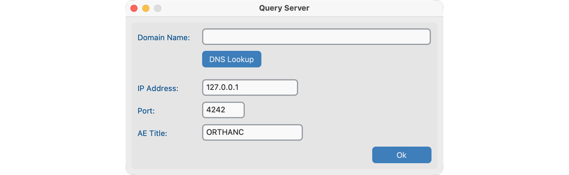
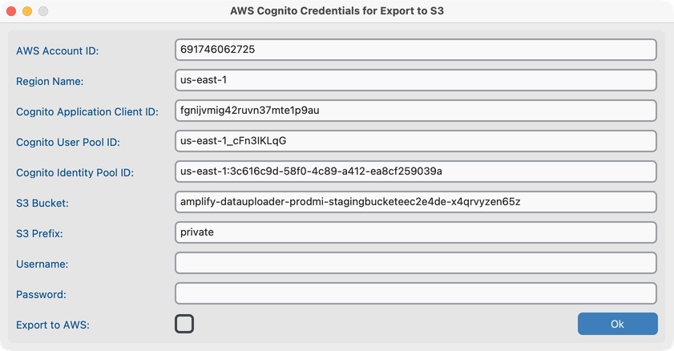
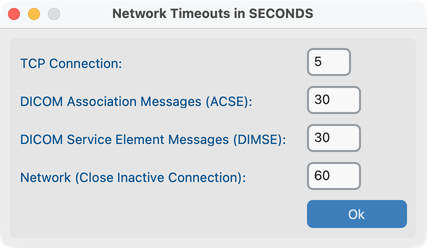
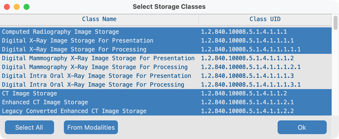
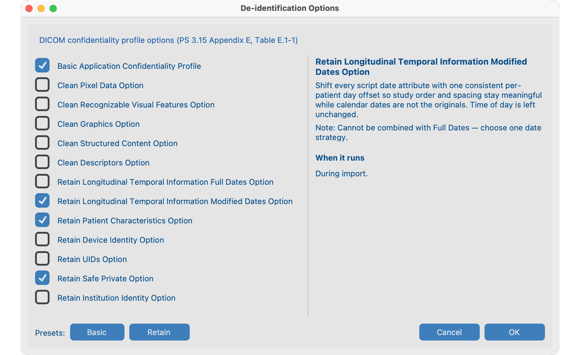
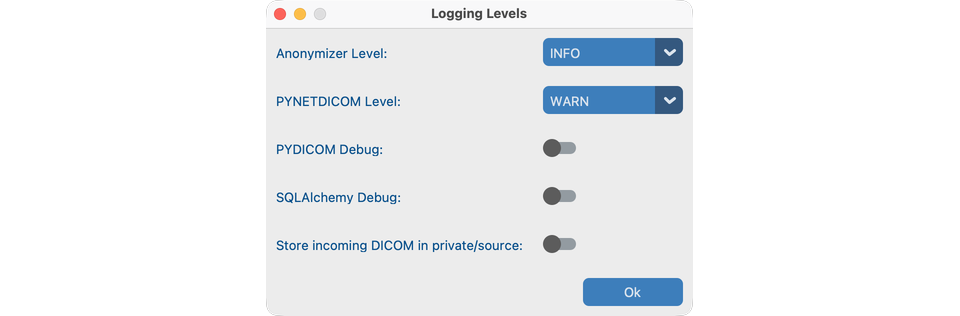
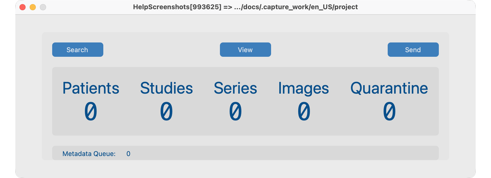

# Create a project

A **project** keeps settings and anonymized storage together. Create it once in the desktop window, even if a server will later run [headless](../10-headless/index.md).

From the **Welcome** screen, choose **File → New Project**, then work through **New Project Settings** **top to bottom** (same order as the dialog).

## Goal

Create a project with site identity, network servers, storage (directory and which studies to accept), de-identification options, and logging agreed with IT.

## 1. Project identity

On Welcome, choose **File → New Project**.

In **New Project Settings**:

- Set **Project Name** (short, under 16 characters).
- Review **Site ID** — filled automatically from the clock (a short number from 30-minute intervals since 1970) so each new project gets its own site code; you cannot edit it here. If you use **Load JAVA Index File**, Site ID is taken from that index instead.
- Review **UID Root** — the fixed RSNA base used to build new anonymized DICOM UIDs. Leave the default for a new site. If you **Load JAVA Index File**, UID Root is extracted from the anonymized study UIDs in that file (along with Site ID) so you continue the same site.

## 2. Project Settings

**New Project Settings** is the dialog below. Configure it top to bottom; the numbered sections that follow match this layout.

## 3. Network Servers {#3-network-and-modalities}

### When you talk to IT {#when-you-talk-to-it}

Share these ideas (details live in the dialogs below):

- **Local server** — address, port, and AE Title this computer uses to **receive** images.
- **Query server** — the hospital archive you search and retrieve from.
- **Export server** or **AWS** — where anonymized studies will be sent.
- **Network timeouts** — how long to wait for slow archives.

If the project will live on a lab server, continue later with [Headless](../10-headless/index.md).

### Local Server

Address, port, and AE Title this computer uses to **receive** images.

### Query Server

Hospital archive used for query / retrieve.

For remotes that speak **DICOMweb**, enable **DICOMweb**. Enter the **HTTP Port**, **Path** (for example `/dicom-web`), optional **Use HTTPS**, and optional username/password. Query then uses QIDO-RS and retrieve uses WADO-RS. The DIMSE port and AE Title remain for **Echo** and dual-stack servers. Echo still uses DIMSE.

### Export Server

DICOM destination used when you **Send** (settings label may still say Export Server).

When **DICOMweb** is enabled on the Export Server, Send uses STOW-RS instead of C-STORE.

### AWS Cognito (optional)

Credentials for S3 Send when enabled.

### Network Timeouts {#network-timeouts}

How long to wait for slow archives.

## 4. Storage {#storage-classes}

### Storage Directory

Choose the **Storage Directory** where anonymized files for this project will live (by default it follows the Project Name under Documents / RSNA Anonymizer).

### Modalities / Storage Classes / Transfer Syntaxes

These settings decide which studies this project will accept when you search a remote archive, receive over the network, or bring files in from disk.

**Modalities** — exam types such as CT, MR, or US. Changing modalities initially fills **Storage Classes** to match.

**Storage Classes** — the DICOM object kinds the anonymizer will **accept** (for example CT Image Storage). The list is **initially set from the selected modalities**, but you can edit it afterward (add or remove classes). Files whose storage class is not on this list are not anonymized into the project — they go to quarantine.

**Transfer Syntaxes** — how pixel data is encoded when it arrives or is stored:

- **Uncompressed** encodings keep every sample as-is. Files are larger on disk.
- **Compressed** encodings (JPEG, JPEG 2000, and similar) shrink files; the same study uses less disk space.

The project keeps each file in the transfer syntax it already has. **Transcoding** from one transfer syntax to another is **not enabled** today — choose the syntaxes your sources already use (and that you want to keep on disk).

## 5. De-identification options {#2-de-identification-options}

Open **De-identification Options**. These are the DICOM confidentiality choices from [PS 3.15 Appendix E](https://dicom.nema.org/medical/dicom/current/output/chtml/part15/chapter_E.html) (Basic Profile, Modified Dates, Retain Safe Private, and related options), shown under their standard names.

### Presets

| Preset | What it selects |
| --- | --- |
| **Basic** | Basic Profile only |
| **Retain** | Basic Profile + Modified Dates + Patient Characteristics + Retain Safe Private |

Presets only fill the checkboxes. The project stores the **selected option codes**, not the preset name.

### How options build the anonymizer script

When you Accept options, the app **compiles** the project anonymizer script:

- Start from the packaged `default-anonymizer.script`.
- Apply **option overlays** for every selected confidentiality option (which tags to keep, remove, or transform).
- Write `{site_id}-anonymizer.script` next to `ProjectModel.json`.

The project uses that **script only** for tag anonymization (not NER/OCR). Rule language and stamp tags: [De-identification protocol](../deidentification-protocol.md). PS 3.15 § E.1.3 checklist: [DICOM Conformance Statement](../dicom-conformance-statement.md).

!!! warning "Changing options after create"
    Applying different options later asks you to confirm. Accepting **recompiles** from the packaged default plus overlays — **custom script edits are lost**. Files already stored in the project are not re-processed.

### Cleaning options and modalities

Cleaning options (Clean Pixel Data, Clean Structured Content, Clean Descriptors, Clean Recognizable Visual Features) can only be selected when their AI feature is installed — you will be offered the model download. Selecting Clean Structured Content or Clean Descriptors enables SR/PDF modalities; newly enabling SR or PDF modalities enables Clean Structured Content when it is off.

Pixel, report, and face cleaning still use the optional [Process](../08-process/index.md) tools when those objects are present. See [De-identification protocol](../deidentification-protocol.md#pixel-and-face-options-in-the-dicom-profile).

Most sites never edit the compiled script by hand. Advanced custom tag rules, date strategies, and patient lookup tables: [Anonymizer script (advanced)](anonymizer-script.md).

## 6. Logging

Raise anonymizer / network logging when troubleshooting with IT.

## Create the project

When settings are complete, choose **Create Project**. The compiled anonymizer script is stored beside `ProjectModel.json` as `{site_id}-anonymizer.script`. The **Dashboard** opens.

## After create

| Action | How |
| --- | --- |
| Close | **File → Close Project** or close the window |
| Clone settings | **File → Clone** into a new storage folder (no images copied). Keep UID Root unique across projects. |

## What good looks like

- Dashboard shows your project name and Site ID.
- Storage directory exists and is writable.
- De-identification options match your privacy plan; `{site_id}-anonymizer.script` exists beside `ProjectModel.json`.
- Network and storage dialogs match what IT expects for this site.

## If it fails

- Storage path not writable → choose another folder.
- Name too long → shorten project name.
- Cloning warning about UID Root → use a unique root per project to avoid ID clashes.

## Next steps

Continue with [Search](../06-search/index.md).
