# View

Dashboard **View** opens the **Dataset** — the list of everything in your project (patients, studies, and series). From Dataset you open **study projections** or a full **Series View** to review pixels and run Process tools.

(Earlier versions called Dataset the PHI Index.)

## Goal

See what you imported, check AI status columns, open projections for a study, open a series for review or [Process](../08-process/index.md) tools, latch or paint **2D / 3D segments** in Series View ([Annotation](#annotation)), review CT/MR **organ-volume distributions** from Harmonize on the Dashboard ([Analytics](#analytics)), and export a **Patient Lookup** CSV when needed.

## Demo studies

After importing the repository demos ([Search — Demo studies from the repository](../06-search/index.md#demo-studies-from-the-repository)), Dataset should list these three studies (help shots do **not** use synthetic phantoms). Full path in a clone: `tests/controller/assets/test_dcm_files/` ([GitHub](https://github.com/RSNA/anonymizer/tree/dev/tests/controller/assets/test_dcm_files)).

| Fixture | Role in the manual |
| --- | --- |
| **`davidson_cxr`** | Open in Series View here; [Metadata](#metadata-dicom-tags); burned-in text in [Embedded PHI — Pixel](../08-process/02-remove-burned-in-text/index.md#pixel) |
| **`CT_Head_With_Contrast`** | [Harmonize](../08-process/03-harmonize-names/index.md) (then latch / Annotate; [Analytics](#analytics) for organ volumes); [Face blur](../08-process/04-blur-faces/index.md) |
| **`us_rgb_single_frame`** | Ultrasound single-frame; burned-in overlays in [Embedded PHI — Pixel](../08-process/02-remove-burned-in-text/index.md#pixel) (exclude-area demos) |

## Open Dataset

1. From the Dashboard, click **View**.
2. Expand a **study** row (triangle) to see nested **series**.
3. Note PHI / anonymized IDs and the AI status columns.

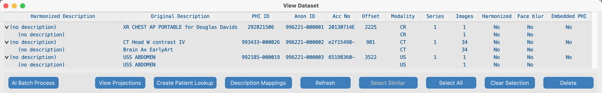

### Columns (V19)

| Column / status | Meaning |
| --- | --- |
| **Harmonized Description** (first column) | Standardized RadLex / LOINC name when set; otherwise “(no description)” |
| **Original Description** | Sticky intake Study/Series Description from import |
| **Harmonized** | Series description standardized (or study-level description applied) |
| **Face blur** | Face de-identification applied |
| **Embedded PHI** | Burned-in text scan / removal recorded |

## Analytics {#analytics}

Once at least one study is in the project, an **Analytics** control appears on the Dashboard (below **Search**, **View**, and **Send**). Expand it to see cohort charts — especially **organ volumes** after you have run [Harmonize](../08-process/03-harmonize-names/index.md) on CT/MR series.

1. From the Dashboard, click **Analytics ▸** to expand the board.
2. Use **Show** to choose which chart tiles are visible.
3. Use **Volumes** to pick which organs appear in the volume histograms.
4. Adjust **Bin width** if the histogram looks too coarse or too fine.
5. Click **Refresh** after Harmonize or new imports so volumes update.

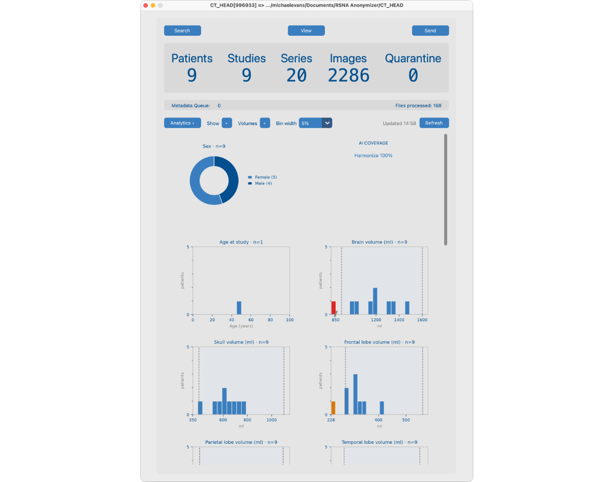

Analytics is for **review inside this project**. It does not change pixels or what you Send. **Organ-volume** histograms come from [Harmonize](../08-process/03-harmonize-names/index.md) anatomy masks on **CT/MR** (TotalSegmentator under the series cache) — not from user ROIs you paint in Annotate, and not from planar XR/US/MG. Use **Volumes** to choose organs and **Show** for demographic tiles (sex, age, modality, ethnicity, AI coverage, and volume distributions). Empty volume charts usually mean Harmonize has not produced anatomy masks yet for those series.

To **create or edit** segment labels on a series (latch TotalSegmentator chips, **New Segment**, Brush / Erase — **2D** on planar frames or **3D** on CT/MR), use Series View [Annotation](#annotation). Those labels are for review and export (NIfTI / DICOM-SEG), not for filling Analytics volume charts.

### Normative ranges on volume histograms {#analytics-normative-ranges}

Each organ volume chart is built against a **healthy-adult normative range** (millilitres) for that TotalSegmentator latch group — for example lungs, liver, or frontal lobe — not against the min–max of whatever is in your project.

- A shaded band marks the normative window; dashed lines mark its low and high bounds (hover empty band area for **Norm: [lo..hi]**).
- **Bin width** is a percentage of that stable normative span (plus a small pad). Extreme volumes do **not** stretch every bar thinner — the axis stays readable.
- Head-limited series skip truncal / whole-column organs (spine, cord, chest/abdomen soft tissue) so whole-body norms are not applied to a partial FOV.
- Custom user organs without a published range show **No normative range** and use a data-driven axis instead.

### Two kinds of outliers {#analytics-outliers}

Volumes outside the normative band are still plotted. The chart distinguishes:

| Type | Where it appears | Colour cue | Meaning |
| --- | --- | --- | --- |
| **Near outlier** | Main axis, just outside the normative band (within a few bin widths of the padded span) | Muted / distinct bar colour (not the normal accent) | Mildly low or high vs the healthy band — still on the same scale as the cohort |
| **Extreme outlier** | Separate **underflow** (far left) or **overflow** (far right) sentinel bin, with a small axis-break mark | Stronger (red) bar | Far outside the main axis — does not stretch the chart; hover shows the true ml values |

Use near outliers to spot subtle cohort skew; use extreme bars to find rare or suspicious volumes (mask error, wrong FOV, or a true clinical extreme) without flattening the rest of the histogram.

### Click a bar to open the outlier studies {#analytics-click-to-dataset}

1. Hover a histogram bar — the tip shows count / ml (and for extreme bins, the true volumes). When the bar is clickable it also says **Click to select these patients in View Dataset**.
2. **Click the bar.** Dashboard opens **View** (Dataset) if needed and selects the studies for every patient in that bin.
3. From Dataset, open [View Projections](#view-projections-full-dataset) or Series View on the highlighted rows to inspect anatomy, Harmonize status, or re-run Process tools.

This is the intended QA loop: spot an outlier band → jump to those studies → decide whether the volume is real, a FOV/mask issue, or needs Harmonize / Annotation review.

## Right-click in Dataset (most important)

Hover tips on the tree say what a right-click will do. Selection follows the row under the pointer.

**Left-click** the study or series **description** (first column) when a single row is selected — see [Edit study and series descriptions](#edit-study-and-series-descriptions) below. Use **Shift** or **Cmd/Ctrl+Click** to multi-select; then **right-click** the selection to set one description on all selected rows.

### Right-click a **study** → View Projections

Right-click a **study** row (not a nested series) to open **Projection View** for that study.

- You see summary projection images for each series in the study (useful to scan a multi-series exam quickly).
- Click a projection tile when you want to jump into full **Series View** for that series.

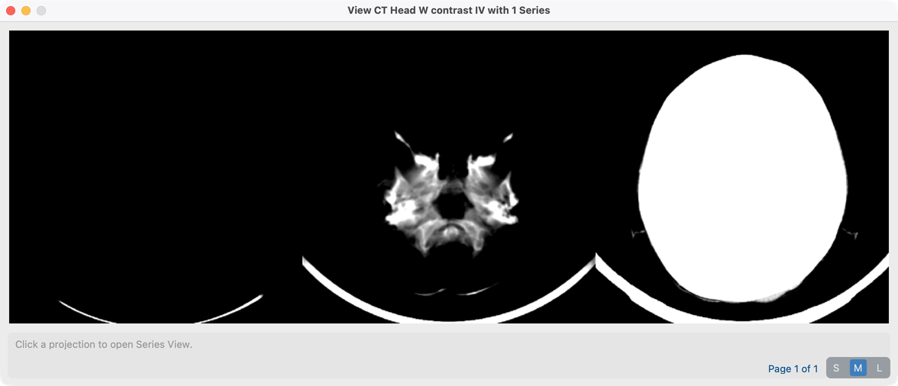

### Multiple studies → View Projections {#view-projections-full-dataset}

To browse several exams at once — including the **whole project** when you need a cohort overview:

1. In Dataset, select two or more **study** rows (Shift+Click and/or Cmd/Ctrl+Click), or use **Select All** for every study in the project.
2. Click **View Projections** in the Dataset toolbar.

The window title becomes **View N Studies with M Series** (and **over P Pages** when the grid needs paging). Each series still gets one projection tile.

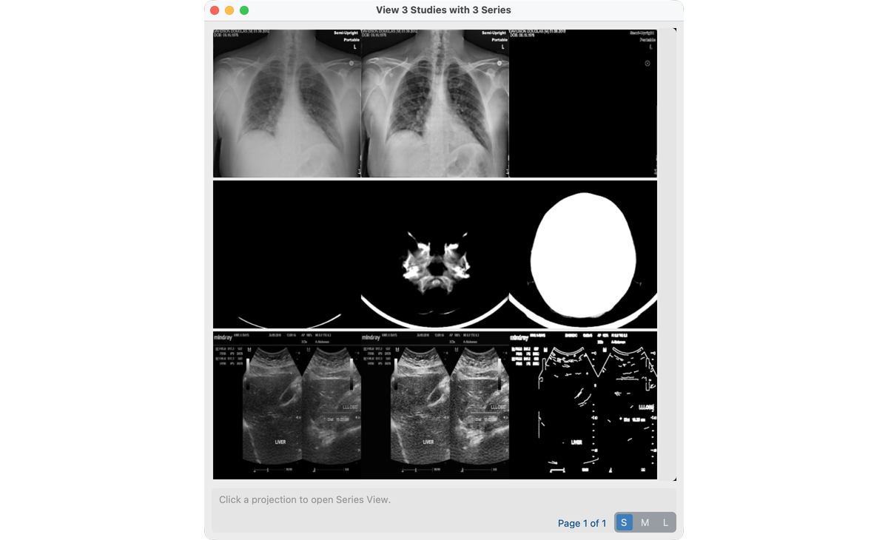

#### Scan a full dataset for burned-in (pixel) PHI {#scan-pixel-phi-with-projections}

**View Projections** on a large selection is the fastest way to **spot burned-in text before** you open Series View Detect or run [AI Batch Embedded PHI](../08-process/05-run-on-many-studies/index.md).

Why it works for pixel PHI:

- Each tile shows a compact **min / mean / max** (volumes) or **grayscale / CLAHE / edge** (single-frame) strip built from the series pixels — text overlays often stand out in CLAHE or edge panels, and bright labels show on max/mean strips.
- You can page through **all series in the selection** without opening each study one by one.
- Click a suspicious tile to jump straight into **Series View**, then run [Embedded PHI — Pixel](../08-process/02-remove-burned-in-text/index.md#pixel) Detect → Remove on that series.

Suggested cohort pass:

1. Import the cohort ([Search](../06-search/index.md)).
2. Open **Dataset** → **Select All** (or select the studies you care about).
3. Click **View Projections**. Use **S** if the grid is huge; use **M** or **L** when a tile looks suspicious.
4. Mark or note series with visible names, dates, IDs, or site logos on the pixels.
5. Open those series in Series View (or include them in AI Batch) for Detect / Remove.

Projections are a **visual triage** — they do not run OCR or update the Embedded PHI column. Confirm and clean with Series View or batch.

### Projection tiles, S / M / L, and how they are built

Each tile is a strip of **three** preview images for one series:

| Series type | Left | Center | Right |
| --- | --- | --- | --- |
| **Multi-frame** (e.g. CT stack) | **Min** intensity across frames | **Mean** | **Max** |
| **Single-frame** (e.g. CXR, many US) | Grayscale | **CLAHE** contrast | **Edge** (Canny) |

The **S / M / L** control sets how large each of those three panels is drawn (before display scaling):

| Size | Tile panel size | Typical use |
| --- | --- | --- |
| **S** | 200×200 | Fit many series on one page |
| **M** | 400×400 | Default help / review size |
| **L** | 800×800 | Inspect anatomy in the strip |

Changing size recalculates how many tiles fit per page and may add a page slider. Click any tile to open that series in **Series View**.

**What happens when a projection is created**

1. The app looks for a cached `Projection.pkl` next to the series files.
2. On a cache hit, it loads that object and draws the three images (resized to S/M/L).
3. On a miss, it loads every frame in the series, computes the three images above (windowed for multi-frame), writes `Projection.pkl`, then draws the tile.
4. Pixel edits that change the series on disk invalidate the cache so the next open rebuilds from current pixels.

This Dataset **View Projections** window is separate from the slice / min / mean / max modes inside Series View.

### Right-click a **series** → Series View {#right-click-a-series-series-view}

1. Expand the study that contains the series (for example `davidson_cxr`).
2. **Right-click the series row** (not the study row).
3. **Series View** opens and loads the images.

That is the main way to open a series for review and for Process tools (Embedded PHI, Harmonize, Face blur).

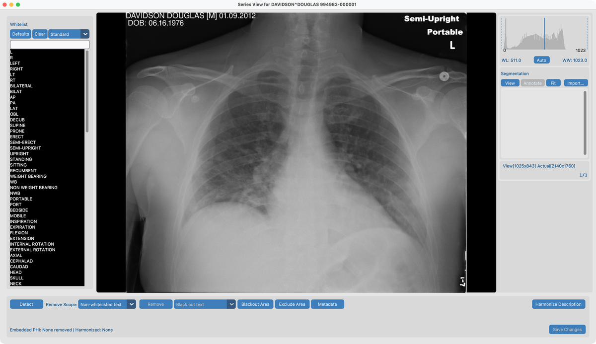

### Which window opens?

Double-click or right-click a series and the Dataset routes it by type:

| Series | Opens |
| --- | --- |
| CT, MR, US, CR, SC and other pixel data | **Series View** (with Embedded PHI tools for burned-in text) |
| Structured Report (SR) | **Report Text Review** |
| Encapsulated PDF | **Report Text Review** (Save rewrites PDF as plain de-identified text) |

## Edit study and series descriptions {#edit-study-and-series-descriptions}

After [Harmonize](../08-process/03-harmonize-names/index.md) (Series View or [AI Batch](../08-process/05-run-on-many-studies/index.md)), green **Harmonized** rows show the standardized name. You can also set RadLex / LOINC names on **unharmonized** rows from Dataset — choosing a standard name writes DICOM and marks the row harmonized (green after refresh).

Hover tooltips explain what a click or toolbar action will do (including why a button is disabled).

**Single-click** selects a row. **Double-click** a study or series description (harmonized or not) to open the **Set description** dialog. **Esc** or **Cancel** closes the dialog without saving. **Shift+Click** and **Cmd/Ctrl+Click** only change selection — they do not open the editor. With several series or studies selected (same modality), **right-click** the selection to open the same dialog for a group apply.

### Set description dialog

The dialog is a modal window (not an inline menu). It always has a short hint at the top, **Apply** / **Cancel**, and one of two work modes:

| Mode | When you see it | What you do |
| --- | --- | --- |
| **Closest list** | Harmonized series/study, or after Expand on LOINC | Filter the list, pick one name, **Apply** |
| **Compose RadLex** | Series only — **Compose RadLex…**, or auto-open on unharmonized / blank series | Pick modality-specific Playbook fields left to right (for example Anatomy / View on XR, or body part / plane / contrast on CT/MR); preview updates; **Apply** |

### Series description (RadLex)

1. Expand the study and **double-click** the **series** Harmonized Description (one row selected).
2. For a **harmonized** series you get a **closest-matches** list for that modality (for example XR views). Use the filter box if the list is long.
3. If the closest list is wrong, click **Compose RadLex…** to build the name field-by-field. Use **Show all codes** / **Closest codes** when the dialog offers that toggle.
4. An **unharmonized** or blank series opens Compose directly so you pick each RadLex field instead of inventing free text.
5. **Apply** writes Series Description, marks the row harmonized, and saves a project mapping when there was an original.

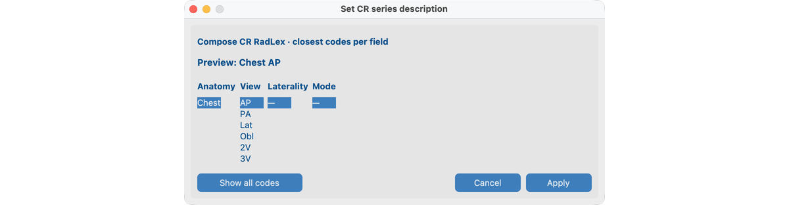

### Study description (LOINC)

1. Harmonize **all** Harmonize-eligible series in the study first (CT/MR and planar cohorts as applicable). Dataset blocks study **Set description** until that is done.
2. **Double-click** the **study** Harmonized Description in the first column (the parent row).
3. The dialog lists **closest LOINC** Long Common Names for that modality prefix (XR / US / MG / CT / MR). Each option is shown as `Long Common Name  (LoincNumber)`.
4. If the category is wrong, click **Show full LOINC catalog…** to load the full modality catalog (still filterable).
5. **Apply** updates Study Description (and Procedure Code Sequence), marks the study harmonized, and saves an original→harmonized mapping (with LOINC) for this project.

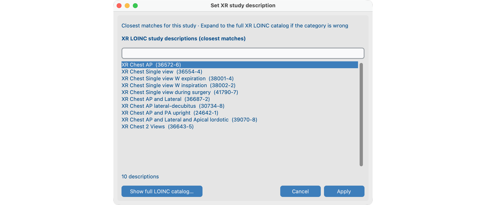

### Set description (group edit)

1. Select **only series** or **only studies**, all with the same modality cohort.
2. **Right-click** any selected row to open **Set description** for the whole group (same dialog as a single row).
3. The chosen string is applied to every selected row. Hover tips change in multi-select mode to say so.

### Select Similar

With a **single** study or series selected, **Select Similar** adds other rows that share the same **original** (intake) description text and cohort. Then right-click the selection to set one description on all selected rows.

### Description Mappings {#description-mappings}

Open **Description Mappings** from the Dataset toolbar to list, inspect, or delete saved corrections for this project. Tabs are **Series (RadLex)** and **Study (LOINC)**. Row management matches Dataset: **Select All**, **Clear Selection**, and **Delete** (multi-select with Shift / Cmd-Ctrl). Mappings are created when you apply **Set description** (**Origin** = Manual) or when AI accepts / auto-applies a description (**Origin** = succinct process label, e.g. `TS 1.5mm+brain`, `LOINC rank`, `XR body+view`). Blank originals and identity mappings (same original and harmonized text) are not stored.

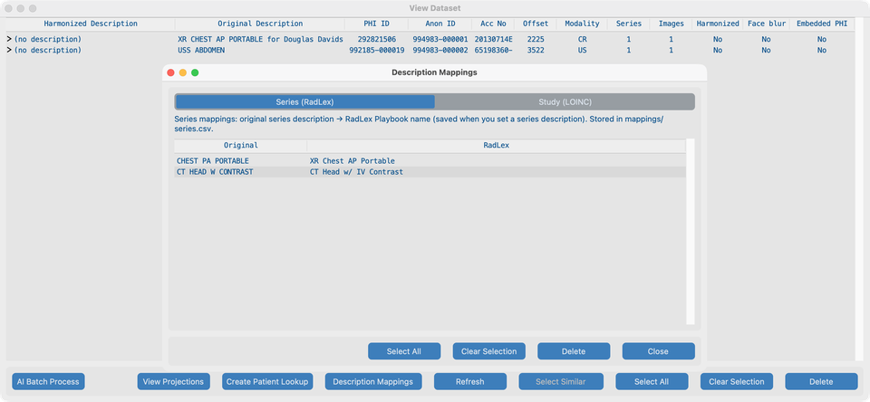

## Series View — what you can do {#series-view-what-you-can-do}

Series View is where you look at pixels and run per-series tools (models must be ready — see [AI Features setup](../03-ai-features-setup/index.md)). For a real cohort, use this window to validate Harmonize, face-blur mode, whitelists, and PHI detection **before** [AI Batch](../08-process/05-run-on-many-studies/index.md) — see [Site workflow](../08-process/index.md#recommended-site-workflow).

- Scroll frames; zoom and pan the viewport; adjust window/level
- **Metadata** — browse DICOM tags for the current image; optional **Detect PHI** on tag values (below)
- **Detect / remove burned-in text** (OCR) and whitelist editing → [Embedded PHI — Pixel](../08-process/02-remove-burned-in-text/index.md#pixel)
- **Harmonize Description** → [Harmonize names](../08-process/03-harmonize-names/index.md)
- **Face blur** (when eligible) → [Blur faces](../08-process/04-blur-faces/index.md)
- **Segmentation** — latch anatomy overlays after Harmonize, or **Annotate** to create / paint user segments — see [Annotation](#annotation)
- Manual blackout rectangles (left-drag in **View** mode)
- Clear analysis cache (does not by itself rewrite DICOM pixels)

Inside Series View, multi-frame series can also show **slice / min / mean / max** projection modes in the viewer (same idea as the multi-frame strip above, but for interactive scrolling).

Open a series as described above ([Right-click a series → Series View](#right-click-a-series-series-view)); the review chrome is the same davidson Series View shot as [Embedded PHI — Pixel](../08-process/02-remove-burned-in-text/index.md#pixel) (`Process_RemovePixel_Whitelist.png`). After Harmonize with brain structures accepted, latch chips and overlays appear on the right — see the segmented middle-slice shot in [Harmonize names](../08-process/03-harmonize-names/index.md#3-segmented-series-view) (`Process_Harmonize_SegmentedSeries.png`). Full Annotate / **New Segment** steps (**2D** or **3D** by modality), including the Brush / Erase toolbar shot, are under [Annotation](#annotation). Mouse and keyboard for the viewport are in [Mouse and keyboard (viewport)](#mouse-and-keyboard-viewport). CT/MR organ-volume **distributions** from Harmonize anatomy masks: [Analytics](#analytics).

### Metadata (DICOM tags) {#metadata-dicom-tags}

Import already replaces or removes patient identifiers in the file labels. **Metadata** lets you **spot-check** the tag tree for the **current image** — useful when a study still looks “too personal” in free-text fields, or when your project keeps more report-oriented text (for example the **Retain** preset).

This is **not** the same as burned-in text on the picture. Pixel cleanup is [Embedded PHI — Pixel](../08-process/02-remove-burned-in-text/index.md#pixel). Tag cleanup lives under [Embedded PHI — Metadata](../08-process/02-remove-burned-in-text/index.md#metadata). Reports open in [Report Text Review](../08-process/02-remove-burned-in-text/index.md#reports-and-free-text-report-text-review).

#### Steps

1. Open a series in Series View (demo: **`davidson_cxr`**, **before** Harmonize Description).
2. Click **Metadata** in the Series View toolbar.
3. Browse the tree (**Field Name**, **Tag**, **Content**). Use **Search** to narrow by field name; **Expand** / **Collapse** to open or close branches.
4. Optional — click **Detect PHI** (needs [Embedded PHI](../03-ai-features-setup/index.md) models). The dialog opens centered on Series View, sized so field names are fully visible (up to 85% of the screen height when the tag list is long). On `davidson_cxr`, **Study Description** still holds free-text PHI such as `… for Douglas Davidson` — Detect colours those spans as **First name** / **Last name**. Highlighted rows use the entity color (same highlight style as Dataset View) and show their category in the Content cell; hovering Content with detected PHI shows the entity color chip (fields without PHI have no hover tooltip). Entity colours match Report Text Review ([OpenMed types](../08-process/02-remove-burned-in-text/index.md#named-entities-openmed)). The status line summarizes counts. Detection uses the same effective modality whitelist as burned-in text: whitelisted words, DICOM code values, UIDs, and dates are not sent to the model. The dialog title names the series it belongs to, and the completion status also reports private-tag UID/date fields: those are handled at import (UID remapping / date shift), not changed by Remove / Replace PHI.
5. Optional — like Report Text Review: click a highlighted field to exclude it from cleanup, choose **Blank** or **Synthetic**, then click **Remove PHI** / **Replace PHI**. The tree updates; click **Save** to write the cleaned tags back to the current image file.
6. After **Save**, Dataset refreshes: **Original Description** shows the cleaned Study/Series Description text, and the **Embedded PHI** column updates from removed spans. Patient Lookup CSV adds **CleanedStudyDescription** / **CleanedSeriesDescription** after the sticky description columns (see [Create Patient Lookup CSV](#create-patient-lookup-csv)).
7. Click **Close** when finished (you will be asked about unsaved changes).

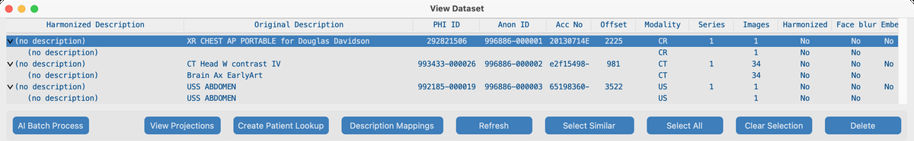

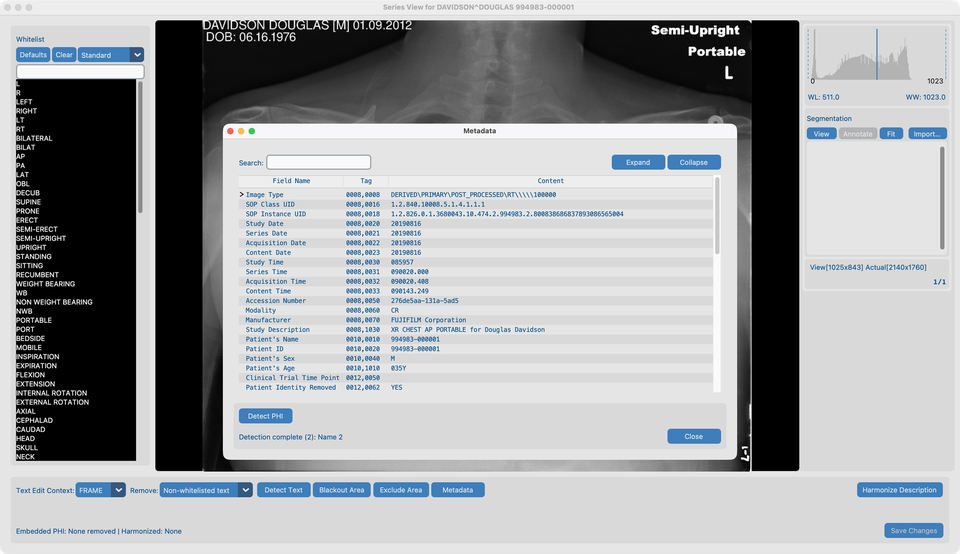

After Detect, review the coloured rows. Leave a row unselected so the orange entity colour stays visible. Click a highlighted field only if you want to **exclude** it from cleanup. Choose how to handle the rest:

- **Blank** → button reads **Remove PHI** (deletes the span).
- **Synthetic** → button reads **Replace PHI** (swaps each span for a realistic fake of the same type — “hide in plain sight”).

The demo below uses **Synthetic**: set the menu to **Synthetic**, click **Replace PHI**, then **Save** when you are ready to write the file.

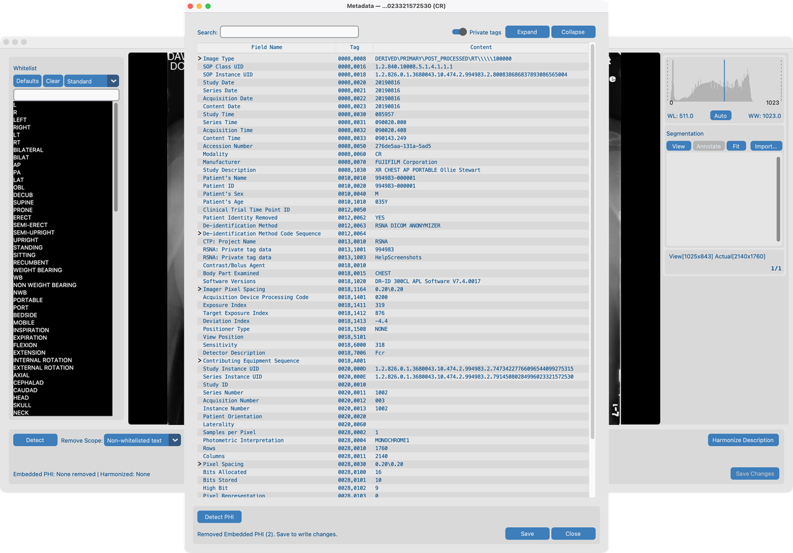

!!! note "Current image only"
    Metadata Blank / Synthetic apply to the **current image** in Series View. Use AI Batch Process when you need to clean tags across a whole series.

#### What good looks like

- The tree shows the current slice’s tags without crashing on large sequences.
- After Detect PHI, colored cells and a status rollup appear when leftover identifiers are found; **No PHI detected** is also a valid result on a clean demo.
- After **Save**, Dataset **Original Description** and **Embedded PHI** refresh; Patient Lookup CSV can include CleanedStudyDescription / CleanedSeriesDescription.

### Mouse and keyboard (viewport) {#mouse-and-keyboard-viewport}

Bindings follow a PACS-style map. The three mouse buttons and the wheel always mean the same things in Series View; only what the **left** button does changes between **View** and **Annotate**.

| Input | Action |
| --- | --- |
| **Left-click / left-drag** | **View:** draw or remove blackout / OCR boxes. **Annotate:** paint (**Brush**) or remove paint (**Erase**) on the selected segment |
| **Right-drag** | Window/level — vertical = brightness (WL), horizontal = contrast (WW) |
| **Middle mouse** drag | Pan when zoomed |
| **Double-click middle mouse** | Fit image to the viewport (reset zoom and pan) |
| **Mouse wheel** | Change slice / frame (**View**). In **Annotate**, change **brush size**; hold **Shift** + wheel to change slice instead |
| **Ctrl+wheel** (Windows/Linux) or **Cmd+wheel** (macOS) | Zoom in / out toward the pointer |
| **Shift+left-drag** | Pan (same as middle-mouse drag) |
| **Fit** button or **F** | Reset zoom and pan to fit the viewport |
| **← / → / ↑ / ↓** | Previous / next frame (one frame) |
| **Page Up / Page Down** | Jump by a larger number of frames |
| **Home / End** | First / last frame |
| **Space** | Play / pause cine (multi-frame series) |

Zoom uses nearest-neighbor magnification so voxel edges and 1 px segment outlines stay crisp for accurate brush work. Fit at 1× still uses smooth resampling for comfortable review.

### Annotation {#annotation}

Segments you latch or paint are **2D or 3D by modality**:

| Modality | Segment shape | Grid |
| --- | --- | --- |
| **CT / MR** | **3D** labels on a voxel volume | From the Harmonize / TotalSegmentator cache, or created when you Annotate / Import |
| **CR / DX (XR), US, MG** | **2D** (frame / pixel-space) ROIs | Built from Series View frames when patient orientation tags are missing — no TotalSegmentator |

Millilitre organ volumes in Dashboard [Analytics](#analytics) come from Harmonize anatomy masks on CT/MR, **not** from these user ROIs. Planar 2D annotations do not appear in Analytics volume charts.

The **Segmentation** panel shows TotalSegmentator structure chips (after Harmonize on CT/MR) and **user segments** you create or import.

#### Labelling lesions and disease areas

For dense disease ROIs (lesions, opacities, masses, and similar region labels—on CT/MR or planar XR/US/MG), use **pixel masks** in Annotate (**New Segment** + Brush / Erase, or **Import…** of NIfTI/NRRD labelmaps). That store (`0_TS_SEG/annotations/`) is the source of truth for training, area metrics, and reload in research tools.

| Hand-off | Role |
| --- | --- |
| **NIfTI ML bundle** (`labels.nii.gz` + `label_map.json`) | Preferred research interchange (Slicer, nnU-Net, local pipelines) |
| **DICOM-SEG** on [Send](../09-send/index.md#export-segments-as-dicom-seg) | DICOM-native packaging for archives and SEG-aware viewers |
| **GSPS / graphic presentation states** | Not used here—fine for arrows and text in clinical PACS, but not a dense lesion mask for AI/research |

Do not expect Orthanc Explorer, Horos, or similar casual PACS UIs to overlay SEG on the source image (CT/MR or XR). Open images + SEG together in a SEG-capable tool (for example 3D Slicer, MITK, or OHIF), or keep working from the NIfTI / in-app overlays.

#### Import Segments (research NIfTI / NRRD)

Use **Import…** to bring masks from tools researchers already use. Files land as user chips (same store as **New Segment**) for View latch and Annotate.

| Source tool | Export like this | Import preset |
| --- | --- | --- |
| **3D Slicer** / **MITK** | Labelmap as `.nii` / `.nii.gz` / `.nrrd`, or one binary volume per segment | Auto-detect or Multi-label / Binary masks |
| **ITK-SNAP** | Segmentation image + **Label Descriptions** (`.label` / `.txt`) beside it | ITK-SNAP (+ .label) |
| **TotalSegmentator** | Output folder of `structure.nii.gz`, or `--ml` multi-label NIfTI | TotalSegmentator folder, or Multi-label |
| **nnU-Net** | `labelsTr/case.nii.gz` + `dataset.json` (`labels` name→int) | nnU-Net (+ dataset.json) |
| **This app** | ML bundle `labels.nii.gz` + `label_map.json` | Auto-detect |

Volumes that do not match the series grid are nearest-neighbor resampled. Import merges with existing user labels (new ids); it does not overwrite TotalSegmentator `seg/` masks.

#### View vs Annotate

| Mode | Purpose |
| --- | --- |
| **View** | Review overlays. Click chips to **multi-select** (latch) any combination of TotalSegmentator structures and user segments. Outlines draw for every latched chip. Left-drag draws blackout rectangles, not paint. |
| **Annotate** | Edit labels. Only the **selected paint target** is drawn. **Brush** / **Erase** / size / **Undo** appear. Left-drag paints or erases. Leaving Annotate restores your previous View multi-select. |

Use **View** / **Annotate** in the Segmentation header to switch. **Esc** cancels an in-progress stroke, or returns to View if you are not painting.

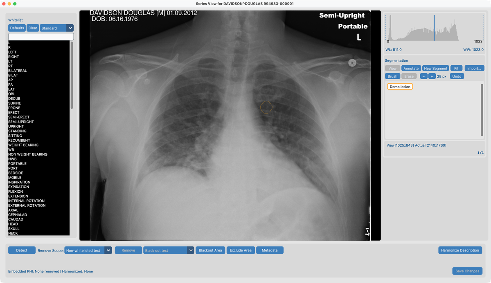

The shot shows **Annotate** active with **Brush** selected, a **Demo lesion** chip, and a painted ROI on the image. Use **Brush** (left-drag adds the selected label) or **Erase** (left-drag clears that label). Change brush size with **− / +**, **[ / ]**, or the mouse wheel; hold **Shift** + wheel to change slice. **Undo** removes the last stroke. Full mouse map: [Mouse and keyboard (viewport)](#mouse-and-keyboard-viewport).

#### Paint workflow

1. Open a series with Annotate available (CT/MR after Harmonize, or CR/DX/US/MG with a displayable frame stack).
2. Click **Annotate** so Brush / Erase / **New Segment** appear.
3. Select the paint target: click a chip, or press **1–9** for the first nine chips in the list — or **New Segment** to create a named user label (as in the shot), or **Import…** for external NIfTI/NRRD (see table above).
4. Choose **Brush** or **Erase** (or **B** / **E**). Adjust size with **− / +**, **[ / ]**, or the mouse wheel.
5. Left-drag on the image to paint. A cyan ring shows the brush footprint (canvas overlay — not part of the pixel paint).
6. Scroll slices with **Shift+wheel** (or the scrollbar / arrow keys). Zoom with **Ctrl/Cmd+wheel**; pan with middle-mouse or **Shift+left-drag**.
7. **Undo** or **Ctrl/Cmd+Z** reverts the last stroke. Strokes save automatically into the series annotate session.

| Input (Annotate) | Action |
| --- | --- |
| **Brush** / **B** | Paint the selected label |
| **Erase** / **E** | Remove paint from the selected label |
| **− / +** or **[ / ]** | Smaller / larger brush (1–64 px in image space) |
| **Mouse wheel** | Nudge brush size |
| **Shift+wheel** | Change slice while keeping Annotate mode |
| **1–9** | Select paint target by chip order |
| **New Segment** | Create a user segment and select it for painting |
| **Import…** | Import NIfTI/NRRD segments from Slicer, ITK-SNAP, TotalSegmentator, nnU-Net, etc. |
| **Undo** / **Ctrl+Z** / **Cmd+Z** | Undo last stroke |
| **Esc** | End stroke, or leave Annotate → View |

**View** multi-select vs **Annotate** exclusive target: in View you can latch brain + ventricles + a user ROI together for review; in Annotate only the chip you are editing is outlined so paint stays unambiguous.

User segments and TotalSegmentator edits persist with the series cache. Clearing analysis cache can offer to keep or delete ROI annotations. On [Send](../09-send/index.md#export-segments-as-dicom-seg), check **Export segments as DICOM-SEG** to send one Segmentation Storage file per series (BINARY, bit-packed; see [SEG format used](../09-send/index.md#seg-format-used)) as a **sibling SEG series** under the same study—not inside the source image series.

## Other Dataset actions

- Select studies for [AI Batch Process](../08-process/05-run-on-many-studies/index.md) or [Send](../09-send/index.md)
- Spot-check AI status columns after Series View or batch runs
- **Create Patient Lookup** CSV (below)

## Create Patient Lookup CSV

Use Dataset to export a spreadsheet that maps PHI identifiers to anonymized IDs (and series AI status). This is separate from the optional [CTP Patient Lookup Table](../05-create-project/anonymizer-script.md#patient-lookup-table) used at import time.

### When to use it

- Hand a mapping file to the receiving site or study coordinator
- Audit which series were harmonized, face-blurred, or had pixel PHI removed
- Keep a durable copy under the project’s private storage

### Steps

1. Open **Dataset** from the Dashboard (**View**).
2. Click **Create Patient Lookup** in the Dataset toolbar (no study selection required — the CSV covers the whole project index). Prefer exporting after [Process](../08-process/index.md) so AI status columns are populated.

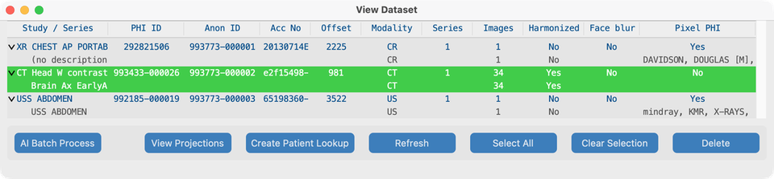

3. On success, a dialog shows the saved path. Files are written under:

   `…/<project>/private/phi_export/`

   Filename pattern:

   `{site_id}_{project_name}_PHI_{patients}_{studies}_{series}.csv`

4. Open the CSV in a spreadsheet. **One row per series** (study and patient fields are repeated on each series row). Studies with no series still emit one row with empty series columns. Help examples use **davidson CXR**, **CT head** (`CT_Head_With_Contrast`), and **ultrasound single-frame** (not synthetic phantoms).

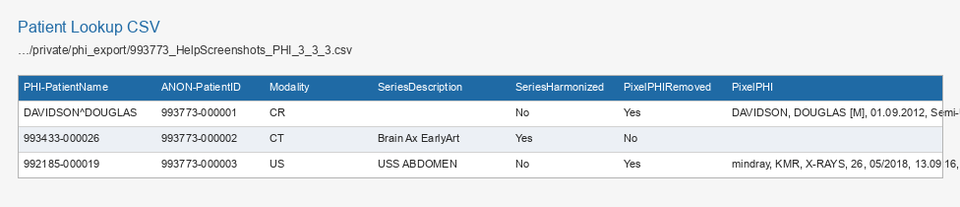

### Columns (summary)

| Group | Examples |
| --- | --- |
| Anonymized IDs | `ANON-PatientID`, `ANON-PatientName`, `ANON-StudyUID`, `ANON-SeriesUID`, `ANON-AccNo` |
| PHI counterparts | `PHI-PatientName`, `PHI-PatientID`, `PHI-StudyDate`, `PHI-StudyUID`, `PHI-AccNo` |
| Study / series | `DateOffset`, `Series`, `StudyInstances`, `StudyDescription`, `StudyHarmonizedDescription`, `Modality`, `SeriesDescription`, `SeriesHarmonizedDescription`, `Instances` |
| AI status | `SeriesHarmonized`, `FaceBlurred`, `PixelPHIRemoved`, `PixelPHI` |
| Cleaned descriptions (after metadata PHI removal) | `CleanedStudyDescription`, `CleanedSeriesDescription` (after the sticky Study/Series Description columns) |

## What good looks like

- Nested study → series tree matches what you imported (`davidson_cxr`, `CT_Head_With_Contrast`, `us_rgb_single_frame`).
- Right-click study opens projections; multi-select or **Select All** + **View Projections** opens the cohort grid (use it to [scan for burned-in pixel PHI](#scan-pixel-phi-with-projections)); right-click series opens Series View; multi-select + right-click opens **Set description**.
- Double-clicking a **series** or **study** description (single selection) opens the **Set description** dialog (RadLex list / Compose, or LOINC list / full catalog); single-click only selects the row; modifier clicks keep multi-select.
- **S / M / L** changes tile size; first open may build `Projection.pkl` under each series.
- `davidson_cxr` loads and scrolls in Series View; Ctrl/Cmd+wheel zooms, middle-mouse or Shift+left-drag pans, **F** / **Fit** resets.
- **Metadata** opens the tag tree; **Detect PHI** highlights leftover identifiers when Embedded PHI models are ready.
- After Harmonize on CT/MR, **View** multi-latches overlays and **Annotate** paints one selected segment (Brush / Erase, wheel for size). On CR/DX/US/MG, **Annotate** is available without Harmonize (pixel-space ROIs).
- AI columns update after Process tools.
- **Create Patient Lookup** writes a CSV under `private/phi_export/` that opens with the expected columns.
- Dashboard **Analytics** expands when the project has studies (organ volumes after Harmonize — see [Analytics](#analytics)). Volume charts show a normative band; near outliers sit on the main axis and extreme outliers in underflow/overflow bins; clicking a bar selects those patients in Dataset.

## If it fails

- Empty list → import first ([Search](../06-search/index.md)).
- Series missing on disk → **Series Not Found**; re-import or check storage path.
- Tools greyed out in Series View → download models / accept license in [AI Features](../03-ai-features-setup/index.md).
- Harmonize already running → finish or cancel the other series first.
- Create Patient Lookup error → ensure the project has studies in the Dataset index and that `private/phi_export/` is writable.

## Next steps

Continue with [Process](../08-process/index.md) — Embedded PHI, Harmonize, Face blur, and batch. After Harmonize on CT/MR, return here to latch / Annotate ([Annotation](#annotation)) and, separately, to review organ-volume charts from those Harmonize masks ([Analytics](#analytics)). After review, [Send](../09-send/index.md) anonymized patients (optionally [export segments as DICOM-SEG](../09-send/index.md#export-segments-as-dicom-seg)).
