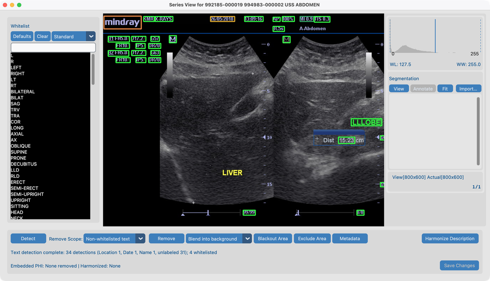

# 8.1 Embedded PHI (burnt-in text)

Some images have **patient names or labels drawn onto the pixels**. Cleaning DICOM tags alone does not remove them. **Embedded PHI** combines OCR (pixels) with English NER (free text / reports). Ingest never runs NER/OCR — use this after import.

## Demo series

| Series | Path | Used for |
| --- | --- | --- |
| **`davidson_cxr`** | `tests/controller/assets/test_dcm_files/davidson_cxr` | Whitelist → Detect → **Black out** |
| **`us_rgb_single_frame`** | `tests/controller/assets/test_dcm_files/us_rgb_single_frame` (`US_RGB_SingleFrame.dcm`) | Detect → **Blend into background**; **Exclude Area** on the machine-parameter block under **mindray** |

Import each folder into your project, then open the series in **Series View**.

## Goal

1. On `davidson_cxr`, detect burned-in text and **black out** PHI while keeping useful markers via the default whitelist.
2. On `us_rgb_single_frame`, detect burned-in text and remove it by **blending into the background** (inpaint).
3. On the same color US series, mark the non-PHI machine-parameter strip with **Exclude Area** so Detect and Remove skip it.

## Before you start

1. Complete [AI Features setup](../../03-ai-features-setup/) so OCR models are ready.
2. Import the demo series and open them in Series View from [Dataset](../../07-view/).

## Workflow on `davidson_cxr` (black out)

Follow these steps in order. Screenshots match this fixture.

### 1. Default whitelist and Frame context

1. Keep the **default whitelist** (do not clear it).
2. Set **Remove Scope** to **Non-whitelisted text** (default). **Edit Context** defaults to **Frame**; on a single-frame series like this one it is not shown (there is no Frame/Series choice to make).

### 2. Detect Embedded PHI

1. Click **Detect**.
2. Wait until detection finishes. **Green rectangles** mark text that would be removed for the current **Remove Scope**. Named Entity Recognition (NER) labels (First name, Last name, Location, Date, ID, Phone, Email) color the boxes; unlabeled text stays boxed when **Remove Scope** is **Non-whitelisted text** or **All text**.

Detect classifies with the **whole frame as context** (all OCR boxes of the frame in reading order go to the NER model in one call, joined as a comma list since each box is a distinct field). Each rectangle is still one OCR box, and a labelled box is removed **whole** — including anything else inside it that the model did not tag separately, such as the `DOB:` prefix before a date or the `[M]` marker after a name. Hovering a PHI rectangle shows only its NER category (bold caps on the category colour), not the detected text.

**Remove Scope** (the menu next to **Detect**) chooses what Detect shows and what Remove deletes. Changing it after a detection simply re-filters the detected boxes: **Remove** stays enabled as long as bounded text remains within the Edit Context under the new scope. **Remove** is only enabled when text has been identified for removal:

| Target | Effect |
| --- | --- |
| **Non-whitelisted text** (default) | Remove OCR that is not a whitelist match (and not in an exclude area) |
| **PHI only** | Remove only NER-labeled PHI (names, dates, IDs, phones, emails). Unlabeled text and whitelist matches are left — the whitelist is a veto in every scope except **All text** |
| **All text** | Remove every detected box; whitelist is ignored |

The toolbar buttons are simply **Detect** (next to **Edit Context**) and **Remove**. Hover the Remove Scope menu for the full Named Entity Recognition (NER) explanation. Black out vs blend (inpaint) stays a separate dropdown.

On this chest X-ray you should see green boxes around the patient name, date, DOB, and similar PHI — but **not** around **Portable** or **L**. Those words are already on the default whitelist, so Detect Embedded PHI leaves them alone.

**Whitelist match dropdown** (next to Defaults / Clear — here set to **Standard**):

Controls how closely OCR text must match a whitelist entry to be treated as a keeper:

| Setting | Effect |
| --- | --- |
| **Exact** | Only hide text that matches a whitelist entry letter-for-letter |
| **Strict** | Almost exact — tiny OCR mistakes only |
| **Standard** (default) | Allows small OCR errors (for example `AXIL` still matches `AXIAL`) |
| **Lenient** | Most forgiving — better for noisy text and short markers |

Use a stricter setting if too much text is skipped; use a looser one if useful markers keep getting boxed.

### 3. Review and whitelist keepers

1. If a green rectangle covers text you want to **keep**, click that rectangle.
2. The text is added to the whitelist on the left and will not be removed.

On `davidson_cxr`, **Portable** and **L** are already covered by the default whitelist — you usually do not need to add them again.

### 4. Remove Embedded PHI using black out

1. Set the removal mode dropdown to **Black out text**.
2. Click **Remove**.
3. PHI regions become solid black; whitelisted keepers stay.
4. Click **Save Changes** when you are satisfied.

Black out is the usual choice for de-identification: removed text is clearly gone and cannot be recovered from the pixels.

## Workflow on `us_rgb_single_frame` (blend into background)

Use this color ultrasound frame when you want removed text to look like nearby tissue instead of black bars.

### 5. Remove Embedded PHI using blend with background

1. Import and open **`us_rgb_single_frame`** (`US_RGB_SingleFrame.dcm`) in Series View.
2. Keep edit context on **Frame**.
3. Set the removal mode dropdown to **Blend into background**.
4. Click **Detect** and wait for the green rectangles.

5. Click **Remove**.
6. Detected text is painted out by blending with surrounding pixels (inpaint), then **Save Changes**.

**Black out** vs **Blend into background**: black out replaces text with black; blend fills the area so it matches the image around it. Prefer black out when you need an obvious, irreversible redaction; prefer blend when a less conspicuous result is acceptable (for example some ultrasound overlays).

## Workflow on Color US (Exclude Area)

Use the same **`us_rgb_single_frame`** series when OCR boxes machine settings that are **not PHI**. **Exclude Area** skips a spatial region for Detect Embedded PHI and Remove Embedded PHI without changing pixels (unlike **Blackout Area**).

### 6. Exclude the parameter block under mindray

On this frame, a dense block of machine parameters (gain, depth, FR, DR, and similar tokens) sits on the **upper left**, directly **below** the **mindray** logo.

1. Open **`us_rgb_single_frame`** in Series View with edit context **Frame**.
2. Draw a rectangle covering that parameter block (leave **mindray** and true PHI / site labels outside if you still want them detected). Pending draws appear as **solid blue** rectangles.
3. Click **Exclude Area**. The rectangle moves to the exclude list and redraws as a **white dotted outline** (no fill). **Save Changes** stores the current exclude set for this modality without changing pixels when that is the only pending change. Hover the button to see whether pixel edits, exclude-area edits, or both will be saved.

4. Click **Detect**. Green boxes should appear on PHI / vendor text **outside** the block; the parameter tokens inside the dotted region should **not** be boxed for removal.

5. Optionally choose **Blend into background** or **Black out text**, then **Remove** and **Save Changes**.
6. Click a white dotted rectangle to remove it from the exclude list if you need to adjust.

**Whitelist** vs **Exclude Area** vs **Blackout Area**: whitelist keeps specific OCR *strings*; Exclude Area skips a *region* (no pixel change); Blackout Area paints drawn rectangles black. Prefer setting exclude rectangles **before** Detect Embedded PHI (or Detect again after adjusting). With **Series** edit context, drawing propagates across frames so the same panel can be excluded on a cine loop.

## After the demo

- Dataset **Pixel PHI** status should update for each series you saved.
- Modality whitelists and the match dropdown (Exact → Lenient) live in Series View; stricter matching means fewer OCR hits are treated as whitelist keepers.
- Exclude regions are session-only until **Save Changes**. Active rectangles (including removals of previously saved ones) are written to `whitelists/{modality}.exclude.json` next to the modality whitelist. Clearing all areas removes that file. AI Batch applies those areas when **Enable Exclude Areas** is on.
- To run the same tool on many studies, see [8.4 Run on many studies](../05-run-on-many-studies/).

## What good looks like

- On `davidson_cxr`: PHI blacked out; orientation markers kept if whitelisted.
- On `us_rgb_single_frame`: burned-in labels blended away without solid black bars; with Exclude Area, the mindray parameter block is not removed as PHI.
- **Embedded PHI** column updates in Dataset (removed PHI text only).

## Tag metadata vs burned-in text

| What you see | Where to look |
| --- | --- |
| Names / IDs still in **DICOM tags** after import | Series View → [Metadata](../../07-view/#metadata-dicom-tags) (Detect PHI highlights; does not rewrite tags) |
| Text **drawn on the image** | This chapter (Detect → Remove) |
| Text inside **SR / Encapsulated PDF** | Report Text Review (below) |

## Reports and free text (Report Text Review)

Structured Reports (and Encapsulated PDFs) open in **Report Text Review** instead of Series View:

1. Click **Detect Embedded PHI**. Detected spans are colored by type (Name, Location, ID, Phone, Date, Email) in the text and listed in the table.
2. Untick rows in the table to **exclude** spans you want to keep.
3. Pick **Blank** (delete the span) or **Synthetic** (replace with a fake value of the same type and similar shape — “hide in plain sight”), then **Remove Embedded PHI**.
4. **Save** writes the report. For Encapsulated PDF, Save replaces the PDF bytes with a plain-text de-identified document (layout is not preserved). Only the **original removed PHI text** is recorded in the Dataset’s Embedded PHI column — never the report body, and never the synthetic replacements.

Synthetic values are derived deterministically from the project and the anonymized patient ID, so the same input gives the same fake every time. Pixels always use Blackout / Inpaint; Synthetic applies to text only.

Free-text DICOM attributes (image comments, protocol/procedure descriptions, …) use the same detector through the text batch.

### Scanned text reports

If a Secondary Capture series looks like a text report (for example a dose or worksheet page), **Save** in Series View also writes the PHI-cleansed OCR transcript as a **Basic Text SR** in the same study for research use. The SR is a derivative; it is not recorded in the Embedded PHI column.

## If it fails

- Many false boxes → tighten match strictness; whitelist keepers; or **Exclude Area** for whole panels.
- Missed text → manual **Blackout Area**.
- Parameter text still boxed → enlarge the exclude rectangle and Detect again; click dotted outlines to delete and redraw.
- Tools greyed out → finish [AI Features](../../03-ai-features-setup/).

## Next steps

Continue with [8.2 Harmonize names](../03-harmonize-names/) using **`CT_Head_With_Contrast`**.
