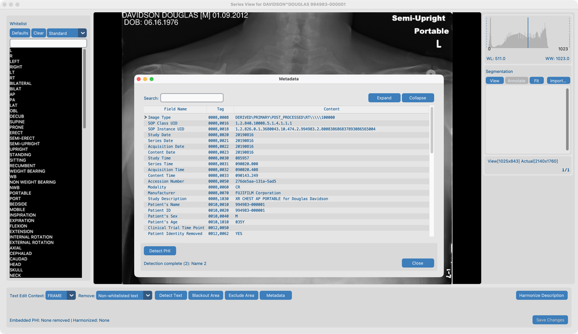
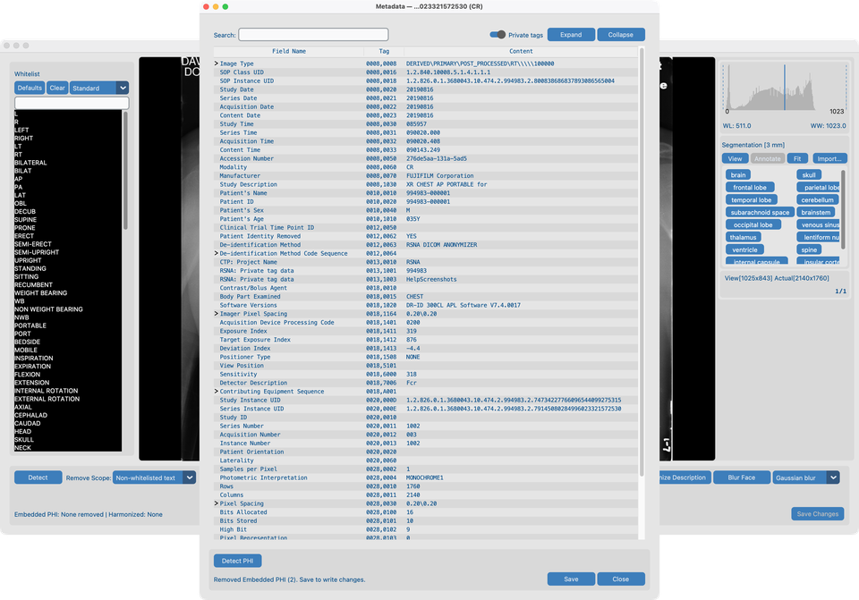

# 8.1 Embedded PHI

**Embedded PHI** finds and removes protected health information that remains **after** tag anonymization at import: text drawn on image pixels, and PHI inside report / free-text content. It uses OCR (pixels) and English named-entity recognition (NER). Ingest never runs NER/OCR.

| Section | What it covers | Where you work |
| --- | --- | --- |
| [Pixel](#pixel) | Burnt-in text on image pixels | Series View |
| [Text › Metadata](#metadata) | Tag values still holding PHI after import | Series View / Report → **Metadata** |
| [Text › Reports](#reports) | Structured Reports, Encapsulated PDF, free-text body | **Report Text Review** (and text batch) |

Finish [AI Features setup](../../03-ai-features-setup/index.md) (Embedded PHI pack) before these sections.

### Named entities (OpenMed)

The Embedded PHI pack’s English NER is **OpenMed ClinicalE5-Small**. Detect colours each hit by type (type name uses that colour):

| Type | Examples |
| --- | --- |
| **First name** | Burnt-in given name on pixels (e.g. `DOUGLAS`); given name in Study Description or a report |
| **Last name** | Burnt-in family name (e.g. `DAVIDSON`); surname in Study Description or a report |
| **Location** | Hospital / site / city text on overlays or in free-text tags and reports |
| **ID** | MRN or similar identifiers in report / free-text tag values |
| **Phone** | Phone numbers in reports or free-text tags |
| **Date** | Burnt-in dates / DOB strings; dates in Study Description or reports |
| **Email** | Email addresses in reports or free-text tags |

On **pixels**, First name and Last name collapse to one **Name** box colour (same family as First name). On **Metadata** and **Report Text Review** they stay separate. Hover a coloured span or box to see its type.

---

## Pixel {#pixel}

Burnt-in names and labels drawn onto the image. Cleaning DICOM tags alone does not remove them.

### Demo series

Repository folder: `tests/controller/assets/test_dcm_files/` ([GitHub](https://github.com/RSNA/anonymizer/tree/dev/tests/controller/assets/test_dcm_files); [how to get them](../../06-search/index.md#demo-studies-from-the-repository)).

| Series | Path in repository | Used for |
| --- | --- | --- |
| **`davidson_cxr`** | `tests/controller/assets/test_dcm_files/davidson_cxr` | Whitelist → **Detect** → **Black out text** |
| **`us_rgb_single_frame`** | `tests/controller/assets/test_dcm_files/us_rgb_single_frame` (`US_RGB_SingleFrame.dcm`) | **Detect** → **Blend into background**; **Exclude Area** on the machine-parameter block under **mindray** |

Import each folder into your project, then open the series in **Series View** from [Dataset](../../07-view/index.md).

### Goal

1. On `davidson_cxr`, detect burned-in text and **black out** PHI while keeping useful markers via the default whitelist.
2. On `us_rgb_single_frame`, detect burned-in text and remove it by **blending into the background** (inpaint).
3. On the same color US series, mark the non-PHI machine-parameter strip with **Exclude Area** so Detect and Remove skip it.

### Series View toolbar

Left-to-right on the text-edit bar:

| Control | Role |
| --- | --- |
| **Edit Context** | **Frame** or **Series**. Hidden on single-frame series (no choice to make). |
| **Detect** | Run OCR (+ NER labelling). Boxes show what **Remove** would delete for the current **Remove Scope**. Pixels are not changed. |
| **Remove Scope** | **Non-whitelisted text** (default), **PHI only**, or **All text**. Filters which detections are boxed and what **Remove** deletes. Changing scope after Detect re-filters existing boxes; **Remove** stays enabled while boxed text remains under the new scope. |
| **Remove** | Delete boxed text using the removal mode menu. Disabled until Detect has identified text for removal. |
| Removal mode menu | **Black out text** or **Blend into background**. |
| **Blackout Area** | Paint drawn user rectangles black (manual). |
| **Exclude Area** | Convert drawn rectangles into keep-out zones for Detect/Remove (no pixel change). |
| **Metadata** | DICOM tag tree for the current slice ([Detect PHI / Remove PHI](../../07-view/index.md#metadata-dicom-tags) on tag values). |

**Save Changes** (bottom right) writes pixel edits and/or modality exclude-area files. Hover it to see what will be saved.

Left panel: **Whitelist** with **Defaults**, **Clear**, match mode (**Exact** / **Strict** / **Standard** / **Lenient**), search, and the keeper list.

### Workflow on `davidson_cxr` (black out)

#### 1. Default whitelist and Remove Scope

1. Keep the **default whitelist** (do not **Clear** it).
2. Leave **Remove Scope** on **Non-whitelisted text**.
3. On this single-frame series, **Edit Context** is hidden.

#### 2. Detect

1. Click **Detect**.
2. Wait until detection finishes. Rectangles mark text that would be removed for the current **Remove Scope**. NER colours boxes by category (**Name**, **Location**, **Date**, **ID**, **Phone**, **Email**); unlabeled OCR stays boxed when scope is **Non-whitelisted text** or **All text**.

Detect classifies with the **whole frame as context** (OCR boxes in reading order joined for one NER call). Each rectangle is still one OCR box and is removed **whole** — including unmarked prefixes or suffixes inside the same box (the `DOB:` prefix before a date; the `[M]` marker after a name). Hover a PHI rectangle to see its NER category (bold caps on the category colour), not the detected string.

| Remove Scope | Effect |
| --- | --- |
| **Non-whitelisted text** (default) | Remove OCR that is not a whitelist match and not in an exclude area |
| **PHI only** | Remove only NER-labelled PHI. Unlabeled text and whitelist matches stay; whitelist still vetoes keepers |
| **All text** | Remove every detected box; whitelist is ignored |

On `davidson_cxr` with the default whitelist and **Remove Scope: Non-whitelisted text**, Detect draws **four** boxes: **DAVIDSON** and **DOUGLAS [M]** (Name), **01.09.2012** and **DOB: 06.16.1976** (Date). It does **not** box **Semi-Upright**, **Portable**, or **L** (default whitelist keepers).

**Whitelist match** (next to Defaults / Clear — default **Standard**):

| Setting | Effect |
| --- | --- |
| **Exact** | Keeper only on letter-for-letter match |
| **Strict** | Almost exact — tiny OCR mistakes only |
| **Standard** (default) | Small OCR errors allowed (`AXIL` still matches `AXIAL`) |
| **Lenient** | Most forgiving — noisy text and short markers |

Use a stricter setting if too much text is skipped; looser if useful markers keep getting boxed.

#### 3. Review and whitelist keepers

1. If a green rectangle covers text you want to **keep**, click that rectangle.
2. The text is added to the whitelist on the left and will not be removed.

On `davidson_cxr`, **Semi-Upright**, **Portable**, and **L** are already on the default DX whitelist.

#### 4. Remove with black out

1. Set the removal mode menu to **Black out text**.
2. Click **Remove**.
3. PHI regions become solid black; whitelisted keepers stay.
4. Click **Save Changes** when satisfied.

Black out is the usual de-identification choice: removed text is clearly gone and cannot be recovered from the pixels.

### Workflow on `us_rgb_single_frame` (blend into background)

Use this color ultrasound frame when removed text should look like nearby tissue instead of black bars.

#### 5. Remove with blend

1. Import and open **`us_rgb_single_frame`** (`US_RGB_SingleFrame.dcm`) in Series View.
2. Set the removal mode menu to **Blend into background**.
3. Click **Detect** and wait for the green rectangles.

4. Click **Remove**.
5. Detected text is painted out by blending with surrounding pixels (inpaint), then **Save Changes**.

**Black out text** replaces text with black. **Blend into background** fills the area to match surrounding pixels. Prefer black out for obvious, irreversible redaction; prefer blend when a less conspicuous result is acceptable (ultrasound overlays).

### Workflow on Color US (Exclude Area)

Use the same **`us_rgb_single_frame`** series when OCR boxes machine settings that are **not PHI**. **Exclude Area** skips a spatial region for Detect and Remove without changing pixels (unlike **Blackout Area**).

#### 6. Exclude the parameter block under mindray

On this frame, a dense block of machine parameters (gain, depth, FR, DR, and similar tokens) sits on the **upper left**, directly **below** the **mindray** logo.

1. Open **`us_rgb_single_frame`** in Series View.
2. Draw a rectangle covering that parameter block (leave **mindray** and true PHI / site labels outside if you still want them detected). Pending draws appear as **solid blue** rectangles.
3. Click **Exclude Area**. The rectangle moves to the exclude list and redraws as a **white dotted outline** (no fill). **Save Changes** stores the current exclude set for this modality without changing pixels when that is the only pending change.

4. Click **Detect**. Green boxes should appear on PHI / vendor text **outside** the block; parameter tokens inside the dotted region should **not** be boxed for removal.

5. Optionally choose **Blend into background** or **Black out text**, then **Remove** and **Save Changes**.
6. Click a white dotted rectangle to remove it from the exclude list if you need to adjust.

**Whitelist** keeps specific OCR *strings*. **Exclude Area** skips a *region* (no pixel change). **Blackout Area** paints drawn rectangles black. Prefer setting exclude rectangles **before** Detect (or Detect again after adjusting). With **Series** edit context (multi-frame), drawing propagates across frames so the same panel can be excluded on a cine loop.

### After pixel work

- Dataset **Embedded PHI** status updates for each series you saved (removed PHI text only).
- Modality whitelists and the match dropdown live in Series View; stricter matching means fewer OCR hits count as keepers.
- Exclude regions are session-only until **Save Changes**. Active rectangles (including removals of previously saved ones) are written to `whitelists/{modality}.exclude.json` next to the modality whitelist. Clearing all areas removes that file. AI Batch applies those areas when **Enable Exclude Areas** is on.
- To run pixel Embedded PHI on many studies, see [8.4 Run on many studies](../05-run-on-many-studies/index.md).

### What good looks like (pixel)

- On `davidson_cxr`: PHI blacked out; orientation markers kept if whitelisted.
- On `us_rgb_single_frame`: burned-in labels blended away without solid black bars; with Exclude Area, the mindray parameter block is not removed as PHI.

### If pixel work fails

- Many false boxes → tighten match strictness; whitelist keepers; or **Exclude Area** for whole panels.
- Missed text → manual **Blackout Area**.
- Parameter text still boxed → enlarge the exclude rectangle and Detect again; click dotted outlines to delete and redraw.
- Tools greyed out → finish [AI Features](../../03-ai-features-setup/index.md).

---

## Text {#text}

PHI in **tag values** and in **report / free-text bodies** — not drawn on pixels. Same Embedded PHI NER pack as pixel work.

### Metadata {#metadata}

Tag values that can still hold PHI after import (comments, descriptions, leftover free-text fields). Work in Series View or Report Text Review via **Metadata**.

Full steps (tree browse, **Detect PHI**, Blank vs Synthetic, **Remove PHI** / **Replace PHI**, current-image save): [View → Metadata (DICOM tags)](../../07-view/index.md#metadata-dicom-tags).

**Clear example — `davidson_cxr` before Harmonize.** Import leaves patient identifiers out of the usual name/ID tags, but **Study Description** can still hold free text such as `XR CHEST AP PORTABLE for Douglas Davidson`. Run Metadata **before** Harmonize Description so you can see that leftover PHI.

1. Open **`davidson_cxr`** in Series View (do **not** Harmonize yet — status should still show Harmonized: None).
2. Click **Metadata**, then **Detect PHI**.
3. Review the highlighted **Study Description** row: the name spans are coloured as **First name** / **Last name** (leave the row unselected so the orange highlight stays visible).

4. Optionally click a highlighted field to **exclude** it. Choose **Blank** (delete) or **Synthetic** (fake value of the same type). With **Synthetic** selected, click **Replace PHI**, then **Save**.

The same Metadata dialog opens from Report Text Review (**Metadata** in the report toolbar) for the current report file.

!!! note "Current image / file only"
    Metadata Blank / Synthetic apply to the **current** image or report file. Use [AI Batch](../05-run-on-many-studies/index.md) when you need tag cleanup across a series or cohort.

### Reports {#reports}

PHI inside **Structured Reports**, **Encapsulated PDF**, and other free-text document bodies. Opens in **Report Text Review** instead of Series View.

#### Report Text Review {#reports-and-free-text-report-text-review}

Demo fixture: **`demo_report_pdf`** (synthetic radiology report) at `tests/controller/assets/test_dcm_files/demo_report_pdf` ([GitHub](https://github.com/RSNA/anonymizer/tree/dev/tests/controller/assets/test_dcm_files/demo_report_pdf); [how to get them](../../06-search/index.md#demo-studies-from-the-repository)). Import must use **Clean Structured Content** so Encapsulated Document / SR text is kept for review.

1. Open the demo report. The left pane shows the PDF page; the right pane shows the extractable text.
2. Click **Detect PHI**. Spans on the **right** light up by type (**First name**, **Last name**, **Location**, **ID**, **Phone**, **Date**, **Email**) — same OpenMed colours as [Named entities](#named-entities-openmed).
3. Click a highlight to **exclude** a span you want to keep.
4. Pick **Blank** (delete the span) or **Synthetic** (replace with a fake value of the same type and similar shape), then **Remove PHI** / **Replace PHI**.
5. **Save** writes the report. For Encapsulated PDF, Save replaces the PDF bytes with a plain-text de-identified document (layout is not preserved). Only the **original removed PHI text** is recorded in the Dataset Embedded PHI column — never the report body, and never the synthetic replacements.
6. Optional — click **Metadata** in the Report toolbar for tag cleanup on this file ([Metadata](#metadata) above).

Synthetic values are derived deterministically from the project and the anonymized patient ID. Pixel removal always uses Black out / Blend; **Synthetic** applies to text only.

#### Scanned text reports

If a Secondary Capture series looks like a text report (dose or worksheet page), use [Pixel](#pixel) tools first. **Save Changes** in Series View can also write the PHI-cleansed OCR transcript as a **Basic Text SR** in the same study for research use. The SR is a derivative; it is not recorded in the Embedded PHI column.

#### Free-text in batch

Comments, protocol/procedure descriptions, and similar free-text attributes across many studies: use the text path in [AI Batch](../05-run-on-many-studies/index.md).

### If text work fails

- Tools greyed out → finish [AI Features](../../03-ai-features-setup/index.md).
- Empty report body after import → enable **Clean Structured Content** (and SR/PDF modalities) before import so document bytes are kept for review.

---

## Next steps

Continue with [8.2 Harmonize names](../03-harmonize-names/index.md) using **`CT_Head_With_Contrast`**.
