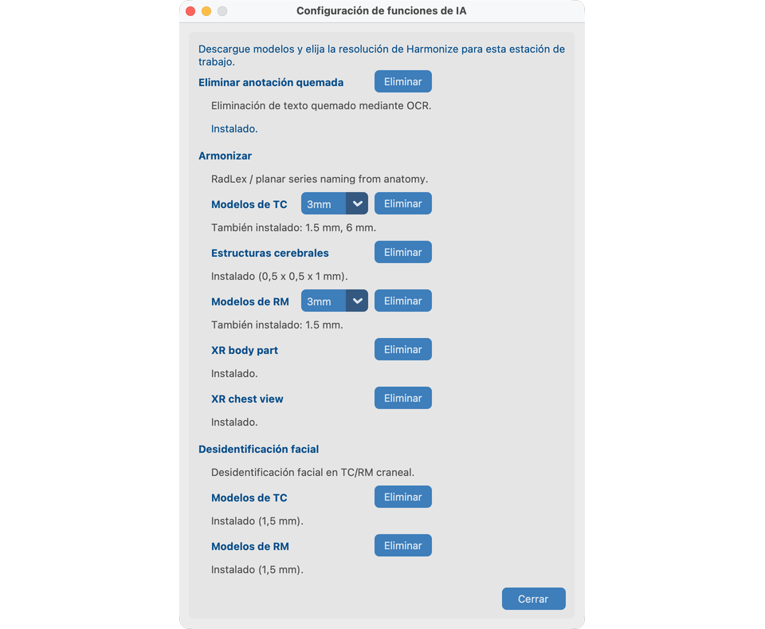

# Configuración de Funciones de IA

Las Funciones de IA son **opcionales**. Se ejecutan en su ordenador tras una descarga única. Las imágenes no se suben para procesarlas.

Haga este capítulo **antes** de los recorridos de herramientas con `davidson_cxr` y `CT_Head_With_Contrast`.

## Objetivo

Descargar los modelos que necesita y elegir la resolución de Harmonize para esta estación de trabajo.

## Abrir la configuración

Solo desde la pantalla **Bienvenido**: pulse **Funciones de IA**.

Cierre el proyecto (o inicie la aplicación) para volver a Bienvenido si necesita descargar modelos o cambiar la resolución de Harmonize más adelante.

!!! note "Cuando todos los modelos están descargados"
    Cada fila muestra **Instalado** (con un detalle breve, p. ej. la resolución) y un botón **Quitar** en lugar de **Descargar**. Las filas Harmonize CT/MR conservan un menú de resolución; las resoluciones adicionales ya en disco aparecen como “También instalado: …”. La captura de arriba muestra ese estado completamente instalado.

## Modelos en este diálogo

Cada fila es una **descarga de esta estación**. **No hay casillas de activar/desactivar por proyecto** — instale aquí; las herramientas correspondientes se desbloquean luego en [Vista](../07-view/index.md) y [Procesar](../08-process/index.md) (incluido [ejecutar en muchos estudios](../08-process/05-run-on-many-studies/index.md)).

| Función | Qué desbloquea después | ¿Descargar? |
| --- | --- | --- |
| **Embedded PHI** (OCR + NER en inglés, un paquete) | Limpieza de texto quemado, revisión de texto de informe y Metadatos **Detectar PHI** | Sí, si limpia píxeles, informes o texto de etiquetas |
| **Harmonize** CT/MR + resolución (1.5 / 3 / 6 mm) | Máscaras de órganos TotalSegmentator para CT/MR — nombres de serie estandarizados y volúmenes de órganos para revisar en [Analytics del Panel](../07-view/index.md#analytics) | Sí, si Armoniza CT/MR o usa Analytics de volúmenes — elija una resolución |
| **Harmonize** parte del cuerpo XR | Ayuda extra de anatomía por píxeles para CR/DX cuando faltan o fallan las etiquetas | Sí, si Armoniza radiografía general |
| **Harmonize** proyección de tórax XR | AP/PA/Lat por píxeles (+ rotación) para CR/DX de tórax | Sí, si Armoniza radiografía general (tórax) |
| **Desidentificación facial** | Desenfoque facial en CT/MR de cabeza elegibles | Sí, si está curando CT/MR de cabeza |
| **Estructuras cerebrales** | Máscaras extra de estructuras cerebrales en CT/MR de cabeza (con Harmonize) — revisar anatomía y distribuciones de volumen de estructuras de interés en [Analytics del Panel](../07-view/index.md#analytics) | Sí, si cura CT/MR de cabeza y usa Analytics de volúmenes de órganos — licencia |

Harmonize XR funciona sin los paquetes de parte del cuerpo XR o proyección de tórax (solo etiquetas / palabras clave DICOM). Cuando están instalados, las series CR/DX pueden usar:

- Clasificador de parte del cuerpo EfficientNet-B4 ([Xp-Bodypart-Mislabel-Checker](https://huggingface.co/spaces/MedicalAILabo/Xp-Bodypart-Mislabel-Checker); [Mitsuyama et al., *European Radiology* 2025](https://doi.org/10.1007/s00330-025-12053-7)), fusionado con la anatomía DICOM.
- Clasificador de proyección/rotación solo tórax ([CXp-Projection-Rotation-Mislabel-Checker](https://huggingface.co/spaces/MedicalAILabo/CXp-Projection-Rotation-Mislabel-Checker); el mismo artículo de [Mitsuyama et al.](https://doi.org/10.1007/s00330-025-12053-7)) para refinar AP/PA/Lat; la rotación se muestra en la tabla de análisis de Harmonize y no se escribe en SeriesDescription.

Mamografía y ecografía no usan estos modelos.

## Pasos la primera vez

1. Abra **Funciones de IA**.
2. Descargue **Quitar texto quemado**, **Harmonize** (CT) y **Desidentificación facial**.
3. Introduzca o valide la licencia académica cuando se le pida (cara / estructuras cerebrales).
4. Elija la resolución CT de Harmonize; descargue si falta el paquete.
5. Opcionalmente descargue **Estructuras cerebrales** y/o **parte del cuerpo XR** / **proyección de tórax XR** si necesita esos extras.
6. Cierre el diálogo. Las preferencias permanecen en esta estación de trabajo.

!!! tip "Internet solo para la descarga"
    Tras tener modelos y licencia, el procesamiento es local. En **macOS**, instale la biblioteca C++ OpenMP antes de usar Harmonize / Funciones de IA relacionadas: `brew install libomp` (véase [Instalación](../02-install/index.md#4-macos-only-openmp-for-ai-features)).

## Quitar modelos

Use **Eliminar** en la tarjeta de una herramienta para borrar los archivos descargados. Esto no deshace los cambios ya escritos en las imágenes anonimizadas.

## Cómo se ve cuando va bien

- El estado muestra listo para OCR, Harmonize CT y Face.
- Tras el import, puede ejecutar las herramientas de [Procesar](../08-process/index.md) correspondientes en las series de demo (capítulos 8.1–8.3).

## Si falla

- Descarga incompleta → compruebe la red e inténtelo de nuevo.
- TotalSegmentator / OpenMP en macOS → `brew install libomp`.
- Licencia no válida → compruebe el formato `aca_` o la URL del proveedor en el diálogo.

## Siguientes pasos

1. [Palabras que usamos](../04-words-we-use/index.md) y [Crear un proyecto](../05-create-project/index.md), o
2. Salte a las herramientas de [Procesar](../08-process/index.md) cuando haya importado estudios — empiece por [8.1 Embedded PHI](../08-process/02-remove-burned-in-text/index.md)
