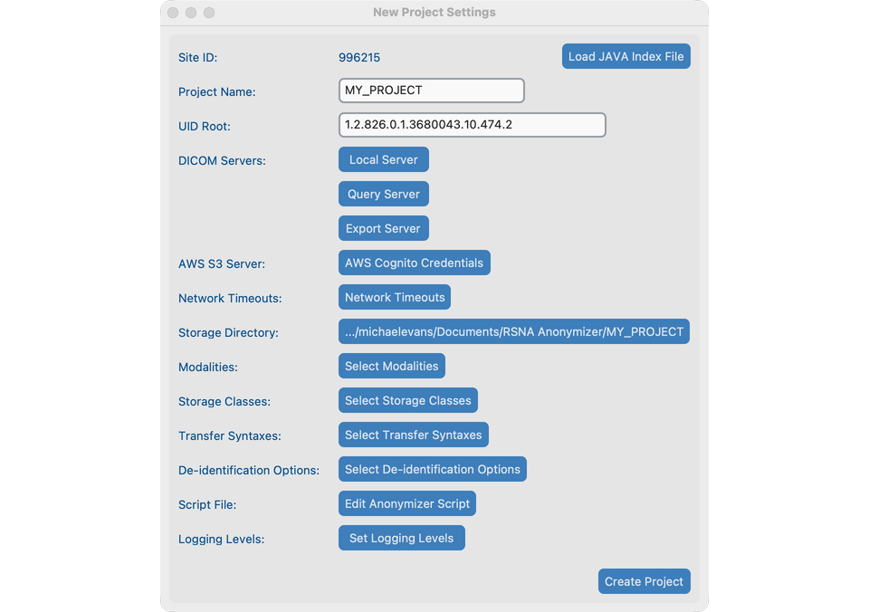
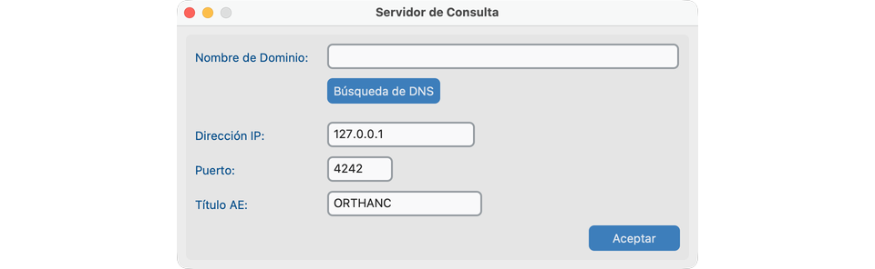
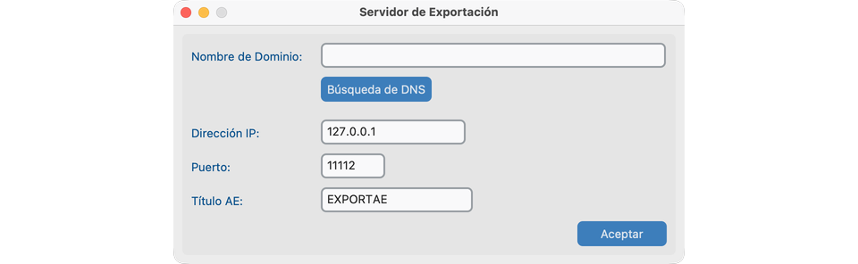
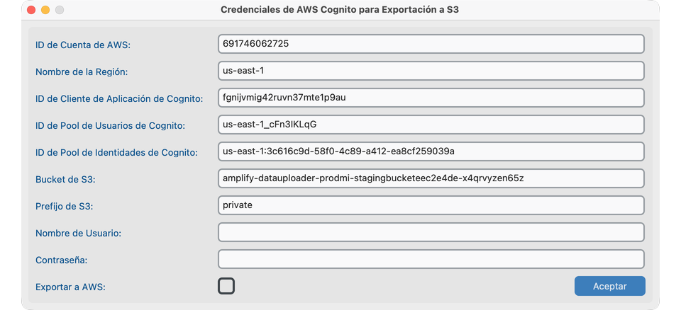
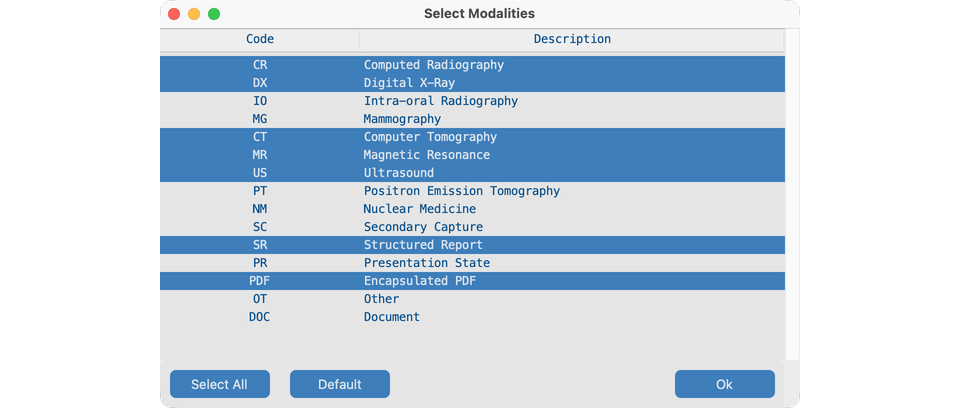
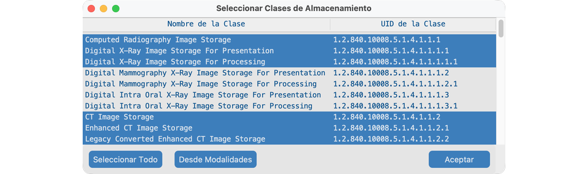
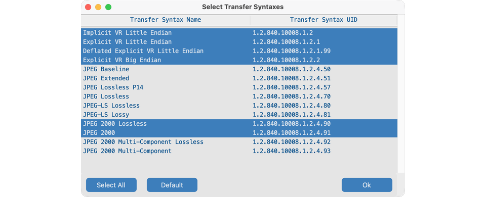
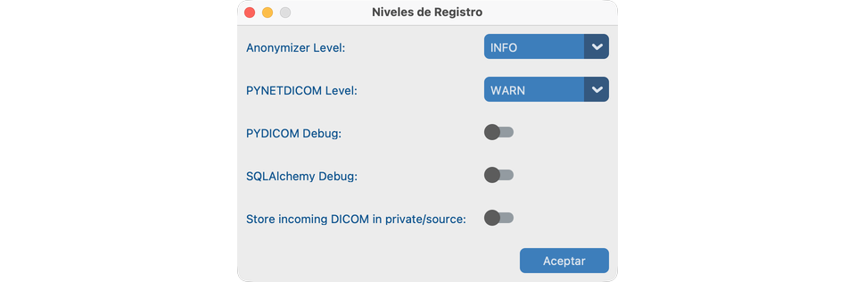
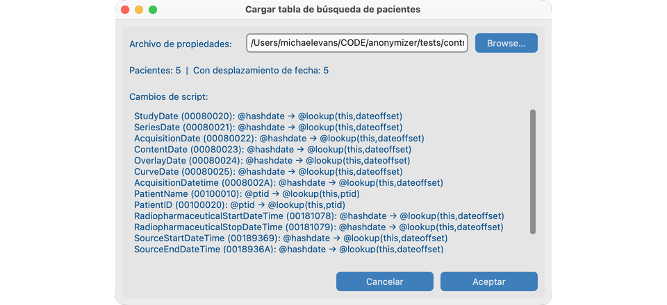
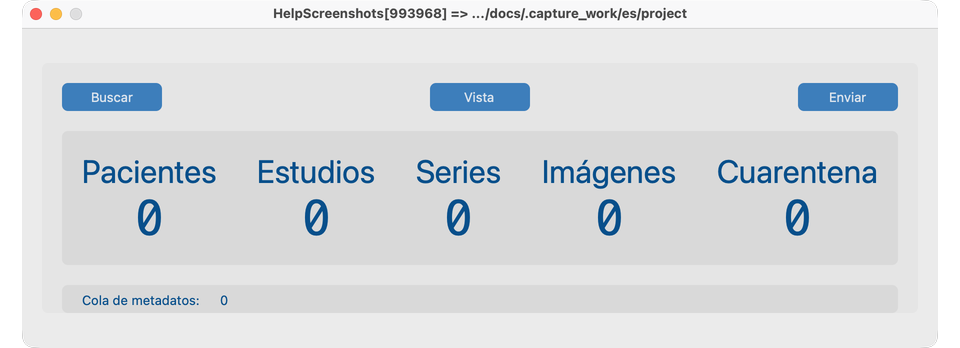

# Crear un proyecto

Un **proyecto** mantiene juntos los ajustes y el almacenamiento anonimizado. Créelo una vez en la ventana de escritorio, aunque un servidor ejecute después [sin interfaz](../10-headless/index.md).

Recorra este capítulo **en orden**: identidad y almacenamiento → opciones de desidentificación (construyen el script del anonimizador) → red y modalidades con TI → ediciones opcionales del script y tablas de búsqueda → Panel de control. Importe estudios a continuación en [Buscar](../06-search/index.md). **Analytics** de cohorte está en el Panel de control solo después del import — véase [Vista](../07-view/index.md#analytics).

## Objetivo

Abrir un proyecto limpio con almacenamiento, identidad del sitio y un script de desidentificación listos para importar.

## 1. Crear un proyecto nuevo

1. Desde **Archivo → Nuevo Proyecto**, abra **Configuración de Nuevo Proyecto**.
2. Elija un **Nombre del Proyecto** (corto, menos de 16 caracteres) y confirme el **Directorio de Almacenamiento**.
3. Revise **ID del Sitio** y **Raíz UID** (normalmente deje los valores predeterminados salvo que continúe un sitio del Java Anonymizer).
4. Continúe con las [opciones de desidentificación](#2-de-identification-options) antes de guardar.
5. Confirme [modalidades y red](#3-network-and-modalities) con TI si va a consultar un PACS.
6. Guarde / cree el proyecto. El script del anonimizador compilado se guarda junto a `ProjectModel.json` como `{site_id}-anonymizer.script`. Se abre el **Panel de control**.



## 2. Opciones de desidentificación {#2-de-identification-options}

Las opciones de desidentificación son las decisiones de confidencialidad DICOM de [PS 3.15 Apéndice E](https://dicom.nema.org/medical/dicom/current/output/chtml/part15/chapter_E.html) (Basic Profile, Modified Dates, Retain Safe Private y opciones relacionadas). Aparecen con sus nombres estándar en **De-identification Options**.


### Ajustes predefinidos

| Ajuste | Qué selecciona |
| --- | --- |
| **Basic** | Solo Basic Profile |
| **Retain** | Basic Profile + Modified Dates + Patient Characteristics + Retain Safe Private |

Los ajustes predefinidos solo marcan las casillas. El proyecto almacena los **códigos de opción seleccionados**, no el nombre del ajuste.

### Cómo las opciones construyen el script del anonimizador

Al crear (y siempre que **Acepte** nuevas opciones en un proyecto existente), la aplicación **compila** el script del anonimizador del proyecto:

1. Parte del `default-anonymizer.script` empaquetado.
2. Aplica **superposiciones de opción** por cada opción de confidencialidad elegida (qué etiquetas conservar, eliminar o transformar).
3. Escribe el resultado como `{site_id}-anonymizer.script` privado del proyecto junto a `ProjectModel.json`.

La importación usa **solo ese script** (no NER/OCR). El lenguaje completo de reglas y las etiquetas de sello están en [Protocolo de desidentificación](../deidentification-protocol.md). Los revisores que busquen la lista PS 3.15 § E.1.3 deben usar la [Declaración de conformidad DICOM](../dicom-conformance-statement.md).

!!! warning "Cambiar opciones más tarde"
    En un proyecto **existente**, aplicar opciones distintas pide confirmación. **Aceptar** **recompila** desde el predeterminado empaquetado más superposiciones — **se pierden las ediciones personalizadas del script**. Las imágenes ya importadas no se reprocesan.

### Opciones de limpieza y modalidades

Las opciones de limpieza (Clean Pixel Data, Clean Structured Content, Clean Descriptors, Clean Recognizable Visual Features) solo pueden elegirse si la función de IA correspondiente está instalada — se le ofrecerá descargar el modelo. Elegir Clean Structured Content o Clean Descriptors habilita modalidades SR/PDF; habilitar de nuevo SR o PDF activa Clean Structured Content si estaba desactivado.

La limpieza en la importación es limitada: la depuración de píxeles e informes sigue necesitando las herramientas opcionales de Process / Report después de importar. Véase [Protocolo de desidentificación](../deidentification-protocol.md#pixel-and-face-options-in-the-dicom-profile).

## 3. Red y modalidades {#3-network-and-modalities}

Abra **Archivo → Ajustes del Proyecto** (o complete esto en Configuración de Nuevo Proyecto antes de crear). Configúrelo antes de Buscar / Enviar.

### Cuando hable con TI {#when-you-talk-to-it}

Comparta estas ideas (los detalles están en los diálogos siguientes):

- **Servidor Local** — dirección, puerto y AE Title que este ordenador usa para **recibir** imágenes.
- **Servidor de Consulta** — el archivo hospitalario desde el que busca y recupera.
- **Servidor de Exportación** o **AWS** — adónde se enviarán los estudios anonimizados.
- **Modalidades / clases de almacenamiento / sintaxis de transferencia** — qué tipos de imagen se permiten.
- **Tiempos de espera de red** — cuánto esperar ante archivos lentos.

Si el proyecto vivirá en un servidor de laboratorio, continúe con [Ejecutar sin interfaz](../10-headless/index.md).

### Servidor Local

Dirección, puerto y AE Title que este ordenador usa para **recibir** imágenes.


### Servidor de Consulta

Archivo hospitalario usado por **Buscar** del Panel de control.



Para remotos que hablan **DICOMweb**, abra el diálogo del Servidor de Consulta y active **DICOMweb**. Introduzca **Puerto HTTP**, **Ruta** (por ejemplo `/dicom-web`), **Use HTTPS** opcional y usuario/contraseña opcionales. Buscar usa entonces QIDO-RS e importar WADO-RS. El puerto DIMSE y el AE Title siguen para **Echo** y servidores dual-stack. Echo sigue usando DIMSE.

### Servidor de Exportación

Destino DICOM usado cuando **Enviar** (la etiqueta de ajustes puede seguir diciendo Export Server).



Con **DICOMweb** activado en el Servidor de Exportación, Enviar usa STOW-RS en lugar de C-STORE.

### AWS Cognito (opcional)

Credenciales para Enviar a S3 cuando esté habilitado.



### Tiempos de Espera de Red {#network-timeouts}

Cuánto esperar ante archivos lentos.


### Modalidades / Clases de Almacenamiento / Sintaxis de Transferencia {#storage-classes}

Qué tipos de imagen y codificaciones se permiten.





### Niveles de Registro

Suba el registro del anonimizador / red al solucionar problemas con TI.



## 4. Ediciones personalizadas del script {#4-custom-script-edits}

La mayoría de sitios nunca editan el script a mano — las [opciones de desidentificación](#2-de-identification-options) ya compilan las reglas correctas. Use el editor cuando la privacidad o la política del ensayo necesiten una regla de etiqueta **personalizada**, otra estrategia de fechas o una [tabla de búsqueda de pacientes](#5-patient-lookup-table-and-dates).

Abra **Archivo → Ajustes del Proyecto** (o Configuración de Nuevo Proyecto) y **Editar script del anonimizador**. El editor carga el predeterminado empaquetado hasta que Acepte; después abre su copia privada del proyecto y muestra la ruta arriba del diálogo.

La cabecera muestra el resumen de opciones (**Basic**, **Retain** o las opciones seleccionadas abreviadas) y la ruta del **Script**. Cuando el script en vivo ya no coincide con una compilación nueva de las opciones guardadas, el estado muestra **Custom**.

**Importar…** carga un script CTP personalizado: se rechazan operandos desconocidos, las reglas de fecha deben coincidir con la operación StudyDate (corrección en un clic disponible) y al Aceptar confirma qué opciones de desidentificación registrar (prefill desde sus reglas).


### Vistas

| Vista | Qué ve |
| --- | --- |
| **Activos** (predeterminada) | Etiquetas **conservadas** o **transformadas** (no `@remove()`). La lista cotidiana — unas 1,5k filas en lugar de ~4,6k. |
| **Eliminados** | Etiquetas con `@remove()` (se borran al anonimizar). |
| **Todos** | Todas las reglas de etiqueta del script. |

La búsqueda y el filtro **Operando** se aplican dentro de la vista actual.

### Cambiar una regla

1. Seleccione una fila de la lista. Los operandos se muestran en sintaxis de script (por ejemplo `@keep`, `@remove()`, `@uid`, `@always()YES`).
2. Para conocer un operando sin cambiar el script, use el filtro **Operando** de la barra de herramientas o el desplegable **Operando** del detalle — **Cómo funciona este operando** se actualiza al instante. La asignación solo ocurre al pulsar **Aplicar**.
3. Si el operando necesita un parámetro, **Aplicar** pide el valor con unidades y significado. **Cambiar parámetro** lo edita después en una regla que ya usa ese operando:
   - **@round(this,n)** — anchura de banda de edad en años enteros
   - **@always()** — texto de reemplazo fijo (estilo CTP, p. ej. `YES`). Se guarda como `@always()YES`. Literales sueltos como `YES` en scripts antiguos son el mismo operando y siguen siendo válidos.
   - Operandos de fecha y búsqueda — véase [Tabla de búsqueda de pacientes y fechas](#5-patient-lookup-table-and-dates).
4. Elegir **@remove()** (luego Aplicar) saca la etiqueta de la vista Activos (sigue en el script como `@remove()`).

### Añadir una etiqueta que falta

Si al script le falta alguna etiqueta del diccionario DICOM, **Añadir desde diccionario** aparece en la barra inferior. Busque esas etiquetas y **Añadir** una (predeterminado `@keep`). Si el script ya cubre el diccionario, el botón está oculto.

### Guardar

- **Aceptar** valida operandos, escribe una copia privada en `{almacenamiento}/private/{site_id}-anonymizer.script`, recarga las reglas activas del anonimizador y apunta el proyecto a ese archivo. El recurso predeterminado empaquetado nunca se sobrescribe.
- **Revertir** recarga el archivo desde el disco y descarta cambios no guardados.
- **Cancelar** cierra sin guardar.

!!! note "Opciones vs. ediciones personalizadas"
    Aceptar nuevas [opciones de desidentificación](#2-de-identification-options) recompila el script y **descarta** ediciones personalizadas. Termine primero las opciones; edite el script después solo si aún necesita excepciones.

## 5. Tabla de búsqueda de pacientes y fechas {#5-patient-lookup-table-and-dates}

Use esta sección cuando su sitio necesite una **Patient Lookup Table** al estilo CTP/TCIA y/o una estrategia concreta de **fechas longitudinales**. Estos controles están en el [editor del script](#4-custom-script-edits).

### Fechas longitudinales (estilo TCIA) {#longitudinal-dates-tcia-style}

Todas las estrategias de delta de fecha preservan intervalos entre estudios de un paciente. Cuando alguna se ejecuta, el anonimizador establece `(0028,0303) LongitudinalTemporalInformationModified = MODIFIED` (opción DICOM 113107) cuando Modified Dates está seleccionado.

| Estrategia | Operando | Cuándo usar |
| --- | --- | --- |
| Hash de paciente | `@hashdate` (script compilado predeterminado) | Sin tabla de mapeo; desplazamiento determinista por paciente |
| Desplazamiento por búsqueda | `@lookup(this,dateoffset)` | Desplazamiento controlado por paciente desde `.properties` del sitio |
| Desplazamiento del ensayo | `@incrementdate(this,n)` | Mismo DATEINC para todos los pacientes (`n` en el editor del script) |
| Rebase de época | `@rebasedate(this,origin)` | Estilo TCIA/NCTN: `origin + (date − basedate)`; necesita filas `basedate/` |

`@hashdate`, UIDs anonimizados y números de accession hasheados son **sin secreto** por diseño: mantienen enlaces estables dentro de un proyecto. No están protegidos frente a verificación si alguien ya conoce un original candidato. Detalles: [Protocolo de desidentificación — Reemplazos deterministas](../deidentification-protocol.md#deterministic-replacements-uids-dates-accessions).

**@incrementdate(this,n)** — delta fijo en días (CTP DATEINC). Se pregunta al aplicar el operando (predeterminado 365). Como DATEINC es del ensayo completo, confirmar aplica el mismo `@incrementdate(this,n)` a cada campo de delta de fecha del script (por ejemplo todas las reglas `@hashdate`), y el aviso lista esos campos.

**@rebasedate(this,origin)** — ORIGIN de época como AAAAMMDD (predeterminado `19600101`). Se pregunta al aplicar; si no hay basedates cargados, Aplicar abre primero el diálogo de tabla de búsqueda.

**@lookup(this,ptid)** / **@lookup(this,dateoffset)** — si la tabla requerida (o filas dateoffset) no está cargada, Aplicar abre primero el diálogo de tabla de búsqueda.

### Tabla de búsqueda de pacientes {#patient-lookup-table}

`@lookup(this,ptid)`, `@lookup(this,dateoffset)` y `@rebasedate(this,origin)` aparecen en la lista de operandos. Elija uno y pulse **Aplicar** — se abre **Cargar Patient Lookup Table** cuando la tabla requerida (o entradas dateoffset / basedate) aún no está cargada. En una regla que ya usa un operando dependiente de búsqueda, use **Cargar tabla de búsqueda** / **Reemplazar tabla de búsqueda** junto al control Operando.

Un archivo CTP/TCIA `.properties` mapea cada ID de paciente PHI a un ID anonimizado, y opcionalmente un desplazamiento de fecha por paciente y/o basedate de registro:

```text
ptid/MRN-1001=527408-000101
dateoffset/MRN-1001=42
basedate/MRN-1001=20180327
```

Aceptar guarda una copia privada del proyecto, reescribe reglas de Patient ID / fecha coincidentes a `@lookup…` y habilita búsqueda en tiempo de ejecución. Con desplazamientos de fecha presentes, puede aplicarse `@lookup(this,dateoffset)`; con filas `basedate/`, `@rebasedate(this,origin)` (se le pide la fecha ORIGIN).

Los `.properties` de búsqueda pueden incluir solo fechas de registro/evento:

```text
ptid/MRN-1=SITE-0001
basedate/MRN-1=20180327
```

Con basedates cargados, `@rebasedate(this,origin)` aparece en la lista de operandos. Anonimizar también escribe `(0012,0052)` / `(0012,0053)=REGISTRATION` desde PHI StudyDate − basedate.

!!! note "Proyectos existentes"
    Cargar una tabla de búsqueda **no** vuelve a anonimizar los archivos ya presentes en el conjunto de datos — permanecen sin cambios. Los pacientes ya importados siguen funcionando sin una fila en la tabla. Los archivos **nuevos** cuyo ID de paciente PHI no esté en la tabla se ponen en cuarentena como **Lookup_Miss** y no se almacenan.



## Acciones cotidianas del proyecto

| Acción | Cómo |
| --- | --- |
| Cerrar | **Archivo → Cerrar Proyecto** o cierre la ventana |
| Reabrir | **Archivo → Abrir Reciente** |
| Clonar ajustes | **Archivo → Clonar** en una carpeta de almacenamiento nueva (no se copian imágenes). Mantenga la Raíz UID única entre proyectos. |

## Panel de control tras crear



El Panel de control expone los botones principales del flujo: **Buscar**, **Vista** y **Enviar**. Después de [importar estudios](../06-search/index.md), use [Vista → Analytics](../07-view/index.md#analytics) para gráficos de cohorte.

## Cómo se ve cuando va bien

- El Panel de control muestra el nombre del proyecto y el ID del Sitio.
- El directorio de almacenamiento existe y es escribible.
- Las opciones de desidentificación coinciden con su plan de privacidad; la ruta del script del proyecto existe junto a `ProjectModel.json`.
- Puede abrir el **Conjunto de datos** curado actual (vacío hasta que importe) pulsando **Vista**.

## Si falla

- Ruta de almacenamiento no escribible → elija otra carpeta.
- Nombre demasiado largo → acorte el nombre del proyecto.
- Aviso al clonar sobre Raíz UID → use una raíz única por proyecto para evitar choques de ID.
- El editor del script **Aceptar** rechazó → corrija los operandos `@…` no admitidos indicados en el error. `@always()` vacío no es válido (indique texto, p. ej. `@always()YES`). Literales sin `@` como `YES` se aceptan como valores fijos.

## Siguientes pasos

1. [Buscar](../06-search/index.md) — importar estudios al proyecto.
2. [Vista](../07-view/index.md) — Conjunto de datos, proyecciones, Vista de series y [Analytics](../07-view/index.md#analytics) después del import.
