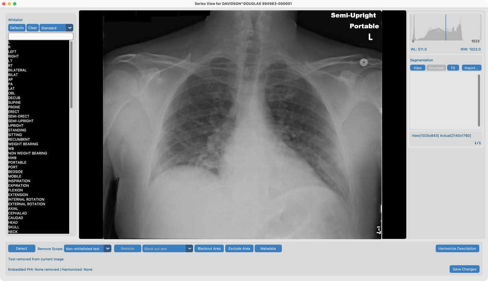
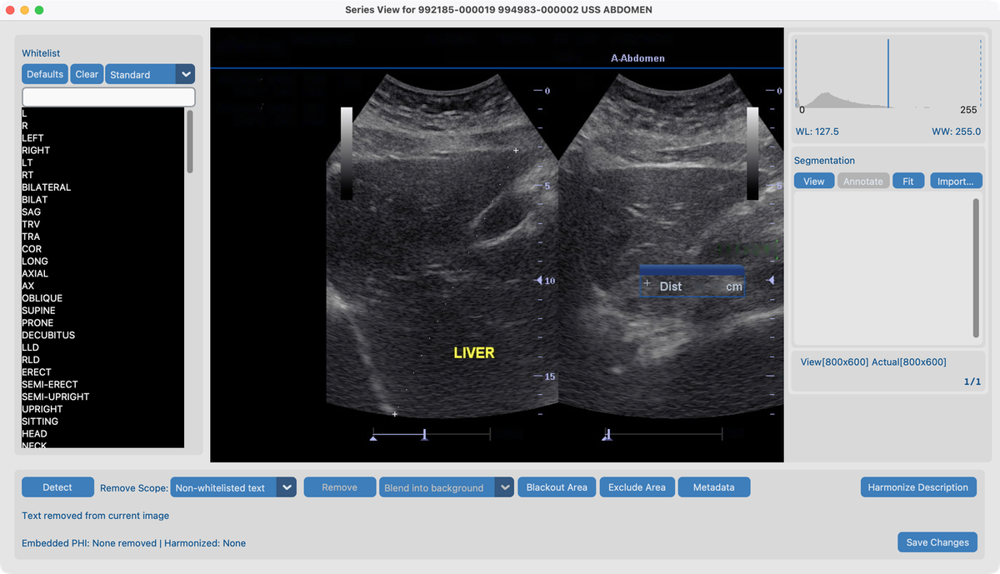
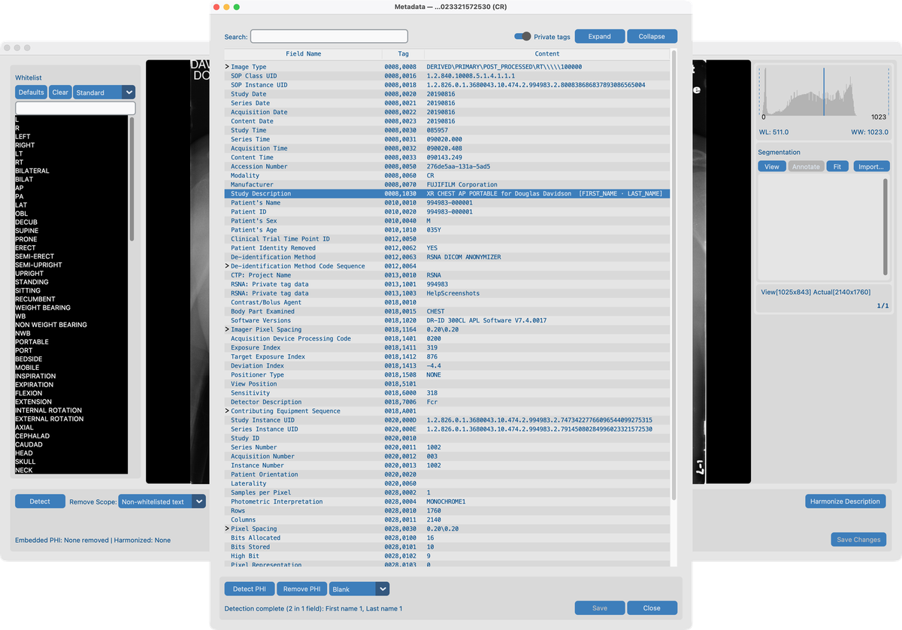

# 8.1 Embedded PHI

**Embedded PHI** encuentra y elimina información sanitaria protegida que permanece **después** de la anonimización de etiquetas en la importación: texto dibujado en píxeles e PHI en informes / texto libre. Usa OCR (píxeles) y reconocimiento de entidades nombradas (NER) en inglés. El ingest no ejecuta NER/OCR.

| Sección | Qué cubre | Dónde trabaja |
| --- | --- | --- |
| [Pixel](#pixel) | Texto quemado en píxeles de imagen | Vista de Series |
| [Text › Metadata](#metadata) | Valores de etiqueta con PHI tras el import | Vista de Series / Informe → **Metadata** |
| [Text › Reports](#reports) | Structured Reports, Encapsulated PDF, cuerpo de texto libre | **Report Text Review** (y lote de texto) |

Termine [Configuración de Funciones de IA](../../03-ai-features-setup/index.md) (paquete Embedded PHI) antes de estas secciones.

### Entidades nombradas (OpenMed)

El NER en inglés del paquete Embedded PHI es **OpenMed ClinicalE5-Small**. Detect colorea cada hallazgo por tipo (el nombre del tipo usa ese color):

| Tipo | Ejemplos |
| --- | --- |
| **First name** | Nombre de pila quemado en píxeles (p. ej. `DOUGLAS`); nombre en Study Description o informe |
| **Last name** | Apellido quemado (p. ej. `DAVIDSON`); apellido en Study Description o informe |
| **Location** | Hospital / sede / ciudad en overlays o en etiquetas de texto libre e informes |
| **ID** | MRN u otros identificadores en informe / valores de etiqueta de texto libre |
| **Phone** | Teléfonos en informes o etiquetas de texto libre |
| **Date** | Fechas / DOB quemados; fechas en Study Description o informes |
| **Email** | Correos en informes o etiquetas de texto libre |

En **píxeles**, First name y Last name se agrupan en un color de caja **Name** (misma familia que First name). En **Metadata** y **Report Text Review** van por separado. Pase el cursor sobre un tramo o caja de color para ver el tipo.

---

## Pixel {#pixel}

Nombres y etiquetas quemados dibujados en la imagen. Limpiar solo las etiquetas DICOM no los elimina.

### Series de demo

| Serie | Ruta | Usada para |
| --- | --- | --- |
| **`davidson_cxr`** | `tests/controller/assets/test_dcm_files/davidson_cxr` | Whitelist → **Detect** → **Black out text** |
| **`us_rgb_single_frame`** | `tests/controller/assets/test_dcm_files/us_rgb_single_frame` (`US_RGB_SingleFrame.dcm`) | **Detect** → **Blend into background**; **Exclude Area** on the machine-parameter block under **mindray** |

Importe cada carpeta en su proyecto, luego abra la serie en **Vista de Series** desde el [Conjunto de datos](../../07-view/index.md).

### Objetivo

1. On `davidson_cxr`, detect burned-in text and **black out** PHI while keeping useful markers via the default whitelist.
2. On `us_rgb_single_frame`, detect burned-in text and remove it by **blending into the background** (inpaint).
3. On the same color US series, mark the non-PHI machine-parameter strip with **Exclude Area** so Detect and Remove skip it.

### Barra de herramientas de Vista de Series

De izquierda a derecha en la barra de edición de texto:

| Control | Función |
| --- | --- |
| **Edit Context** | **Frame** or **Series**. Hidden on single-frame series (no choice to make). |
| **Detect** | Run OCR (+ NER labelling). Boxes show what **Remove** would delete for the current **Remove Scope**. Pixels are not changed. |
| **Remove Scope** | **Non-whitelisted text** (default), **PHI only**, or **All text**. Filters which detections are boxed and what **Remove** deletes. Changing scope after Detect re-filters existing boxes; **Remove** stays enabled while boxed text remains under the new scope. |
| **Remove** | Delete boxed text using the removal mode menu. Disabled until Detect has identified text for removal. |
| Removal mode menu | **Black out text** or **Blend into background**. |
| **Blackout Area** | Paint drawn user rectangles black (manual). |
| **Exclude Area** | Convert drawn rectangles into keep-out zones for Detect/Remove (no pixel change). |
| **Metadata** | DICOM tag tree for the current slice ([Detect PHI / Remove PHI](../../07-view/index.md#metadata-dicom-tags) on tag values). |

**Save Changes** (bottom right) writes pixel edits and/or modality exclude-area files. Hover it to see what will be saved.

Left panel: **Whitelist** with **Defaults**, **Clear**, match mode (**Exact** / **Strict** / **Standard** / **Lenient**), search, and the keeper list.

### Flujo en `davidson_cxr` (ocultar)

#### 1. Default whitelist and Remove Scope

1. Keep the **default whitelist** (do not **Clear** it).
2. Leave **Remove Scope** on **Non-whitelisted text**.
3. On this single-frame series, **Edit Context** is hidden.

#### 2. Detect

1. Click **Detect**.
2. Espere a que termine Detect. Los rectángulos marcan el texto que se eliminaría con el **Remove Scope** actual. NER colorea por categoría (**Name**, **Location**, **Date**, **ID**, **Phone**, **Email**); el OCR sin etiqueta sigue encuadrado con **Non-whitelisted text** o **All text**.

Detect classifies with the **whole frame as context** (OCR boxes in reading order joined for one NER call). Each rectangle is still one OCR box and is removed **whole** — including unmarked prefixes or suffixes inside the same box (the `DOB:` prefix before a date; the `[M]` marker after a name). Hover a PHI rectangle to see its NER category (bold caps on the category colour), not the detected string.

| Remove Scope | Effect |
| --- | --- |
| **Non-whitelisted text** (default) | Remove OCR that is not a whitelist match and not in an exclude area |
| **PHI only** | Remove only NER-labelled PHI. Unlabeled text and whitelist matches stay; whitelist still vetoes keepers |
| **All text** | Remove every detected box; whitelist is ignored |

En `davidson_cxr` con la lista blanca predeterminada y **Remove Scope: Non-whitelisted text**, Detect dibuja **cuatro** recuadros: **DAVIDSON** y **DOUGLAS [M]** (Name), **01.09.2012** y **DOB: 06.16.1976** (Date). **No** encuadra **Semi-Upright**, **Portable** ni **L** (términos de la lista blanca predeterminada).

**Whitelist match** (next to Defaults / Clear — default **Standard**):

| Setting | Effect |
| --- | --- |
| **Exact** | Keeper only on letter-for-letter match |
| **Strict** | Almost exact — tiny OCR mistakes only |
| **Standard** (default) | Small OCR errors allowed (`AXIL` still matches `AXIAL`) |
| **Lenient** | Most forgiving — noisy text and short markers |

Use a stricter setting if too much text is skipped; looser if useful markers keep getting boxed.

#### 3. Review and whitelist keepers

1. If a green rectangle covers text you want to **keep**, click that rectangle.
2. The text is added to the whitelist on the left and will not be removed.

En `davidson_cxr`, **Semi-Upright**, **Portable** y **L** ya están en la lista blanca DX predeterminada.

#### 4. Remove with black out

1. Set the removal mode menu to **Black out text**.
2. Click **Remove**.
3. PHI regions become solid black; whitelisted keepers stay.
4. Click **Save Changes** when satisfied.

Black out is the usual de-identification choice: removed text is clearly gone and cannot be recovered from the pixels.

### Flujo en `us_rgb_single_frame` (fundir)

Use this color ultrasound frame when removed text should look like nearby tissue instead of black bars.

#### 5. Remove with blend

1. Import and open **`us_rgb_single_frame`** (`US_RGB_SingleFrame.dcm`) in Series View.
2. Set the removal mode menu to **Blend into background**.
3. Click **Detect** and wait for the green rectangles.

4. Click **Remove**.
5. Detected text is painted out by blending with surrounding pixels (inpaint), then **Save Changes**.

**Black out text** replaces text with black. **Blend into background** fills the area to match surrounding pixels. Prefer black out for obvious, irreversible redaction; prefer blend when a less conspicuous result is acceptable (ultrasound overlays).

### Flujo en US en color (Exclude Area)

Use the same **`us_rgb_single_frame`** series when OCR boxes machine settings that are **not PHI**. **Exclude Area** skips a spatial region for Detect and Remove without changing pixels (unlike **Blackout Area**).

#### 6. Exclude the parameter block under mindray

On this frame, a dense block of machine parameters (gain, depth, FR, DR, and similar tokens) sits on the **upper left**, directly **below** the **mindray** logo.

1. Open **`us_rgb_single_frame`** in Series View.
2. Draw a rectangle covering that parameter block (leave **mindray** and true PHI / site labels outside if you still want them detected). Pending draws appear as **solid blue** rectangles.
3. Click **Exclude Area**. The rectangle moves to the exclude list and redraws as a **white dotted outline** (no fill). **Save Changes** stores the current exclude set for this modality without changing pixels when that is the only pending change.

4. Click **Detect**. Green boxes should appear on PHI / vendor text **outside** the block; parameter tokens inside the dotted region should **not** be boxed for removal.

5. Optionally choose **Blend into background** or **Black out text**, then **Remove** and **Save Changes**.
6. Click a white dotted rectangle to remove it from the exclude list if you need to adjust.

**Whitelist** keeps specific OCR *strings*. **Exclude Area** skips a *region* (no pixel change). **Blackout Area** paints drawn rectangles black. Prefer setting exclude rectangles **before** Detect (or Detect again after adjusting). With **Series** edit context (multi-frame), drawing propagates across frames so the same panel can be excluded on a cine loop.

### Tras el trabajo de píxeles

- Dataset **Embedded PHI** status updates for each series you saved (removed PHI text only).
- Modality whitelists and the match dropdown live in Series View; stricter matching means fewer OCR hits count as keepers.
- Exclude regions are session-only until **Save Changes**. Active rectangles (including removals of previously saved ones) are written to `whitelists/{modality}.exclude.json` next to the modality whitelist. Clearing all areas removes that file. AI Batch applies those areas when **Enable Exclude Areas** is on.
- To run pixel Embedded PHI on many studies, see [8.4 Run on many studies](../05-run-on-many-studies/index.md).

### Qué se ve bien (píxel)

- On `davidson_cxr`: PHI blacked out; orientation markers kept if whitelisted.
- On `us_rgb_single_frame`: burned-in labels blended away without solid black bars; with Exclude Area, the mindray parameter block is not removed as PHI.

### Si falla el trabajo de píxeles

- Many false boxes → tighten match strictness; whitelist keepers; or **Exclude Area** for whole panels.
- Missed text → manual **Blackout Area**.
- Parameter text still boxed → enlarge the exclude rectangle and Detect again; click dotted outlines to delete and redraw.
- Tools greyed out → finish [AI Features](../../03-ai-features-setup/index.md).

---

## Text {#text}

PHI en **valores de etiqueta** y en **cuerpos de informe / texto libre** — no dibujado en píxeles. El mismo paquete NER Embedded PHI que en píxeles.

### Metadata {#metadata}

Valores de etiqueta que aún pueden contener PHI tras el import (comentarios, descripciones, texto libre residual). Trabaje en Vista de Series o Report Text Review vía **Metadata**.

Pasos completos (árbol, **Detect PHI** / **Remove PHI**, Blank vs Synthetic, guardar el archivo actual): [Vista → Metadatos (etiquetas DICOM)](../../07-view/index.md#metadata-dicom-tags).

**Ejemplo claro — `davidson_cxr` antes de Harmonize.** El import quita identificadores de las etiquetas habituales de nombre/ID, pero **Study Description** puede conservar texto libre como `XR CHEST AP PORTABLE for Douglas Davidson`. Ejecute Metadata **antes** de Harmonize Description para ver ese PHI residual.

1. Abra **`davidson_cxr`** en Vista de Series (**sin** Harmonize aún — Harmonized: None).
2. Pulse **Metadata**, luego **Detect PHI**.
3. Revise la fila resaltada **Study Description**: los tramos de nombre como **First name** / **Last name**. Opcionalmente excluya una fila, elija **Blank** o **Synthetic**, luego **Remove PHI** / **Replace PHI**, y **Save**.

El mismo diálogo Metadata se abre desde Report Text Review (**Metadata** en la barra del informe) para el archivo de informe actual.

!!! note "Solo el archivo actual"
    La eliminación de Metadata se aplica a la imagen o informe **actual**. Para limpiar etiquetas en una serie o cohorte: [Lote de IA](../05-run-on-many-studies/index.md).

### Reports {#reports}

PHI en **Structured Reports**, **Encapsulated PDF** y otros cuerpos de documento de texto libre. Se abre en **Report Text Review** en lugar de Vista de Series.

#### Report Text Review {#reports-and-free-text-report-text-review}

Demo: **`demo_report_pdf`** (informe radiológico sintético). El import debe usar **Clean Structured Content** para conservar el texto Encapsulated Document / SR para revisión.

1. Abra el informe demo. El panel izquierdo muestra la página PDF; el derecho, el texto extraíble.
2. Pulse **Detect PHI**. Los tramos a la **derecha** se colorean por tipo (**First name**, **Last name**, **Location**, **ID**, **Phone**, **Date**, **Email**) — mismos colores OpenMed que [Entidades nombradas](#entidades-nombradas-openmed).
3. Pulse un resaltado para **excluir** un tramo que quiera conservar.
4. Elija **Blank** (borrar) o **Synthetic** (sustituir por un valor falso del mismo tipo), luego **Remove PHI** / **Replace PHI**.
5. **Save** escribe el informe. En Encapsulated PDF, Save sustituye los bytes PDF por un documento de texto plano desidentificado (no se conserva el diseño). En la columna Embedded PHI del Dataset solo se registra el **texto PHI original eliminado** — nunca el cuerpo del informe ni los reemplazos sintéticos.
6. Opcional — **Metadata** en la barra del informe para limpiar etiquetas de este archivo ([Metadata](#metadata) arriba).

Los valores sintéticos se derivan de forma determinista del proyecto y del ID de paciente anonimizado. La eliminación de píxeles siempre usa Black out / Blend; **Synthetic** solo aplica al texto.

#### Informes de texto escaneados

Si una serie Secondary Capture parece un informe de texto (página de dosis o hoja de trabajo), use primero las herramientas [Pixel](#pixel). **Save Changes** en Vista de Series también puede escribir la transcripción OCR depurada como **Basic Text SR** en el mismo estudio. El SR es un derivado; no se registra en la columna Embedded PHI.

#### Texto libre en lote

Comentarios, descripciones de protocolo/procedimiento y atributos similares en muchos estudios: ruta de texto en [Lote de IA](../05-run-on-many-studies/index.md).

### Si falla el trabajo de texto

- Herramientas en gris → termine [Funciones de IA](../../03-ai-features-setup/index.md).
- Cuerpo de informe vacío tras el import → active **Clean Structured Content** (y modalidades SR/PDF) antes del import para conservar los bytes del documento.

---

## Siguientes pasos

Continúe con [8.2 Armonizar nombres](../03-harmonize-names/index.md) usando **`CT_Head_With_Contrast`**.
