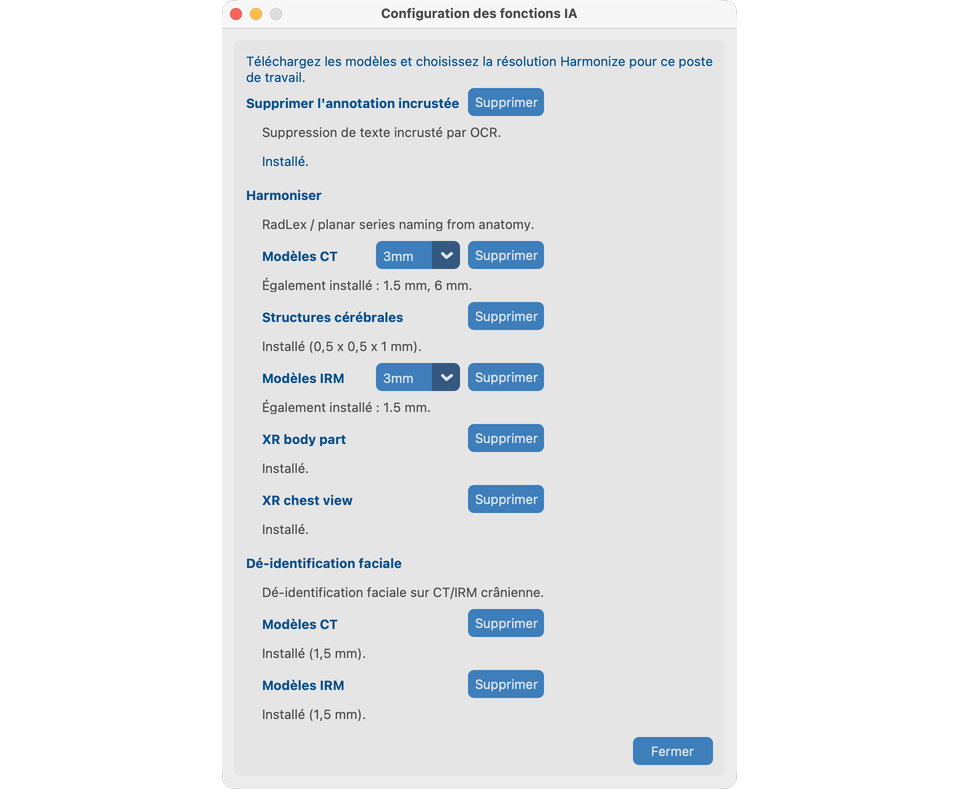

# Configuration des Fonctions IA

Les **Fonctions IA** sont **optionnelles**. Elles s’exécutent sur votre ordinateur après un téléchargement unique. Les images ne sont pas envoyées pour le traitement.

Faites ce chapitre **avant** les parcours d’outils sur `davidson_cxr` et `CT_Head_With_Contrast`.

## Objectif

Télécharger les modèles dont vous avez besoin et choisir la résolution Harmonize pour ce poste de travail.

## Ouvrir la configuration

Depuis l’écran **Bienvenue** uniquement : cliquez sur **Fonctions IA**.

Fermez le projet (ou lancez l’application) pour revenir à Bienvenue si vous devez télécharger des modèles ou modifier la résolution Harmonize plus tard.

!!! note "Après le téléchargement de tous les modèles"
    Chaque ligne affiche **Installé** (avec un court détail, p. ex. la résolution) et un bouton **Supprimer** à la place de **Télécharger**. Les lignes Harmonize CT/MR conservent un menu de résolution ; les résolutions supplémentaires déjà présentes apparaissent comme « Également installé : … ». La capture ci-dessus montre cet état entièrement installé.

## Modèles dans cette boîte de dialogue

Chaque ligne est un **téléchargement pour ce poste**. Il n’y a **aucune case projet on/off** — installez ici ; les outils correspondants se déverrouillent plus tard dans [Vue](../07-view/index.md) et [Traiter](../08-process/index.md) (y compris [exécuter sur plusieurs études](../08-process/05-run-on-many-studies/index.md)).

| Fonction | Ce qu’elle débloque ensuite | Télécharger ? |
| --- | --- | --- |
| **Embedded PHI** (OCR + NER anglais, un pack) | Nettoyage du texte incrusté, revue de texte de rapport et Métadonnées **Détecter PHI** | Oui, si vous nettoyez pixels, comptes rendus ou texte de tags |
| **Harmoniser** CT/MR + résolution (1.5 / 3 / 6 mm) | Masques d’organes TotalSegmentator pour CT/MR — noms de série standardisés et volumes d’organes à revoir dans [Analytics du Tableau de bord](../07-view/index.md#analytics) | Oui, si vous Harmonisez CT/MR ou utilisez Analytics de volumes — choisissez une résolution |
| **Harmoniser** région anatomique XR | Aide pixel supplémentaire pour CR/DX quand les tags manquent ou sont faux | Oui, si vous Harmonisez la radiographie générale |
| **Harmoniser** vue thorax XR | AP/PA/Lat pixel (+ contrôle de rotation) pour CR/DX thoraciques | Oui, si vous Harmonisez la radiographie générale (thorax) |
| **Dé-identification faciale** | Flou facial sur CT/MR tête éligibles | Oui, si vous curatez des CT/MR tête |
| **Structures cérébrales** | Masques supplémentaires de structures cérébrales sur CT/MR tête (avec Harmonize) — revoir l’anatomie et les distributions de volume des structures d’intérêt dans [Analytics du Tableau de bord](../07-view/index.md#analytics) | Oui, si vous curatez des CT/MR tête et utilisez Analytics de volumes d’organes — licence |

Harmonize XR fonctionne sans les packs région anatomique XR ou vue thorax (tags DICOM / mots-clés uniquement). Une fois installés, les séries CR/DX peuvent utiliser :

- Classifieur de région anatomique EfficientNet-B4 ([Xp-Bodypart-Mislabel-Checker](https://huggingface.co/spaces/MedicalAILabo/Xp-Bodypart-Mislabel-Checker) ; [Mitsuyama et al., *European Radiology* 2025](https://doi.org/10.1007/s00330-025-12053-7)), fusionné avec l’anatomie DICOM.
- Classifieur de projection/rotation thorax uniquement ([CXp-Projection-Rotation-Mislabel-Checker](https://huggingface.co/spaces/MedicalAILabo/CXp-Projection-Rotation-Mislabel-Checker) ; même article de [Mitsuyama et al.](https://doi.org/10.1007/s00330-025-12053-7)) pour affiner AP/PA/Lat ; la rotation apparaît dans le tableau d’analyse Harmonize et n’est pas écrite dans SeriesDescription.

La mammographie et l’échographie n’utilisent pas ces modèles.

## Premières étapes

1. Ouvrez **Fonctions IA**.
2. Téléchargez **Supprimer le texte incrusté**, **Harmoniser** (CT) et **Dé-identification faciale**.
3. Saisissez ou validez la licence académique lorsque demandé (visage / structures cérébrales).
4. Choisissez la résolution Harmonize CT ; téléchargez si le pack manque.
5. Optionnellement, téléchargez **Structures cérébrales** et/ou **région anatomique XR** / **vue thorax XR** si vous avez besoin de ces extras.
6. Fermez la boîte de dialogue. Les préférences restent sur ce poste de travail.

!!! tip "Internet uniquement pour le téléchargement"
    Une fois les modèles et la licence en place, le traitement est local. Sous **macOS**, installez la bibliothèque C++ OpenMP avant d’utiliser Harmonize / les Fonctions IA associées : `brew install libomp` (voir [Installation](../02-install/index.md#4-macos-only-openmp-for-ai-features)).

## Supprimer les modèles

Utilisez **Supprimer** sur la carte d’un outil pour effacer les fichiers téléchargés. Cela n’annule pas les modifications déjà écrites dans les images anonymisées.

## Ce qui indique que tout va bien

- Le statut indique prêt pour OCR, Harmonize CT et Face.
- Après l’import, vous pouvez exécuter les outils [Traiter](../08-process/index.md) correspondants sur les séries de démo (chapitres 8.1–8.3).

## En cas d’échec

- Téléchargement incomplet → vérifiez le réseau et réessayez.
- TotalSegmentator / OpenMP sous macOS → `brew install libomp`.
- Licence invalide → vérifiez le format `aca_` ou l’URL du fournisseur dans la boîte de dialogue.

## Prochaines étapes

1. [Mots que nous utilisons](../04-words-we-use/index.md) et [Créer un projet](../05-create-project/index.md), ou
2. Passez aux outils [Traiter](../08-process/index.md) une fois les études importées — commencez par [8.1 Embedded PHI](../08-process/02-remove-burned-in-text/index.md)
