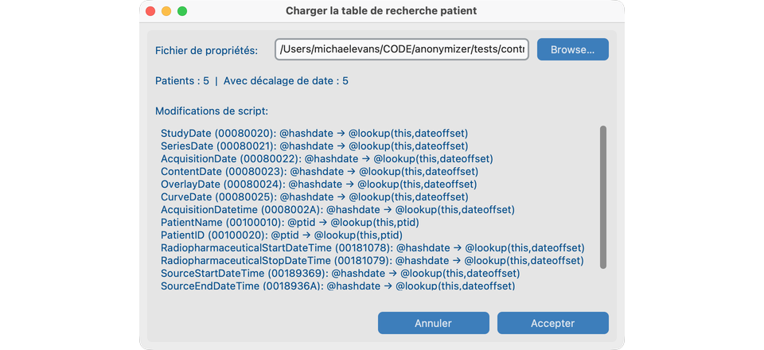

# Script d’anonymisation (avancé)

Les [options de dé-identification](index.md#2-de-identification-options) compilent le script du projet pour la plupart des sites. Utilisez cette page pour modifier des règles de balise individuelles, choisir une stratégie de dates, charger une table de correspondance des patients ou importer un `.script` CTP.

## Ouvrir l’éditeur

Une fois le projet créé : **Fichier → Paramètres du projet → Modifier le script d’anonymisation**.

L’éditeur charge `{site_id}-anonymizer.script` à côté de `ProjectModel.json` dans le dossier de stockage du projet (le dossier affiché en haut du **Tableau de bord**). La ligne **Script** du dialogue est le chemin de ce fichier script. Le `default-anonymizer.script` fourni n’est jamais écrasé.

État d’en-tête : résumé des options (**Basic**, **Retain**, ou options sélectionnées abrégées). **Custom** signifie que le script actif ne correspond plus à une compilation à neuf des options enregistrées.


## Vues

| Vue | Contenu |
| --- | --- |
| **Actifs** (par défaut) | Règles qui conservent ou transforment la valeur (pas `@remove()`). |
| **Supprimés** | Règles dont l’opération est `@remove()`. |
| **Tous** | Toutes les règles du script. |

**Recherche** et le filtre barre d’outils **Opérande** s’appliquent dans la vue courante.

## Modifier une règle {#4-custom-script-edits}

1. Sélectionnez une ligne.
2. Inspectez les opérandes avec le filtre **Opérande** de la barre ou le contrôle **Opérande** du détail — **Fonctionnement de cet opérande** se met à jour immédiatement ; la règle ne change qu’avec **Appliquer**.
3. Si l’opérande exige un paramètre, **Appliquer** le demande (voir [Opérandes](#operands)). **Modifier le paramètre** édite le paramètre sur une règle qui utilise déjà cet opérande.
4. **@remove()** puis **Appliquer** retire la balise de **Actifs** (la règle reste dans le script).

## Catalogue des opérandes {#operands}

Les opérations prises en charge correspondent au catalogue de l’éditeur de script et au parcours d’ingest. Les paramètres sont demandés à **Appliquer** si besoin. Les opérations de delta de date sur les champs de date doivent utiliser la même opération que **StudyDate** (alignement en un clic dans l’éditeur).

| Opérande (texte script) | Paramètre | Comportement |
| --- | --- | --- |
| `@keep` | — | Laisser la valeur inchangée. Le texte libre conservé peut encore être scanné par Embedded PHI / NER de rapport. |
| `@safe()` | — | Extension produit (pas CTP) : laisser la valeur inchangée et l’exclure du NER bulk Embedded PHI / PseudoPHI. Pour les chaînes techniques retenues qui ne doivent pas être nettoyées par NER. |
| `@remove()` | — | Supprimer la balise du jeu de données anonymisé. |
| `@empty()` | — | Conserver la balise présente avec une valeur vide. |
| `@uid` | — | Remplacer par un UID anonymisé stable. Même UID d’origine → même UID anon dans le projet (intégrité référentielle). |
| `@ptid` | — | Remplacer par l’identifiant patient anonymisé du projet pour ce patient. |
| `@acc` | — | Remplacer par le numéro d’accession anonymisé de cette étude lorsqu’il est attribué. Source vide reste vide. |
| `@hashdate` | — | Décaler date/datetime d’un décalage stable par patient dérivé de l’identifiant patient PHI. Les intervalles entre les examens de ce patient sont préservés. Définit `(0028,0303) LongitudinalTemporalInformationModified = MODIFIED` lorsqu’un delta de date s’exécute (code 113107 si Modified Dates est sélectionné). |
| `@lookup(this,ptid)` | — | Remplacer par l’identifiant patient anonymisé de la table de correspondance (lignes `ptid/` dans les `.properties` CTP). Si la table n’est pas chargée, **Appliquer** ouvre **Charger la table de correspondance des patients**. |
| `@lookup(this,dateoffset)` | — | Appliquer le décalage en jours par patient de la table (lignes `dateoffset/`). Si ces lignes ne sont pas chargées, **Appliquer** ouvre **Charger la table de correspondance des patients**. |
| `@incrementdate(this,n)` | **`n`**: décalage en jours entier signé (DATEINC à l’échelle de l’essai). Positif décale plus tard ; négatif plus tôt. Confirmer applique le même `@incrementdate(this,n)` à chaque champ delta de date du script (listés dans l’invite). | Décalage fixe en jours pour tous les patients. Les intervalles entre les examens d’un patient sont préservés. |
| `@rebasedate(this,origin)` | **`origin`**: début d’époque en `YYYYMMDD` (huit chiffres ; défaut `19600101`). | Rebase TCIA/NCTN : date anonymisée = `origin + (date réelle − basedate)`. Exige `basedate/<PatientID>=YYYYMMDD` dans la table. Écrit `(0012,0052)` / `(0012,0053)=REGISTRATION` à partir de PHI StudyDate − basedate. Si les basedates ne sont pas chargées, **Appliquer** ouvre d’abord **Charger la table de correspondance des patients**. |
| `@round(this,n)` | **`n`**: entier ≥ 1, largeur de tranche d’âge en années entières. Les âges sont arrondis **vers le bas** au multiple le plus proche de `n` (VR AS). | Grossir Patient Age. Largeur `5` : `023Y` → `020Y`, `029Y` → `025Y`. |
| `@always()text` | **`text`**: remplacement littéral non vide (ne doit pas commencer par `@`). Stocké comme `@always()YES`. Les littéraux sans `@` (`YES`) dans d’anciens scripts sont le même opérande. | Fixer l’élément à une valeur fixe ; créer l’élément s’il est absent. |
| `@process()` | — | Conserver le wrapper de séquence (`SQ`) et appliquer récursivement les règles du script aux items internes. |

Le filtre barre **Opérande** **Tous** affiche chaque règle de la vue ; un opérande précis filtre la liste et met à jour l’aide sans affecter avant **Appliquer**.

## Ajouter une balise manquante

**Ajouter depuis le dictionnaire** (barre du bas) liste les balises du dictionnaire DICOM absentes du script. **Ajouter** insère une règle avec `@keep` par défaut. Le bouton est masqué lorsque le script couvre déjà le dictionnaire.

## Enregistrer

| Contrôle | Effet |
| --- | --- |
| **Accepter** | Valider les opérandes ; écrire `{site_id}-anonymizer.script` dans le dossier de stockage du projet ; recharger les règles d’anonymisation actives ; garder le projet pointé sur ce fichier. |
| **Rétablir** | Recharger le fichier script depuis le disque ; abandonner les modifications non enregistrées. |
| **Annuler** | Fermer sans enregistrer. |

!!! note "Options vs. modifications personnalisées"
    Accepter de nouvelles [options de dé-identification](index.md#2-de-identification-options) recompile depuis le défaut fourni plus les overlays et **supprime** les modifications personnalisées du script. Les instances déjà stockées ne sont pas ré-anonymisées.

## Table de correspondance des patients et dates {#5-patient-lookup-table-and-dates}

### Dates longitudinales {#longitudinal-dates-tcia-style}

| Stratégie | Opérande | Exigence |
| --- | --- | --- |
| Hash par patient | `@hashdate` | Script compilé par défaut ; pas de table de correspondance. |
| Décalage par lookup | `@lookup(this,dateoffset)` | Lignes `dateoffset/` dans le `.properties` de lookup. |
| Décalage essai | `@incrementdate(this,n)` | Paramètre `n` (DATEINC) ; appliqué à tous les champs delta de date. |
| Rebase d’époque | `@rebasedate(this,origin)` | Lignes `basedate/` ; paramètre `origin` (`YYYYMMDD`). |

Les quatre préservent les intervalles entre les examens d’un patient et définissent Longitudinal Temporal Information Modified comme pour `@hashdate`. Limites UID/date/accession déterministes : [Protocole de dé-identification](../deidentification-protocol.md#deterministic-replacements-uids-dates-accessions).

### Table de correspondance des patients {#patient-lookup-table}

Ouvrez **Charger la table de correspondance des patients** par :

- **Appliquer** sur `@lookup(this,ptid)`, `@lookup(this,dateoffset)` ou `@rebasedate(this,origin)` lorsque la table requise (ou les lignes `dateoffset` / `basedate`) n’est pas chargée ; ou
- **Charger la table de correspondance** / **Remplacer la table de correspondance** à côté du contrôle **Opérande** du détail sur une règle dépendante du lookup.



**Charger la table de correspondance des patients** :

1. **Parcourir…** un fichier `.properties` CTP/TCIA.
2. Vérifiez les compteurs patients / décalages de date et les **modifications de script** listées (`@ptid` → `@lookup(this,ptid)`, `@hashdate` → `@lookup(this,dateoffset)`, et champs de date correspondants).
3. **Accepter** enregistre une copie privée du projet de la table, réécrit ces règles et active le lookup à l’exécution. **Annuler** laisse le script inchangé.

Clés `.properties` :

```text
ptid/<PHI-PatientID>=<anonymized-PatientID>
dateoffset/<PHI-PatientID>=<jours-entiers-signés>
basedate/<PHI-PatientID>=YYYYMMDD
```

`ptid/` seul est valide. `dateoffset/` active `@lookup(this,dateoffset)`. `basedate/` active `@rebasedate(this,origin)`.

!!! note "Correspondance après stockage"
    Charger une table de correspondance **ne** ré-anonymise **pas** les instances déjà présentes dans le projet. Les patients déjà dans le projet continuent sans ligne dans la table. Les fichiers **nouveaux** dont l’identifiant patient PHI est absent de la table sont mis en quarantaine comme **Lookup_Miss** et ne sont pas stockés.

## Importer un script CTP

**Importer…** charge un fichier `.script` personnalisé (pas un `.properties` de lookup). Les opérandes inconnues sont rejetées. Les règles de date doivent correspondre à l’opération StudyDate (correction en un clic disponible). À l’**Acceptation**, confirmez quelles options de dé-identification enregistrer pour ce script (préremplies depuis ses règles).

## En cas d’échec

- **Accepter** refusé → corrigez les opérandes `@…` non pris en charge indiqués dans l’erreur. `@always()` vide est invalide ; fournissez un `text` non vide. Les littéraux sans `@` sont acceptés comme valeurs fixes (`ALWAYS`).

## Voir aussi

- [Créer un projet](index.md) — comment les options compilent `{site_id}-anonymizer.script`
- [Protocole de dé-identification](../deidentification-protocol.md)
- [Déclaration de conformité DICOM](../dicom-conformance-statement.md)
