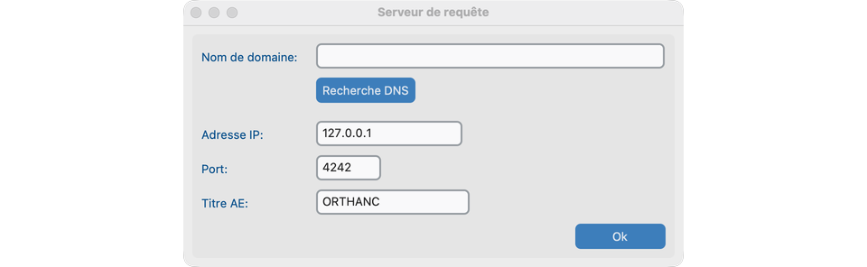
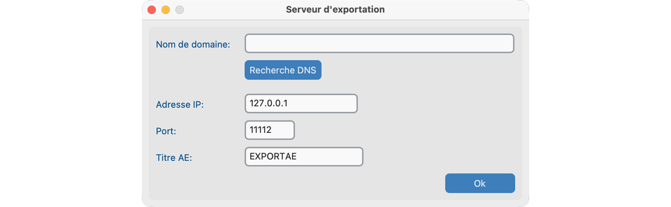
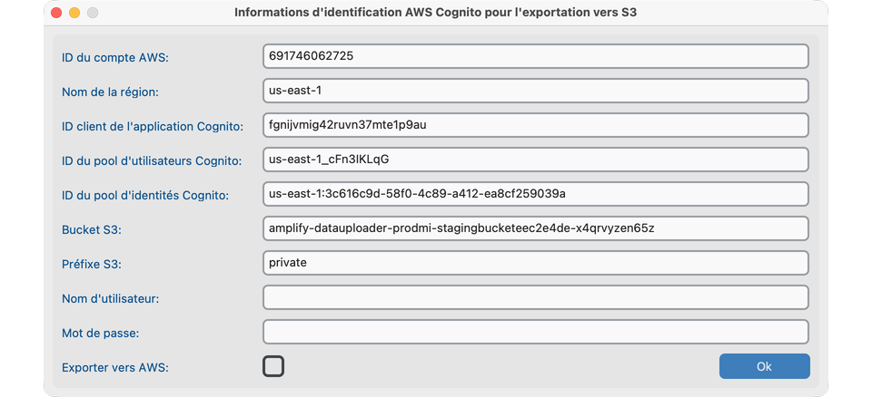
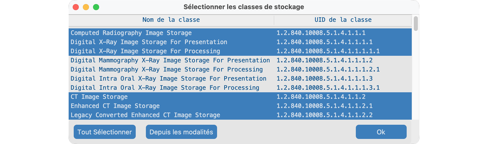
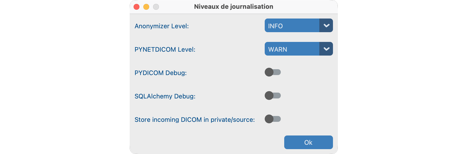
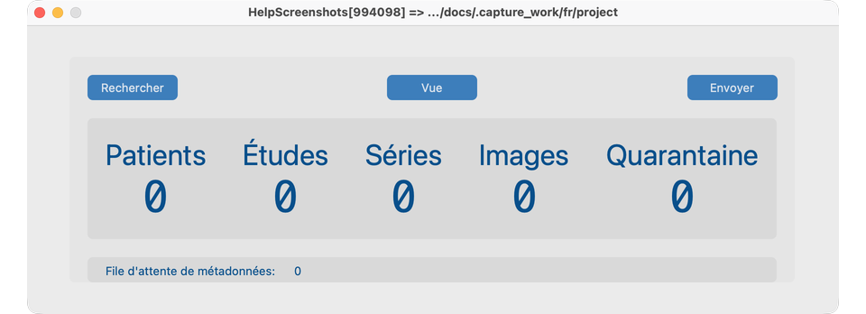

# Créer un projet

Un **projet** regroupe les paramètres et le stockage anonymisé. Créez-le une fois dans la fenêtre bureau, même si un serveur exécutera ensuite le mode [headless](../10-headless/index.md).

Parcourez ce chapitre **dans l’ordre** : identité et stockage → options de dé-identification (elles construisent le script d’anonymisation) → réseau et modalités avec l’informatique → modifications optionnelles du script et tables de correspondance → Tableau de bord. Importez les études ensuite dans [Rechercher](../06-search/index.md). **Analytics** de cohorte est sur le Tableau de bord uniquement après l’import — voir [Vue](../07-view/index.md#analytics).

## Objectif

Ouvrir un projet propre avec stockage, identité de site et un script de dé-identification prêts pour l’import.

## 1. Créer un nouveau projet

1. Depuis **Fichier → Nouveau projet**, ouvrez **Paramètres du nouveau projet**.
2. Choisissez un **Nom du projet** (court, moins de 16 caractères) et confirmez le **Répertoire de stockage**.
3. Vérifiez **Site ID** et **UID Root** (laissez en général les valeurs par défaut, sauf si vous continuez un site Java Anonymizer).
4. Poursuivez avec les [options de dé-identification](#2-de-identification-options) avant d’enregistrer.
5. Confirmez [modalités et réseau](#3-network-and-modalities) avec l’informatique si vous interrogez un PACS.
6. Enregistrez / créez le projet. Le script d’anonymisation compilé est stocké à côté de `ProjectModel.json` sous `{site_id}-anonymizer.script`. Le **Tableau de bord** s’ouvre.


## 2. Options de dé-identification {#2-de-identification-options}

Les options de dé-identification sont les choix de confidentialité DICOM de [PS 3.15 Annexe E](https://dicom.nema.org/medical/dicom/current/output/chtml/part15/chapter_E.html) (Basic Profile, Modified Dates, Retain Safe Private et options associées). Elles apparaissent sous leurs noms standard dans **De-identification Options**.


### Préréglages

| Préréglage | Ce qu’il sélectionne |
| --- | --- |
| **Basic** | Basic Profile seulement |
| **Retain** | Basic Profile + Modified Dates + Patient Characteristics + Retain Safe Private |

Les préréglages ne remplissent que les cases. Le projet stocke les **codes d’option sélectionnés**, pas le nom du préréglage.

### Comment les options construisent le script d’anonymisation

À la création (et chaque fois que vous **Acceptez** de nouvelles options sur un projet existant), l’application **compile** le script d’anonymisation du projet :

1. Départ du `default-anonymizer.script` fourni.
2. Application des **superpositions d’option** pour chaque option de confidentialité choisie (balises à conserver, supprimer ou transformer).
3. Écriture du résultat en `{site_id}-anonymizer.script` privé au projet à côté de `ProjectModel.json`.

L’import utilise **ce script uniquement** (pas NER/OCR). Langage de règles complet et balises de tampon dans [Protocole de dé-identification](../deidentification-protocol.md). Les réviseurs cherchant la checklist PS 3.15 § E.1.3 doivent utiliser la [Déclaration de conformité DICOM](../dicom-conformance-statement.md).

!!! warning "Changer les options plus tard"
    Sur un projet **existant**, appliquer d’autres options demande confirmation. **Accepter** **recompile** à partir du défaut fourni plus les superpositions — **les modifications personnalisées du script sont perdues**. Les images déjà importées ne sont pas retraitées.

### Options de nettoyage et modalités

Les options de nettoyage (Clean Pixel Data, Clean Structured Content, Clean Descriptors, Clean Recognizable Visual Features) ne peuvent être sélectionnées que si la fonction IA correspondante est installée — le téléchargement du modèle vous sera proposé. Sélectionner Clean Structured Content ou Clean Descriptors active les modalités SR/PDF ; activer SR ou PDF active Clean Structured Content s’il était désactivé.

Le nettoyage à l’import est limité : le nettoyage pixel et rapport nécessite encore les outils Process / Report optionnels après l’import. Voir [Protocole de dé-identification](../deidentification-protocol.md#pixel-and-face-options-in-the-dicom-profile).

## 3. Réseau et modalités {#3-network-and-modalities}

Ouvrez **Fichier → Paramètres du projet** (ou terminez ces étapes dans Paramètres du nouveau projet avant la création). Configurez-les avant Rechercher / Envoyer.

### Quand vous parlez à l’informatique {#when-you-talk-to-it}

Partagez ces idées (les détails sont dans les dialogues ci-dessous) :

- **Serveur local** — adresse, port et AE Title que cet ordinateur utilise pour **recevoir** les images.
- **Serveur de requête** — l’archive hospitalière que vous interrogez et depuis laquelle vous récupérez.
- **Serveur d’exportation** ou **AWS** — où les études anonymisées seront envoyées.
- **Modalités / classes de stockage / transfer syntaxes** — quels types d’images sont autorisés.
- **Délais réseau** — combien de temps attendre les archives lentes.

Si le projet vivra sur un serveur de laboratoire, continuez avec [Exécution sans interface](../10-headless/index.md).

### Serveur local

Adresse, port et AE Title que cet ordinateur utilise pour **recevoir** les images.


### Serveur de requête

Archive hospitalière utilisée par **Rechercher** sur le Tableau de bord.



Pour les distants qui parlent **DICOMweb**, ouvrez le dialogue Serveur de requête et activez **DICOMweb**. Saisissez **Port HTTP**, **Chemin** (par exemple `/dicom-web`), **Use HTTPS** optionnel et identifiant/mot de passe optionnels. Rechercher utilise alors QIDO-RS et l’import WADO-RS. Le port DIMSE et l’AE Title restent pour **Echo** et les serveurs dual-stack. Echo utilise toujours DIMSE.

### Serveur d’exportation

Destination DICOM utilisée lorsque vous **Envoyer** (l’étiquette des paramètres peut encore dire Export Server).



Lorsque **DICOMweb** est activé sur le Serveur d’exportation, Envoyer utilise STOW-RS au lieu de C-STORE.

### AWS Cognito (optionnel)

Identifiants pour Envoyer vers S3 lorsque activé.



### Délais réseau {#network-timeouts}

Combien de temps attendre les archives lentes.


### Modalités / classes de stockage / transfer syntaxes {#storage-classes}

Quels types d’images et encodages sont autorisés.





### Niveaux de journalisation

Augmentez la journalisation anonymizer / réseau lors du dépannage avec l’informatique.



## 4. Modifications personnalisées du script {#4-custom-script-edits}

La plupart des sites ne modifient jamais le script à la main — les [options de dé-identification](#2-de-identification-options) compilent déjà les bonnes règles. Utilisez l’éditeur lorsque la confidentialité ou la politique d’essai exige une règle de balise **personnalisée**, une autre stratégie de dates ou une [table de correspondance des patients](#5-patient-lookup-table-and-dates).

Ouvrez **Fichier → Paramètres du projet** (ou Paramètres du nouveau projet), puis **Modifier le script d’anonymisation**. L’éditeur charge le défaut fourni jusqu’à Accepter ; ensuite il ouvre votre copie privée du projet et affiche le chemin en haut du dialogue.

L’en-tête montre le résumé des options (**Basic**, **Retain** ou les options sélectionnées abrégées) et le chemin du **Script**. Lorsque le script actif ne correspond plus à une compilation fraîche des options enregistrées, le statut affiche **Custom**.

**Importer…** charge un script CTP personnalisé : les opérandes inconnues sont rejetées, les règles de date doivent correspondre à l’opération StudyDate (correction en un clic disponible), et à l’Acceptation vous confirmez quelles options de dé-identification enregistrer (prérempli depuis ses règles).


### Vues

| Vue | Contenu |
| --- | --- |
| **Actifs** (par défaut) | Balises **conservées** ou **transformées** (pas `@remove()`). La liste du quotidien — environ 1,5k lignes au lieu de ~4,6k. |
| **Supprimés** | Balises marquées `@remove()` (supprimées à l’anonymisation). |
| **Tous** | Toutes les règles de balise du script. |

La recherche et le filtre **Opérande** s’appliquent dans la vue courante.

### Modifier une règle

1. Sélectionnez une ligne dans la liste. Les opérandes s’affichent en syntaxe script (par exemple `@keep`, `@remove()`, `@uid`, `@always()YES`).
2. Pour comprendre un opérande sans modifier le script, utilisez le filtre **Opérande** de la barre d’outils ou la liste **Opérande** du détail — **Fonctionnement de cet opérande** se met à jour immédiatement. L’affectation n’a lieu qu’au clic sur **Appliquer**.
3. Si l’opérande nécessite un paramètre, **Appliquer** demande la valeur avec unités et signification. **Modifier le paramètre** l’édite ensuite sur une règle qui utilise déjà cet opérande :
   - **@round(this,n)** — largeur de tranche d’âge en années entières
   - **@always()** — texte de remplacement fixe (style CTP, p. ex. `YES`). Stocké comme `@always()YES`. Les littéraux nus comme `YES` dans d’anciens scripts sont le même opérande et restent valides.
   - Opérandes de date et de correspondance — voir [Table de correspondance des patients et dates](#5-patient-lookup-table-and-dates).
4. Choisir **@remove()** (puis Appliquer) retire la balise de la vue Actifs (elle reste dans le script en `@remove()`).

### Ajouter une balise manquante

Si le script manque des balises du dictionnaire DICOM, **Ajouter depuis le dictionnaire** apparaît sur la barre du bas. Recherchez ces balises manquantes et **Ajouter** une (par défaut `@keep`). Lorsque le script couvre déjà le dictionnaire, le bouton est masqué.

### Enregistrer

- **Accepter** valide les opérandes, écrit une copie privée sous `{stockage}/private/{site_id}-anonymizer.script`, recharge les règles d’anonymisation actives et pointe le projet vers ce fichier. L’asset par défaut fourni n’est jamais écrasé.
- **Rétablir** recharge le fichier depuis le disque et abandonne les modifications non enregistrées.
- **Annuler** ferme sans enregistrer.

!!! note "Options vs. modifications personnalisées"
    Accepter de nouvelles [options de dé-identification](#2-de-identification-options) recompile le script et **supprime** les modifications personnalisées. Terminez d’abord les choix d’options ; modifiez le script ensuite seulement si vous avez encore besoin d’exceptions.

## 5. Table de correspondance des patients et dates {#5-patient-lookup-table-and-dates}

Utilisez cette section lorsque votre site a besoin d’une **Patient Lookup Table** de style CTP/TCIA et/ou d’une stratégie **longitudinale de dates** précise. Ces contrôles se trouvent dans l’[éditeur de script](#4-custom-script-edits).

### Dates longitudinales (style TCIA) {#longitudinal-dates-tcia-style}

Toutes les stratégies de delta de date préservent les intervalles entre les études d’un patient. Lorsqu’une d’elles s’exécute, l’anonymiseur définit `(0028,0303) LongitudinalTemporalInformationModified = MODIFIED` (option DICOM 113107) lorsque Modified Dates est sélectionné.

| Stratégie | Opérande | Quand l’utiliser |
| --- | --- | --- |
| Hash patient | `@hashdate` (script compilé par défaut) | Pas de table de correspondance ; décalage déterministe par patient |
| Décalage par lookup | `@lookup(this,dateoffset)` | Décalage contrôlé par patient depuis `.properties` du site |
| Décalage essai | `@incrementdate(this,n)` | Même DATEINC pour tous les patients (`n` défini dans l’éditeur de script) |
| Rebase d’époque | `@rebasedate(this,origin)` | Style TCIA/NCTN : `origin + (date − basedate)` ; nécessite des lignes `basedate/` |

`@hashdate`, UIDs anonymisés et numéros d’accession hachés sont **sans secret** par conception : ils maintiennent des liens stables dans un projet. Ils ne sont pas protégés contre une vérification si quelqu’un connaît déjà un original candidat. Détails : [Protocole de dé-identification — Remplacements déterministes](../deidentification-protocol.md#deterministic-replacements-uids-dates-accessions).

**@incrementdate(this,n)** — delta fixe en jours (CTP DATEINC). Demandé lors de l’application de l’opérande (défaut 365). Comme DATEINC est à l’échelle de l’essai, confirmer applique le même `@incrementdate(this,n)` à chaque champ delta de date du script (par exemple toutes les règles `@hashdate`), et l’invite liste ces champs.

**@rebasedate(this,origin)** — ORIGIN d’époque en AAAAMMJJ (défaut `19600101`). Demandé lors de l’application ; si les basedates ne sont pas chargées, Appliquer ouvre d’abord le dialogue de table de correspondance.

**@lookup(this,ptid)** / **@lookup(this,dateoffset)** — si la table requise (ou lignes dateoffset) n’est pas chargée, Appliquer ouvre d’abord le dialogue de table de correspondance.

### Table de correspondance des patients {#patient-lookup-table}

`@lookup(this,ptid)`, `@lookup(this,dateoffset)` et `@rebasedate(this,origin)` apparaissent dans la liste d’opérandes. Choisissez-en un et cliquez **Appliquer** — **Charger Patient Lookup Table** s’ouvre lorsque la table requise (ou entrées dateoffset / basedate) n’est pas encore chargée. Sur une règle qui utilise déjà un opérande dépendant du lookup, utilisez **Charger la table de correspondance** / **Remplacer la table de correspondance** à côté du contrôle Opérande.

Un fichier CTP/TCIA `.properties` associe chaque identifiant patient PHI à un identifiant anonymisé, et optionnellement un décalage de date par patient et/ou basedate d’enregistrement :

```text
ptid/MRN-1001=527408-000101
dateoffset/MRN-1001=42
basedate/MRN-1001=20180327
```

Accepter stocke une copie privée du projet, réécrit les règles Patient ID / date correspondantes en `@lookup…` et active le lookup à l’exécution. Avec des décalages de date présents, `@lookup(this,dateoffset)` peut être appliqué ; avec des lignes `basedate/`, `@rebasedate(this,origin)` (vous êtes invité à saisir la date ORIGIN).

Les `.properties` de lookup peuvent inclure uniquement des dates d’enregistrement/événement :

```text
ptid/MRN-1=SITE-0001
basedate/MRN-1=20180327
```

Avec basedates chargées, `@rebasedate(this,origin)` apparaît dans la liste d’opérandes. Anonymiser écrit aussi `(0012,0052)` / `(0012,0053)=REGISTRATION` à partir de PHI StudyDate − basedate.

!!! note "Projets existants"
    Charger une table de correspondance **ne** ré-anonymise **pas** les fichiers déjà présents dans le jeu de données — ils restent inchangés. Les patients déjà importés continuent de fonctionner sans ligne dans la table. Les fichiers **nouveaux** dont l’identifiant patient PHI est absent de la table sont mis en quarantaine comme **Lookup_Miss** et ne sont pas stockés.


## Actions courantes sur le projet

| Action | Comment |
| --- | --- |
| Fermer | **Fichier → Fermer le projet** ou fermer la fenêtre |
| Rouvrir | **Fichier → Ouvrir récent** |
| Cloner les paramètres | **Fichier → Cloner le projet** dans un nouveau dossier de stockage (aucune image copiée). Gardez un UID Root unique par projet. |

## Tableau de bord après création



Le Tableau de bord expose les principaux boutons de flux de travail : **Rechercher**, **Vue** et **Envoyer**. Après [l’import d’études](../06-search/index.md), utilisez [Vue → Analytics](../07-view/index.md#analytics) pour les graphiques de cohorte.

## Ce qui indique que tout va bien

- Le Tableau de bord affiche le nom du projet et le Site ID.
- Le répertoire de stockage existe et est accessible en écriture.
- Les options de dé-identification correspondent à votre plan de confidentialité ; le chemin du script du projet existe à côté de `ProjectModel.json`.
- Vous pouvez ouvrir le **Jeu de données** actuellement constitué (vide jusqu’à l’import) en cliquant sur **Vue**.

## En cas d’échec

- Chemin de stockage non accessible en écriture → choisissez un autre dossier.
- Nom trop long → raccourcissez le nom du projet.
- Avertissement de clonage sur UID Root → utilisez une racine unique par projet pour éviter les collisions d’identifiants.
- L’éditeur de script **Accepter** a rejeté → corrigez les opérandes `@…` non pris en charge indiqués dans l’erreur. `@always()` vide est invalide (fournissez du texte, p. ex. `@always()YES`). Les littéraux sans `@` comme `YES` sont acceptés comme valeurs fixes.

## Prochaines étapes

1. [Rechercher](../06-search/index.md) — importer des études dans le projet.
2. [Vue](../07-view/index.md) — Jeu de données, projections, Vue série et [Analytics](../07-view/index.md#analytics) après l’import.
