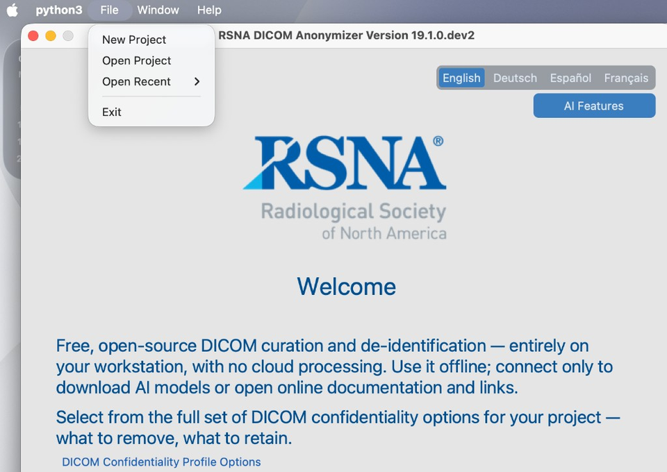

# Créer un projet

Un **projet** regroupe les paramètres et le stockage anonymisé. Créez-le une fois dans la fenêtre bureau, même si un serveur exécutera plus tard le mode [sans interface](../10-headless/index.md).

Sur l’écran **Bienvenue**, choisissez **Fichier → Nouveau projet**, puis parcourez **Paramètres de nouveau projet** **de haut en bas** (même ordre que la boîte de dialogue).

## Objectif

Créer un projet avec identité du site, serveurs réseau, stockage (répertoire et quelles études accepter), options de dé-identification et journalisation, convenus avec l’informatique.

## 1. Identité du projet

Sur Bienvenue, choisissez **Fichier → Nouveau projet**.

Dans **Paramètres de nouveau projet** :

- Définissez le **Nom du projet** (court, moins de 16 caractères).
- Vérifiez l’**ID de site** — rempli automatiquement à partir de l’horloge (un court nombre issu d’intervalles de 30 minutes depuis 1970) pour que chaque nouveau projet ait son propre code de site ; non modifiable ici. Si vous utilisez **Charger le fichier d’index JAVA**, l’ID de site est pris dans cet index.
- Vérifiez la **Racine UID** — la base RSNA fixe utilisée pour construire les nouveaux UID DICOM anonymisés. Laissez la valeur par défaut pour un nouveau site. Si vous **Chargez le fichier d’index JAVA**, la Racine UID est extraite des UID d’étude anonymisés de ce fichier (avec l’ID de site) pour poursuivre le même site.

## 2. Paramètres du projet

**Paramètres de nouveau projet** est la boîte de dialogue ci-dessous. Configurez-la de haut en bas ; les sections numérotées suivantes suivent cette disposition.

## 3. Serveurs réseau {#3-network-and-modalities}

### Quand vous parlez à l’informatique {#when-you-talk-to-it}

Partagez ces idées (les détails sont dans les dialogues ci-dessous) :

- **Serveur local** — adresse, port et AE Title que cet ordinateur utilise pour **recevoir** les images.
- **Serveur de requête** — l’archive hospitalière que vous interrogez et depuis laquelle vous récupérez.
- **Serveur d’exportation** ou **AWS** — où les études anonymisées seront envoyées.
- **Délais réseau** — combien de temps attendre les archives lentes.

Si le projet vivra sur un serveur de laboratoire, continuez avec [Exécution sans interface](../10-headless/index.md).

### Serveur local

Adresse, port et AE Title que cet ordinateur utilise pour **recevoir** les images.

### Serveur de requête

Archive hospitalière pour requête / récupération.

Pour les distants qui parlent **DICOMweb**, ouvrez le dialogue Serveur de requête et activez **DICOMweb**. Saisissez **Port HTTP**, **Chemin** (par exemple `/dicom-web`), **Use HTTPS** optionnel et identifiant/mot de passe optionnels. La requête utilise alors QIDO-RS et la récupération WADO-RS. Le port DIMSE et l’AE Title restent pour **Echo** et les serveurs dual-stack. Echo utilise toujours DIMSE.

### Serveur d’exportation

Destination DICOM utilisée lorsque vous **Envoyer** (l’étiquette des paramètres peut encore dire Export Server).

Lorsque **DICOMweb** est activé sur le Serveur d’exportation, Envoyer utilise STOW-RS au lieu de C-STORE.

### AWS Cognito (optionnel)

Identifiants pour Envoyer vers S3 lorsque activé.

### Délais réseau {#network-timeouts}

Combien de temps attendre les archives lentes.

## 4. Stockage {#storage-classes}

### Répertoire de stockage

Choisissez le **Répertoire de stockage** où vivront les fichiers anonymisés de ce projet (par défaut il suit le Nom du projet sous Documents / RSNA Anonymizer).

### Modalités / classes de stockage / transfer syntaxes

Ces trois réglages décident quelles études ce projet acceptera lors d’une recherche sur une archive distante, à la réception réseau ou en apportant des fichiers depuis le disque.

**Modalités** — types d’examen tels que CT, MR ou US. Modifier les modalités remplit d’abord les **classes de stockage** correspondantes.

**Classes de stockage** — les types d’objets DICOM que l’anonymiseur **acceptera** (par exemple CT Image Storage). La liste est **initialement définie à partir des modalités sélectionnées**, mais vous pouvez l’éditer ensuite (ajouter ou retirer des classes). Les fichiers dont la classe de stockage n’est pas dans cette liste ne sont pas anonymisés dans le projet — ils vont en quarantaine.

**Transfer syntaxes** — comment les pixels sont encodés à l’arrivée ou au stockage :

- Les encodages **non compressés** gardent chaque échantillon tel quel. Les fichiers sont plus volumineux sur le disque.
- Les encodages **compressés** (JPEG, JPEG 2000 et similaires) réduisent la taille ; la même étude occupe moins d’espace.

Le projet conserve chaque fichier dans la transfer syntax qu’il a déjà. Le **transcodage** d’une transfer syntax vers une autre n’est **pas activé** aujourd’hui — choisissez les syntaxes que vos sources utilisent déjà (et que vous voulez garder sur le disque).

## 5. Options de dé-identification {#2-de-identification-options}

Ouvrez **Options de dé-identification**. Les options de dé-identification sont les choix de confidentialité DICOM de [PS 3.15 Annexe E](https://dicom.nema.org/medical/dicom/current/output/chtml/part15/chapter_E.html) (Basic Profile, Modified Dates, Retain Safe Private et options associées). Elles apparaissent sous leurs noms standard dans **De-identification Options**.

### Préréglages

| Préréglage | Ce qu’il sélectionne |
| --- | --- |
| **Basic** | Basic Profile seulement |
| **Retain** | Basic Profile + Modified Dates + Patient Characteristics + Retain Safe Private |

Les préréglages ne remplissent que les cases. Le projet stocke les **codes d’option sélectionnés**, pas le nom du préréglage.

### Comment les options construisent le script d’anonymisation

À la création (et chaque fois que vous **Acceptez** de nouvelles options sur un projet existant), l’application **compile** le script d’anonymisation du projet :

- Départ du `default-anonymizer.script` fourni.
- Application des **superpositions d’option** pour chaque option de confidentialité choisie (balises à conserver, supprimer ou transformer).
- Écriture du résultat en `{site_id}-anonymizer.script` privé au projet à côté de `ProjectModel.json`.

Le projet utilise **ce script uniquement** pour l’anonymisation des balises (pas NER/OCR). Langage de règles et balises de tampon : [Protocole de dé-identification](../deidentification-protocol.md). Checklist PS 3.15 § E.1.3 : [Déclaration de conformité DICOM](../dicom-conformance-statement.md).

!!! warning "Changer les options après la création"
    Appliquer d’autres options plus tard demande confirmation. **Accepter** **recompile** à partir du défaut fourni plus les superpositions — **les modifications personnalisées du script sont perdues**. Les fichiers déjà stockés dans le projet ne sont pas retraités.

### Options de nettoyage et modalités

Les options de nettoyage (Clean Pixel Data, Clean Structured Content, Clean Descriptors, Clean Recognizable Visual Features) ne peuvent être sélectionnées que si la fonction IA correspondante est installée — le téléchargement du modèle vous sera proposé. Sélectionner Clean Structured Content ou Clean Descriptors active les modalités SR/PDF ; activer SR ou PDF active Clean Structured Content s’il était désactivé.

Le nettoyage pixel, compte rendu et visage utilise encore les outils optionnels [Traiter](../08-process/index.md) lorsque ces objets sont présents. Voir [Protocole de dé-identification](../deidentification-protocol.md#pixel-and-face-options-in-the-dicom-profile).

La plupart des sites ne modifient jamais le script compilé à la main. Règles de balises avancées, stratégies de dates et tables de correspondance : [Script d’anonymisation (avancé)](anonymizer-script.md).

## 6. Journalisation

Augmentez la journalisation anonymizer / réseau lors du dépannage avec l’informatique.

## Créer le projet

Lorsque les paramètres sont prêts, choisissez **Créer le projet**. Le script d’anonymisation compilé est stocké à côté de `ProjectModel.json` sous `{site_id}-anonymizer.script`. Le **Tableau de bord** s’ouvre.

## Après la création

| Action | Comment |
| --- | --- |
| Fermer | **Fichier → Fermer le projet** ou fermer la fenêtre |
| Cloner les paramètres | **Fichier → Cloner** dans un nouveau dossier de stockage (aucune image copiée). Gardez une Racine UID unique par projet. |

## Ce qui indique que tout va bien

- Le Tableau de bord affiche le nom du projet et l’ID de site.
- Le répertoire de stockage existe et est accessible en écriture.
- Les options de dé-identification correspondent à votre politique ; `{site_id}-anonymizer.script` existe à côté de `ProjectModel.json`.
- Les boîtes réseau et modalités correspondent à ce que l’informatique attend pour ce site.

## En cas d’échec

- Chemin de stockage non accessible en écriture → choisissez un autre dossier.
- Nom trop long → raccourcissez le nom du projet.
- Avertissement de clonage sur la Racine UID → utilisez une racine unique par projet pour éviter les collisions d’ID.

## Prochaines étapes

Poursuivez avec [Rechercher](../06-search/index.md).
