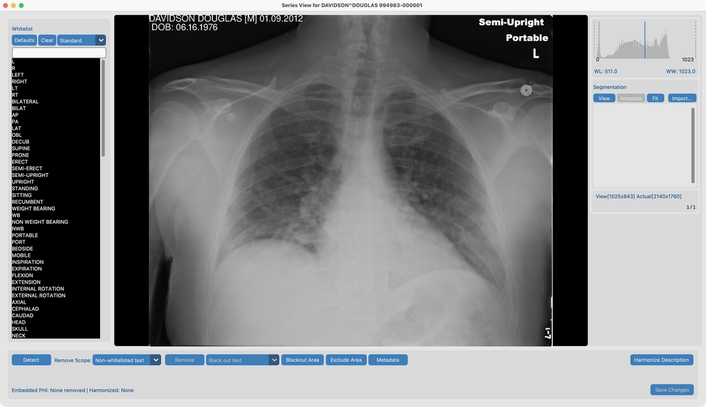
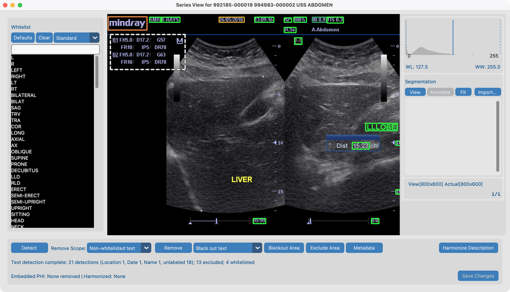
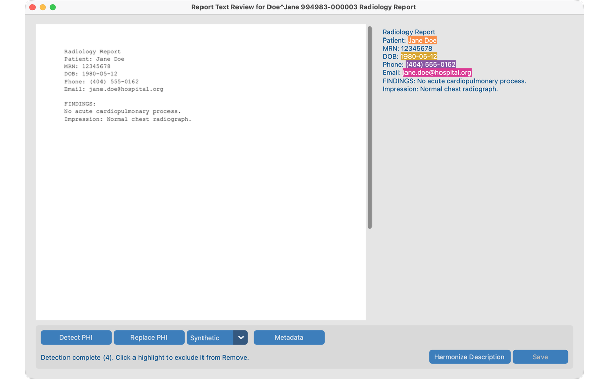

# 8.1 Embedded PHI

**Embedded PHI** trouve et retire les informations de santé protégées qui restent **après** l’anonymisation des tags à l’import : texte dessiné sur les pixels, et PHI dans les comptes rendus / texte libre. OCR (pixels) et reconnaissance d’entités nommées (NER) en anglais. L’ingest n’exécute ni NER ni OCR.

| Section | Contenu | Où vous travaillez |
| --- | --- | --- |
| [Pixel](#pixel) | Texte incrusté sur les pixels | Vue des séries |
| [Text › Metadata](#metadata) | Valeurs de tag encore porteuses de PHI après import | Vue des séries / Compte rendu → **Metadata** |
| [Text › Reports](#reports) | Structured Reports, Encapsulated PDF, corps texte libre | **Report Text Review** (et lot texte) |

Terminez [Configuration des Fonctions IA](../../03-ai-features-setup/index.md) (pack Embedded PHI) avant ces sections.

### Entités nommées (OpenMed)

Le NER anglais du pack Embedded PHI est **OpenMed ClinicalE5-Small**. Detect colore chaque hit par type (le nom du type utilise cette couleur) :

| Type | Exemples |
| --- | --- |
| **First name** | Prénom incrusté sur les pixels (p. ex. `DOUGLAS`) ; prénom dans Study Description ou un compte rendu |
| **Last name** | Nom de famille incrusté (p. ex. `DAVIDSON`) ; nom dans Study Description ou un compte rendu |
| **Location** | Hôpital / site / ville sur les incrustations ou dans les tags texte libre et comptes rendus |
| **ID** | MRN ou identifiants similaires dans un compte rendu / valeurs de tag texte libre |
| **Phone** | Numéros de téléphone dans comptes rendus ou tags texte libre |
| **Date** | Dates / DOB incrustés ; dates dans Study Description ou comptes rendus |
| **Email** | Adresses e-mail dans comptes rendus ou tags texte libre |

Sur les **pixels**, First name et Last name fusionnent en une couleur de boîte **Name** (même famille que First name). Dans **Metadata** et **Report Text Review**, ils restent séparés. Survolez une plage ou une boîte colorée pour voir le type.

---

## Pixel {#pixel}

Noms et libellés incrustés dessinés sur l’image. Nettoyer les tags DICOM seuls ne les enlève pas.

### Séries de démo

| Série | Chemin | Utilisé pour |
| --- | --- | --- |
| **`davidson_cxr`** | `tests/controller/assets/test_dcm_files/davidson_cxr` | Whitelist → **Detect** → **Black out text** |
| **`us_rgb_single_frame`** | `tests/controller/assets/test_dcm_files/us_rgb_single_frame` (`US_RGB_SingleFrame.dcm`) | **Detect** → **Blend into background**; **Exclude Area** on the machine-parameter block under **mindray** |

Importez chaque dossier dans votre projet, puis ouvrez la série en **Vue des séries** depuis [Jeu de données](../../07-view/index.md).

### Objectif

1. On `davidson_cxr`, detect burned-in text and **black out** PHI while keeping useful markers via the default whitelist.
2. On `us_rgb_single_frame`, detect burned-in text and remove it by **blending into the background** (inpaint).
3. On the same color US series, mark the non-PHI machine-parameter strip with **Exclude Area** so Detect and Remove skip it.

### Barre d’outils Vue des séries

De gauche à droite sur la barre d’édition de texte :

| Contrôle | Rôle |
| --- | --- |
| **Edit Context** | **Frame** or **Series**. Hidden on single-frame series (no choice to make). |
| **Detect** | Run OCR (+ NER labelling). Boxes show what **Remove** would delete for the current **Remove Scope**. Pixels are not changed. |
| **Remove Scope** | **Non-whitelisted text** (default), **PHI only**, or **All text**. Filters which detections are boxed and what **Remove** deletes. Changing scope after Detect re-filters existing boxes; **Remove** stays enabled while boxed text remains under the new scope. |
| **Remove** | Delete boxed text using the removal mode menu. Disabled until Detect has identified text for removal. |
| Removal mode menu | **Black out text** or **Blend into background**. |
| **Blackout Area** | Paint drawn user rectangles black (manual). |
| **Exclude Area** | Convert drawn rectangles into keep-out zones for Detect/Remove (no pixel change). |
| **Metadata** | DICOM tag tree for the current slice ([Detect PHI / Remove PHI](../../07-view/index.md#metadata-dicom-tags) on tag values). |

**Save Changes** (bottom right) writes pixel edits and/or modality exclude-area files. Hover it to see what will be saved.

Left panel: **Whitelist** with **Defaults**, **Clear**, match mode (**Exact** / **Strict** / **Standard** / **Lenient**), search, and the keeper list.

### Flux de travail sur `davidson_cxr` (noircir)

#### 1. Default whitelist and Remove Scope

1. Keep the **default whitelist** (do not **Clear** it).
2. Leave **Remove Scope** on **Non-whitelisted text**.
3. On this single-frame series, **Edit Context** is hidden.

#### 2. Detect

1. Click **Detect**.
2. Attendez la fin de Detect. Les rectangles marquent le texte qui serait retiré pour le **Remove Scope** courant. NER colore par catégorie (**Name**, **Location**, **Date**, **ID**, **Phone**, **Email**) ; l’OCR non étiqueté reste cadré avec **Non-whitelisted text** ou **All text**.

Detect classifies with the **whole frame as context** (OCR boxes in reading order joined for one NER call). Each rectangle is still one OCR box and is removed **whole** — including unmarked prefixes or suffixes inside the same box (the `DOB:` prefix before a date; the `[M]` marker after a name). Hover a PHI rectangle to see its NER category (bold caps on the category colour), not the detected string.

| Remove Scope | Effect |
| --- | --- |
| **Non-whitelisted text** (default) | Remove OCR that is not a whitelist match and not in an exclude area |
| **PHI only** | Remove only NER-labelled PHI. Unlabeled text and whitelist matches stay; whitelist still vetoes keepers |
| **All text** | Remove every detected box; whitelist is ignored |

Sur `davidson_cxr` avec la liste blanche par défaut et **Remove Scope: Non-whitelisted text**, Detect trace **quatre** cadres : **DAVIDSON** et **DOUGLAS [M]** (Name), **01.09.2012** et **DOB: 06.16.1976** (Date). Il ne cadre **pas** **Semi-Upright**, **Portable** ni **L** (termes de la liste blanche par défaut).

**Whitelist match** (next to Defaults / Clear — default **Standard**):

| Setting | Effect |
| --- | --- |
| **Exact** | Keeper only on letter-for-letter match |
| **Strict** | Almost exact — tiny OCR mistakes only |
| **Standard** (default) | Small OCR errors allowed (`AXIL` still matches `AXIAL`) |
| **Lenient** | Most forgiving — noisy text and short markers |

Use a stricter setting if too much text is skipped; looser if useful markers keep getting boxed.

#### 3. Review and whitelist keepers

1. If a green rectangle covers text you want to **keep**, click that rectangle.
2. The text is added to the whitelist on the left and will not be removed.

Sur `davidson_cxr`, **Semi-Upright**, **Portable** et **L** sont déjà dans la liste blanche DX par défaut.

#### 4. Remove with black out

1. Set the removal mode menu to **Black out text**.
2. Click **Remove**.
3. PHI regions become solid black; whitelisted keepers stay.
4. Click **Save Changes** when satisfied.

Black out is the usual de-identification choice: removed text is clearly gone and cannot be recovered from the pixels.

### Flux de travail sur `us_rgb_single_frame` (fusionner)

Use this color ultrasound frame when removed text should look like nearby tissue instead of black bars.

#### 5. Remove with blend

1. Import and open **`us_rgb_single_frame`** (`US_RGB_SingleFrame.dcm`) in Series View.
2. Set the removal mode menu to **Blend into background**.
3. Click **Detect** and wait for the green rectangles.

4. Click **Remove**.
5. Detected text is painted out by blending with surrounding pixels (inpaint), then **Save Changes**.

**Black out text** replaces text with black. **Blend into background** fills the area to match surrounding pixels. Prefer black out for obvious, irreversible redaction; prefer blend when a less conspicuous result is acceptable (ultrasound overlays).

### Flux de travail sur US couleur (Exclude Area)

Use the same **`us_rgb_single_frame`** series when OCR boxes machine settings that are **not PHI**. **Exclude Area** skips a spatial region for Detect and Remove without changing pixels (unlike **Blackout Area**).

#### 6. Exclude the parameter block under mindray

On this frame, a dense block of machine parameters (gain, depth, FR, DR, and similar tokens) sits on the **upper left**, directly **below** the **mindray** logo.

1. Open **`us_rgb_single_frame`** in Series View.
2. Draw a rectangle covering that parameter block (leave **mindray** and true PHI / site labels outside if you still want them detected). Pending draws appear as **solid blue** rectangles.
3. Click **Exclude Area**. The rectangle moves to the exclude list and redraws as a **white dotted outline** (no fill). **Save Changes** stores the current exclude set for this modality without changing pixels when that is the only pending change.

4. Click **Detect**. Green boxes should appear on PHI / vendor text **outside** the block; parameter tokens inside the dotted region should **not** be boxed for removal.

5. Optionally choose **Blend into background** or **Black out text**, then **Remove** and **Save Changes**.
6. Click a white dotted rectangle to remove it from the exclude list if you need to adjust.

**Whitelist** keeps specific OCR *strings*. **Exclude Area** skips a *region* (no pixel change). **Blackout Area** paints drawn rectangles black. Prefer setting exclude rectangles **before** Detect (or Detect again after adjusting). With **Series** edit context (multi-frame), drawing propagates across frames so the same panel can be excluded on a cine loop.

### Après le travail pixel

- Dataset **Embedded PHI** status updates for each series you saved (removed PHI text only).
- Modality whitelists and the match dropdown live in Series View; stricter matching means fewer OCR hits count as keepers.
- Exclude regions are session-only until **Save Changes**. Active rectangles (including removals of previously saved ones) are written to `whitelists/{modality}.exclude.json` next to the modality whitelist. Clearing all areas removes that file. AI Batch applies those areas when **Enable Exclude Areas** is on.
- To run pixel Embedded PHI on many studies, see [8.4 Run on many studies](../05-run-on-many-studies/index.md).

### À quoi ressemble un bon résultat (pixel)

- On `davidson_cxr`: PHI blacked out; orientation markers kept if whitelisted.
- On `us_rgb_single_frame`: burned-in labels blended away without solid black bars; with Exclude Area, the mindray parameter block is not removed as PHI.

### Si le travail pixel échoue

- Many false boxes → tighten match strictness; whitelist keepers; or **Exclude Area** for whole panels.
- Missed text → manual **Blackout Area**.
- Parameter text still boxed → enlarge the exclude rectangle and Detect again; click dotted outlines to delete and redraw.
- Tools greyed out → finish [AI Features](../../03-ai-features-setup/index.md).

---

## Text {#text}

PHI dans les **valeurs de tag** et dans les **corps de compte rendu / texte libre** — non dessiné sur les pixels. Même pack NER Embedded PHI que pour le pixel.

### Metadata {#metadata}

Valeurs de tag qui peuvent encore porter du PHI après import (commentaires, descriptions, texte libre restant). Travaillez dans Vue des séries ou Report Text Review via **Metadata**.

Étapes complètes (arbre, **Detect PHI** / **Remove PHI**, Blank vs Synthetic, enregistrement du fichier courant) : [Vue → Métadonnées (tags DICOM)](../../07-view/index.md#metadata-dicom-tags).

**Exemple clair — `davidson_cxr` avant Harmonize.** L’import retire les identifiants des tags nom/ID habituels, mais **Study Description** peut encore contenir du texte libre tel que `XR CHEST AP PORTABLE for Douglas Davidson`. Lancez Metadata **avant** Harmonize Description pour voir ce PHI résiduel.

1. Ouvrez **`davidson_cxr`** dans Vue des séries (**sans** Harmonize — Harmonized: None).
2. Cliquez **Metadata**, puis **Detect PHI**.
3. Examinez la ligne surlignée **Study Description** : les spans de nom en **First name** / **Last name**. Excluez une ligne si besoin, choisissez **Blank** ou **Synthetic**, puis **Remove PHI** / **Replace PHI**, et **Save**.

Le même dialogue Metadata s’ouvre depuis Report Text Review (**Metadata** dans la barre du rapport) pour le fichier de compte rendu courant.

!!! note "Fichier courant uniquement"
    La suppression Metadata s’applique à l’image ou au compte rendu **courant**. Pour nettoyer les tags sur une série ou une cohorte : [Lot IA](../05-run-on-many-studies/index.md).

### Reports {#reports}

PHI dans les **Structured Reports**, **Encapsulated PDF** et autres corps de document texte libre. S’ouvre dans **Report Text Review** au lieu de Vue des séries.

#### Report Text Review {#reports-and-free-text-report-text-review}

Démo : **`demo_report_pdf`** (compte rendu radiologique synthétique). L’import doit utiliser **Clean Structured Content** pour conserver le texte Encapsulated Document / SR pour relecture.

1. Ouvrez le compte rendu démo. Le panneau gauche montre la page PDF ; le droit, le texte extractible.
2. Cliquez **Detect PHI**. Les spans à **droite** se colorent par type (**First name**, **Last name**, **Location**, **ID**, **Phone**, **Date**, **Email**) — mêmes couleurs OpenMed que [Entités nommées](#entités-nommées-openmed).
3. Cliquez une surbrillance pour **exclure** un span à conserver.
4. Choisissez **Blank** (supprimer) ou **Synthetic** (remplacer par une fausse valeur du même type), puis **Remove PHI** / **Replace PHI**.
5. **Save** écrit le compte rendu. Pour Encapsulated PDF, Save remplace les octets PDF par un document texte brut désidentifié (la mise en page n’est pas conservée). Seul le **texte PHI original retiré** est enregistré dans la colonne Embedded PHI du Dataset — jamais le corps du compte rendu, ni les remplacements synthétiques.
6. Optionnel — **Metadata** dans la barre du rapport pour nettoyer les tags de ce fichier ([Metadata](#metadata) ci-dessus).

Les valeurs synthétiques dérivent de façon déterministe du projet et de l’ID patient anonymisé. La suppression pixel utilise toujours Black out / Blend ; **Synthetic** s’applique au texte uniquement.

#### Comptes rendus texte scannés

Si une série Secondary Capture ressemble à un compte rendu texte (page de dose ou feuille de travail), utilisez d’abord les outils [Pixel](#pixel). **Save Changes** dans Vue des séries peut aussi écrire la transcription OCR nettoyée comme **Basic Text SR** dans la même étude. Le SR est un dérivé ; il n’est pas enregistré dans la colonne Embedded PHI.

#### Texte libre en lot

Commentaires, descriptions de protocole/procédure et attributs similaires sur de nombreuses études : chemin texte dans [Lot IA](../05-run-on-many-studies/index.md).

### Si le travail texte échoue

- Outils grisés → terminez [Fonctions IA](../../03-ai-features-setup/index.md).
- Corps de compte rendu vide après import → activez **Clean Structured Content** (et modalités SR/PDF) avant l’import pour conserver les octets du document.

---

## Étapes suivantes

Continuez avec [8.2 Harmoniser les noms](../03-harmonize-names/index.md) en utilisant **`CT_Head_With_Contrast`**.
